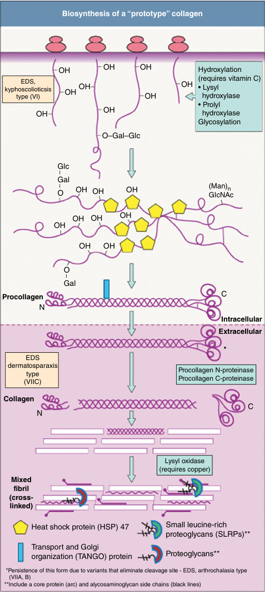

# Chapter 10: Heritable Disorders of Connective Tissue — Board-Style Self-Assessment MCQs
**Section II: Developmental Structural Disorders** | [📖 Read Wiki Chapter](../chapters/010_Heritable_Disorders_of_Connective_Tissue.md) | [🃏 Chapter Flashcards](../flashcards/010_flashcards.md) | [🏠 Course Master Index](../../index.md)

Total questions: **14** *(Click "Show Answer & Rationale" beneath each question)*

### Question 1 (Clinical Vignette & Syndrome Diagnosis)
A pediatric patient is evaluated in the medical genetics clinic with the following clinical and molecular profile: Collagen Type: the causative gene the causative gene the causative gene — Genetic Alteration: Variants in 20 genes have been found to cause [syndrome] (#130000). Classical [syndrome] (#130010) results from variants in either the the causative gene(12. Which of the following rare disorders is the most likely diagnosis?

- **A.** Stickler syndrome type V (STL5)
- **B.** FTAA
- **C.** Ehlers-Danlos syndrome (EDS)
- **D.** Stanescu type of spondyloepiphyseal dysplasia (SEDSTN)

<b>Show Answer & Rationale</b>

**Correct Answer: C** — Ehlers-Danlos syndrome (EDS)

**Rationale:** **Ehlers-Danlos syndrome (EDS)** (#130000, #130010, #130060, #617821, #225320) caused by pathogenic variants in **`COL5A1, COL1, COL3, COL5`** presents with: Collagen Type: COL1 COL3 COL5 — Genetic Alteration: Variants in 20 genes have been found to cause EDS (#130000). Classical EDS (#130010) results from variants in either the COL5A1(120215) orCOL5A2(120190) gene. Variants inCOL1A1(120150) orCOL1A2(120160) that lead to skipping of exon 6 of the mRNA coding the pro α1 or pro α2-chain result i.

**Why Other Options Are Incorrect:** **Stickler syndrome type V (STL5)** is incorrect (associated with STL5 — Genetic Alteration: STL5 (#614284) is caused by homozygous variant in COL9A2gene (*120260) on chromosome 1p34.). **FTAA** is incorrect (associated with ACTA2 — ACTA2(α-smooth muscle actin) — Clinical Features: TAA, AD, BAV, Moya-Moya, premature CAD and CVD, livedo retic). **Stanescu type of spondyloepiphyseal dysplasia (SEDSTN)** is incorrect (associated with COL2 — Type: COL2 — Genetic Alteration: SEDSTN (#616583) is caused by heterozygous variant in COL2A1gene (*120140) on).

### Question 2 (Clinical Vignette & Syndrome Diagnosis)
A pediatric patient is evaluated in the medical genetics clinic with the following clinical and molecular profile: Collagen Type: the causative gene — Genetic Alteration: Variants in theCOL1A1(120150) andCOL1A2(120160) genes are responsible for more than 90% of all cases of [syndrome] (#166200). Most of the variants causative of [syndrome] type I affectCOL1A1gene. Which of the following rare disorders is the most likely diagnosis?

- **A.** Brittle Cornea Syndrome (BCS)
- **B.** Osteogenesis Imperfecta (OI)
- **C.** Bruck syndrome 1 (BRKS1)
- **D.** Autosomal dominant mental retardation-34 (MRD34)

<b>Show Answer & Rationale</b>

**Correct Answer: B** — Osteogenesis Imperfecta (OI)

**Rationale:** **Osteogenesis Imperfecta (OI)** (#166200, #166210, #259420, #166220) caused by pathogenic variants in **`COL1`** presents with: Collagen Type: COL1 — Genetic Alteration: Variants in theCOL1A1(120150) andCOL1A2(120160) genes are responsible for more than 90% of all cases of OI (#166200). Most of the variants causative of OI type I affectCOL1A1gene and result in reduced levels of COL1, whereas those responsible for most of OI types II (#166210), III (#259420) and IV.

**Why Other Options Are Incorrect:** **Brittle Cornea Syndrome (BCS)** is incorrect (associated with ZNF469, PRDM5 — Gene (Protein): ZNF469(ZNF469) PRDM5(PRDM5) — Major Clinical Criteria: • Thin cornea with/without rupture • Ea). **Bruck syndrome 1 (BRKS1)** is incorrect (associated with BRKS1, FKBP10, FKBP65 — Genetic Alteration: BRKS1 (#259450) is caused by homozygous variants in FKBP10 gene (*607063) on chromosome 17). **Autosomal dominant mental retardation-34 (MRD34)** is incorrect (associated with MRD34, COL4A3BP, COL4 — Collagen Type: COL4 — Genetic Alteration: MRD34 (#616351) is caused by heterozygous variant in COL4A3BP(*60467).

### Question 3 (Clinical Vignette & Syndrome Diagnosis)
A pediatric patient is evaluated in the medical genetics clinic with the following clinical and molecular profile: Type: the causative gene — Genetic Alteration: Two missense variants inCOL1A1(*120150) (variant c.3040C>T, p.[Arg836Cys] and variant c. c.2752C>T, p.[Arg918Cys]) have been identified in individuals with Caffey disease (#114000). Inheritance is autoso. Which of the following rare disorders is the most likely diagnosis?

- **A.** Alport syndrome X-LINKED (ATS)
- **B.** Hereditary angiopathy with nephropathy, aneurysms and muscle cramps (HANAC)
- **C.** Myopathic(mEDS)
- **D.** Caffey disease, also called infantile cortical hyperostosis

<b>Show Answer & Rationale</b>

**Correct Answer: D** — Caffey disease, also called infantile cortical hyperostosis

**Rationale:** **Caffey disease, also called infantile cortical hyperostosis** (#120150, #114000) caused by pathogenic variants in **`COL1`** presents with: Type: COL1 — Genetic Alteration: Two missense variants inCOL1A1(*120150) (variant c.3040C>T, p.[Arg836Cys] and variant c. c.2752C>T, p.[Arg918Cys]) have been identified in individuals with Caffey disease (#114000). Inheritance is autosomal dominant but not all people who inherit the variant develop signs and symptoms. The amino acid chang.

**Why Other Options Are Incorrect:** **Alport syndrome X-LINKED (ATS)** is incorrect (associated with a distinct locus — Genetic Alteration: ATS (#301050) is caused by variants inCOL4A5(*303630) gene. The inheritance is dominant. —). **Myopathic(mEDS)** is incorrect (associated with COL12A1 — COL12A1(α1(XII) procollagen chain) — • Congenital muscle hypotonia and/or muscle atrophy • Proximal joint cont).

### Question 4 (Clinical Vignette & Syndrome Diagnosis)
A pediatric patient is evaluated in the medical genetics clinic with the following clinical and molecular profile: Type: the causative gene — Genetic Alteration: [syndrome] congenita (#183900) is caused by heterozygous variant inCOL2A1gene (*120140) on chromosome 12q13. The inheritance is autosomal dominant. — Major Clinical Features: [syndrome] congenita is a ch. Which of the following rare disorders is the most likely diagnosis?

- **A.** Familial thoracic aortic aneurysm TGFBR2, ACTA2, others
- **B.** ARCL type 1 C (Urban–Rifkin–Davis syndrome)
- **C.** EDS Kyphoscoliotic Type 1 (EDSKSCL1)
- **D.** Spondyloepiphysea l dysplasia congenita (SED)

<b>Show Answer & Rationale</b>

**Correct Answer: D** — Spondyloepiphysea l dysplasia congenita (SED)

**Rationale:** **Spondyloepiphysea l dysplasia congenita (SED)** (#183900, #120140) caused by pathogenic variants in **`COL2`** presents with: Type: COL2 — Genetic Alteration: SED congenita (#183900) is caused by heterozygous variant inCOL2A1gene (*120140) on chromosome 12q13. The inheritance is autosomal dominant. — Major Clinical Features: SED congenita is a chondrodysplasia characterized by short spine, barrel-shaped chest, abnormal epiphyses, and flattened vertebral bodies. .

**Why Other Options Are Incorrect:** **Familial thoracic aortic aneurysm TGFBR2, ACTA2, others** is incorrect (associated with TGFBR2, ACTA2 — Cardiac Features: • Generally none • Rare forms with patent ductus arteriosus — Vascular Features: • Aortic ro). **ARCL type 1 C (Urban–Rifkin–Davis syndrome)** is incorrect (associated with LTBP4 — Inheritance: AR — Protein: Latent TGF-βbinding protein-4 — Distribution of Cutis Laxa: Generalized — Additiona). **EDS Kyphoscoliotic Type 1 (EDSKSCL1)** is incorrect (associated with EDSKSCL1, EDS6, PLOD1 — Genetic Alteration: EDSKSCL1 (#225400) previously designated EDS6, is caused by homozygous or compound heteroz).

### Question 5 (Clinical Vignette & Syndrome Diagnosis)
A pediatric patient is evaluated in the medical genetics clinic with the following clinical and molecular profile: Type: the causative gene — Genetic Alteration: [syndrome] (#616583) is caused by heterozygous variant in COL2A1gene (*120140) on chromosome 12q13. The inheritance is autosomal dominant. — Major Clinical Features: Spondyloepiphyseal dysplasia with acc. Which of the following rare disorders is the most likely diagnosis?

- **A.** Cutis Laxa, autosomal recessive Type IIIB (ARCL3B)
- **B.** Brittle Cornea Syndrome2 (BCS2)
- **C.** Fibrillin-2
- **D.** Stanescu type of spondyloepiphyseal dysplasia (SEDSTN)

<b>Show Answer & Rationale</b>

**Correct Answer: D** — Stanescu type of spondyloepiphyseal dysplasia (SEDSTN)

**Rationale:** **Stanescu type of spondyloepiphyseal dysplasia (SEDSTN)** (#616583, #120140) caused by pathogenic variants in **`COL2`** presents with: Type: COL2 — Genetic Alteration: SEDSTN (#616583) is caused by heterozygous variant in COL2A1gene (*120140) on chromosome 12q13. The inheritance is autosomal dominant. — Major Clinical Features: Spondyloepiphyseal dysplasia with accumulation of glycoprotein in chondrocytes has been designated the “Stanescu type.” Clinical hallmarks includ.

**Why Other Options Are Incorrect:** **Cutis Laxa, autosomal recessive Type IIIB (ARCL3B)** is incorrect (associated with ARCL3B, PYCR1 — ARCL3B (#614438) is caused by variant in PYCR1 gene (179035) on chromosome 17q25. Inheritance is autosomal rec). **Brittle Cornea Syndrome2 (BCS2)** is incorrect (associated with BCS2, PRDM5, COL4A1, COL11A1, BCS1 — BCS2 (#614170) is caused by variant in PRDM5 gene (*614161) on chromosome 4q27. Inheritance is autosomal reces). **Fibrillin-2** is incorrect (associated with FBN2 — n-exhausti: FBN2 — Congenital contractural arachnodactyly (CCA) or Beals-Hecht Syndrome — Tall stature, arachn).

### Question 6 (Molecular & Genomic Etiology)
A child is diagnosed with **Ehlers-Danlos syndrome (EDS)** (#130000, #130010, #130060, #617821, #225320) after presenting with Collagen Type: the causative gene the causative gene the causative gene — Genetic Alteration: Variants in 20 genes have been found to cause EDS (#130000). Classical EDS (#130010) results from variants in either. Pathogenic variants in which of the following genes are the primary molecular etiology of this disorder?

- **A.** COL5A1
- **B.** NDP
- **C.** BCKDHB
- **D.** COL4A3

<b>Show Answer & Rationale</b>

**Correct Answer: A** — COL5A1

**Rationale:** Pathogenic variants in **`COL5A1`** (AR) cause **Ehlers-Danlos syndrome (EDS)** (#130000, #130010, #130060, #617821, #225320), characterized by Collagen Type: COL1 COL3 COL5 — Genetic Alteration: Variants in 20 genes have been found to cause EDS (#130000). Classical EDS (#130010) results from variants in either the COL5A1(120215) orCOL5A2(120190) gene. Variants inCOL1A1(120150) orCOL1A2(120160) that lead to skipping of exon 6 of the mRNA coding the pro α1 or pro α2-chain result i.

**Why Other Options Are Incorrect:** **NDP** is incorrect (associated with Norrie disease). **COL4A3** is incorrect (associated with Alport syndrome).

### Question 7 (Molecular & Genomic Etiology)
A child is diagnosed with **Osteogenesis Imperfecta (OI)** (#166200, #166210, #259420, #166220) after presenting with Collagen Type: the causative gene — Genetic Alteration: Variants in theCOL1A1(120150) andCOL1A2(120160) genes are responsible for more than 90% of all cases of OI (#166200). Most of the variants causative of OI. Pathogenic variants in which of the following genes are the primary molecular etiology of this disorder?

- **A.** ABCA3
- **B.** LMNA
- **C.** COL1
- **D.** WNK1

<b>Show Answer & Rationale</b>

**Correct Answer: C** — COL1

**Rationale:** Pathogenic variants in **`COL1`** (AD) cause **Osteogenesis Imperfecta (OI)** (#166200, #166210, #259420, #166220), characterized by Collagen Type: COL1 — Genetic Alteration: Variants in theCOL1A1(120150) andCOL1A2(120160) genes are responsible for more than 90% of all cases of OI (#166200). Most of the variants causative of OI type I affectCOL1A1gene and result in reduced levels of COL1, whereas those responsible for most of OI types II (#166210), III (#259420) and IV.

**Why Other Options Are Incorrect:** **ABCA3** is incorrect (associated with Pulmonary interstitial glycogenosis (infantile cellular interstitial pneumonia) Surfactant dysfunction disorde). **LMNA** is incorrect (associated with Hutchinson-Gilford syndrome). **WNK1** is incorrect (associated with HSAN2A(HSN2/WNK1)).

### Question 8 (Molecular & Genomic Etiology)
A child is diagnosed with **Spondyloepiphysea l dysplasia congenita (SED)** (#183900, #120140) after presenting with Type: the causative gene — Genetic Alteration: SED congenita (#183900) is caused by heterozygous variant inCOL2A1gene (*120140) on chromosome 12q13. The inheritance is autosomal dominant. — Major Clinical Featu. Pathogenic variants in which of the following genes are the primary molecular etiology of this disorder?

- **A.** COL2
- **B.** BBS1
- **C.** ELANE
- **D.** SCN2A

<b>Show Answer & Rationale</b>

**Correct Answer: A** — COL2

**Rationale:** Pathogenic variants in **`COL2`** (AD) cause **Spondyloepiphysea l dysplasia congenita (SED)** (#183900, #120140), characterized by Type: COL2 — Genetic Alteration: SED congenita (#183900) is caused by heterozygous variant inCOL2A1gene (*120140) on chromosome 12q13. The inheritance is autosomal dominant. — Major Clinical Features: SED congenita is a chondrodysplasia characterized by short spine, barrel-shaped chest, abnormal epiphyses, and flattened vertebral bodies. .

**Why Other Options Are Incorrect:** **BBS1** is incorrect (associated with Bardet-Biedl syndrome (BBS)). **ELANE** is incorrect (associated with Severe congenital). **SCN2A** is incorrect (associated with Complex).

### Question 9 (Molecular & Genomic Etiology)
A child is diagnosed with **Achondrogenesis type II (ACG2)** (#200610, #120140) after presenting with Collagen Type: the causative gene — Genetic Alteration: the causative gene (#200610) is caused by variants inCOL2A1gene (*120140) on chromosome 12q13. The inheritance is autosomal dominant but somatic and germl. Pathogenic variants in which of the following genes are the primary molecular etiology of this disorder?

- **A.** TMEM67
- **B.** GRIN2B
- **C.** LAMB2
- **D.** ACG2

<b>Show Answer & Rationale</b>

**Correct Answer: D** — ACG2

**Rationale:** Pathogenic variants in **`ACG2`** (AD) cause **Achondrogenesis type II (ACG2)** (#200610, #120140), characterized by Collagen Type: COL2 — Genetic Alteration: ACG2 (#200610) is caused by variants inCOL2A1gene (*120140) on chromosome 12q13. The inheritance is autosomal dominant but somatic and germline mosaicism have also been reported. — Major Clinical Features: ACG2 is characterized by severe micromelic dwarfism with small chest and prominent abdomen. .

**Why Other Options Are Incorrect:** **TMEM67** is incorrect (associated with Meckel-Gruber-syndrome). **GRIN2B** is incorrect (associated with Autosomal dominant intellectual disability 6). **LAMB2** is incorrect (associated with Microcoria).

### Question 10 (Visual & Diagnostic Imaging Vignette)

A pediatric patient undergoes diagnostic evaluation for **Heritable Disorders of Connective Tissue**, yielding the clinical, neuroimaging, or molecular finding shown below. Which of the following best characterizes the illustrated disorder or mechanism?

- **A.** Beighton score. The range of motion of several key small and large joints is measured to provide an overview of joint hypermobility. Instability is not assessed. Scoring: 2 points for each b
- **B.** Clinical features of Ehlers–Danlos syndrome (EDS). Patients with classical EDS demonstrating hyperextensible skin (A), joint hypermobility at the wrist (B), atrophic horseshoe-shaped scars o
- **C.** Atrophic scarring in an individual with classical EhlersDanlos syndrome.
- **D.** Biosynthesis of a “prototype” collagen. The procollagen α-chains are synthesized by ribosomes in the rough endoplasmic reticulum (ER). Already during the synthesis of the nascent polypeptide, cer

<b>Show Answer & Rationale</b>

**Correct Answer: D** — Biosynthesis of a “prototype” collagen. The procollagen α-chains are synthesized by ribosomes in the rough endoplasmic reticulum (ER). Already during the synthesis of the nascent polypeptide, cer

**Rationale:** **Fig. 10.1**: Biosynthesis of a “prototype” collagen. The procollagen α-chains are synthesized by ribosomes in the rough endoplasmic reticulum (ER). Already during the synthesis of the nascent polypeptide, certain prolyl and lysyl residues are hydroxylated and modified by glycosylation. Three α-chains associate to form a trimer and fold into a triple helix. This process is facilitated by heat shock protein (HSP) 47, a collagen-specific molecular chaperone in the ER. The transport and Golgi organization (TANGO) protein 1 mediates secretion of the newly formed triple helical procollagen into the extracellular space, where the N- and C-terminal propeptides are cleaved by specific proteases. The mature collagen molecules assemble to form mixed fibrils with other collagens and non-collagenous molecules. The suprastructures are stabilized by covalent crosslinks. Small leucine-rich proteoglycans (SLRPs) and other proteoglycans have roles in the regulation of collagen fibrillogenesis and crosslinking. EDS, Ehlers–Danlos syndrome.

### Question 11 (Diagnostic Criteria (FRANSISKA LIEVE MALFAIT))
During a multidisciplinary genetics evaluation for **FRANSISKA LIEVE MALFAIT**, which clinical entity or diagnostic phenomenon is defined by the following profile?
"proteoglycans , and glycoproteins ."

- **A.** tenascin
- **B.** Cardiac-valvular (cvEDS)
- **C.** collagens
- **D.** Cutis laxa

<b>Show Answer & Rationale</b>

**Correct Answer: C** — collagens

**Rationale:** collagens , proteoglycans , and glycoproteins .

### Question 12 (Diagnostic Criteria (Collagen Structure and Classification))
During a multidisciplinary genetics evaluation for **Collagen Structure and Classification**, which clinical entity or diagnostic phenomenon is defined by the following profile?
"or fibrillar collagens make up approximately 70% of all collagen in the human body."

- **A.** Stickler syndrome type I (STL1)
- **B.** Myopathic(mEDS)
- **C.** Fibril-forming
- **D.** Stanescu type of spondyloepiphyseal dysplasia (SEDSTN)

<b>Show Answer & Rationale</b>

**Correct Answer: C** — Fibril-forming

**Rationale:** Fibril-forming or fibrillar collagens make up approximately 70% of all collagen in the human body.

### Question 13 (Diagnostic Criteria (10.1 Hereditary Disorders Resulting From Collagen Structural Alterations—cont’d))
During a multidisciplinary genetics evaluation for **10.1 Hereditary Disorders Resulting From Collagen Structural Alterations—cont’d**, which clinical entity or diagnostic phenomenon is defined by the following profile?
"(types IV, VI, VIII, and X) associate in multiple dimensions and form open networks rather than fibers."

- **A.** Porencephaly-1 (POREN1)
- **B.** Loeys-Dietz syndrome (LDS)
- **C.** hypermobility spectrum disorders
- **D.** Network-forming collagens

<b>Show Answer & Rationale</b>

**Correct Answer: D** — Network-forming collagens

**Rationale:** Network-forming collagens (types IV, VI, VIII, and X) associate in multiple dimensions and form open networks rather than fibers.

### Question 14 (Clinical & Pathophysiologic Mastery (Collagen Biosynthesis))
When counseling a family and planning diagnostic management for **Collagen Biosynthesis** (*Heritable Disorders of Connective Tissue*), which of the following clinical-genetic principles is **ACCURATE**?

- **A.** Enzyme activity and protein expression remain completely normal across all affected tissues, excluding a monogenic etiology.
- **B.** The exact role of 3-hydroxyproline residues is unknown, though their presence confers specific biomechanical properties and influences collagen fiber assembly; a severe autosomal recessive form of osteogen
- **C.** The condition is a benign, self-limiting physiologic variant that requires neither longitudinal surveillance nor genetic counseling.
- **D.** Inheritance is exclusively holandric (Y-linked) with complete penetrance restricted to male offspring.

<b>Show Answer & Rationale</b>

**Correct Answer: B** — The exact role of 3-hydroxyproline residues is unknown, though their presence confers specific biomechanical properties and influences collagen fiber assembly; a severe autosomal recessive form of osteogen

**Rationale:** **Clinical & Molecular Principle (Collagen Biosynthesis):** The exact role of 3-hydroxyproline residues is unknown, though their presence confers specific biomechanical properties and influences collagen fiber assembly; a severe autosomal recessive form of osteogenesis imperfecta is related to pathogenic variants in P3H1 .

