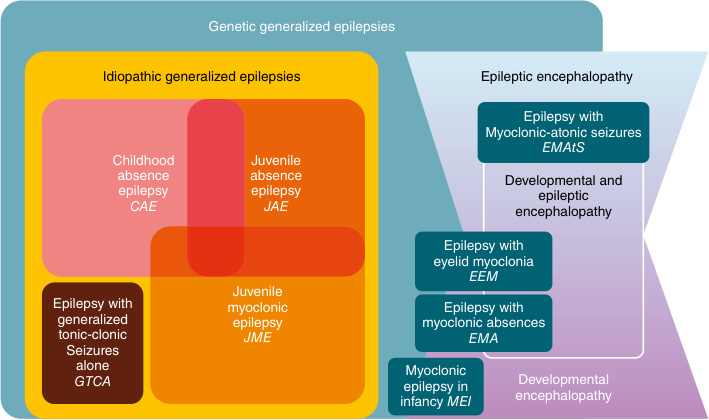

# Chapter 16: Nonfebrile Epilepsy Syndromes Including Epileptic Encephalopathies — Board-Style Self-Assessment MCQs
**Section III: Neuro-Sensory Disorders** | [📖 Read Wiki Chapter](../chapters/016_Nonfebrile_Epilepsy_Syndromes_Including_Epileptic_Encephalopathies.md) | [🃏 Chapter Flashcards](../flashcards/016_flashcards.md) | [🏠 Course Master Index](../../index.md)

Total questions: **14** *(Click "Show Answer & Rationale" beneath each question)*

### Question 1 (Clinical Vignette & Syndrome Diagnosis)
A pediatric patient is evaluated in the medical genetics clinic with the following clinical and molecular profile: Encoded Protein: Voltage-gated sodium channel Nav1.1 — Protein Function: Initiates action potential firing in GABAergic inhibitory interneurons — Type of Pathogenic Variant: Haploinsufficiency and LOF — Main Clinical Features: Fever sensitivity, seiz. Which of the following rare disorders is the most likely diagnosis?

- **A.** Dravet syndrome and GEFS+
- **B.** Infantile onset epilepsy with or without intellectual disability and autism
- **C.** EIDEE
- **D.** Epilepsy with or without intellectual disability and autism

<b>Show Answer & Rationale</b>

**Correct Answer: A** — Dravet syndrome and GEFS+

**Rationale:** **Dravet syndrome and GEFS+** caused by pathogenic variants in **`SCN1A`** presents with: Encoded Protein: Voltage-gated sodium channel Nav1.1 — Protein Function: Initiates action potential firing in GABAergic inhibitory interneurons — Type of Pathogenic Variant: Haploinsufficiency and LOF — Main Clinical Features: Fever sensitivity, seizure onset <6 months of age, ataxia, mild-to-severe intellectual disability, and autism — T.

**Why Other Options Are Incorrect:** **EIDEE** is incorrect (associated with CDKL5 — Encoded Protein: CDKL5 — Protein Function: CDKL5 is localized at excitatory synapses and contributes to correc). **Epilepsy with or without intellectual disability and autism** is incorrect (associated with SCN2A — Encoded Protein: Voltage-gated sodium channel Nav1.2 — Protein Function: Regulating the flow of sodium ions ac).

### Question 2 (Clinical Vignette & Syndrome Diagnosis)
A pediatric patient is evaluated in the medical genetics clinic with the following clinical and molecular profile: Encoded Protein: Voltage-gated sodium channel Nav1.1 — Protein Function: Initiates action potential firing in GABAergic inhibitory interneurons — Type of Pathogenic Variant: GOF — Main Clinical Features: Neonatal-onset seizures, movement disorder, co. Which of the following rare disorders is the most likely diagnosis?

- **A.** PCDH19-clustering epilepsy
- **B.** CAE, simple febrile seizures, GEFS+, GGE, and DEE
- **C.** EIDEE and bitemporal focal epilepsy
- **D.** EIDEE, SeLFIE, and SeLIE

<b>Show Answer & Rationale</b>

**Correct Answer: C** — EIDEE and bitemporal focal epilepsy

**Rationale:** **EIDEE and bitemporal focal epilepsy** caused by pathogenic variants in **`SCN1A`** presents with: Encoded Protein: Voltage-gated sodium channel Nav1.1 — Protein Function: Initiates action potential firing in GABAergic inhibitory interneurons — Type of Pathogenic Variant: GOF — Main Clinical Features: Neonatal-onset seizures, movement disorder, congenital arthrogryposis, severe-to-profound intellectual disability — Targeted Treatments:.

**Why Other Options Are Incorrect:** **PCDH19-clustering epilepsy** is incorrect (associated with PCDH19 — Encoded Protein: Protocadherin-19 — Protein Function: Regulates synaptic transmission — Type of Pathogenic Var). **CAE, simple febrile seizures, GEFS+, GGE, and DEE** is incorrect (associated with HCN1, HCN2, HCN3, HCN4 — Encoded Protein: HCN channels 1–4 — Protein Function: Key roles in the regulation of cellular excitability, sy). **EIDEE, SeLFIE, and SeLIE** is incorrect (associated with KCNQ2 — Encoded Protein: Voltage-gated potassium channel subunit Kv7.2 — Protein Function: Regulating the membrane exc).

### Question 3 (Clinical Vignette & Syndrome Diagnosis)
A pediatric patient is evaluated in the medical genetics clinic with the following clinical and molecular profile: Encoded Protein: Voltage-gated sodium channel Nav1.2 — Protein Function: Regulating the flow of sodium ions across neuronal membranes — Type of Pathogenic Variant: Haploinsufficiency and LOF — Main Clinical Features: Infantile onset, mainly generaliz. Which of the following rare disorders is the most likely diagnosis?

- **A.** Epilepsy with or without intellectual disability and autism
- **B.** SeLNE, SeLFNE, and EIDEE
- **C.** EIDEE
- **D.** EIDEE and bitemporal focal epilepsy

<b>Show Answer & Rationale</b>

**Correct Answer: A** — Epilepsy with or without intellectual disability and autism

**Rationale:** **Epilepsy with or without intellectual disability and autism** caused by pathogenic variants in **`SCN2A`** presents with: Encoded Protein: Voltage-gated sodium channel Nav1.2 — Protein Function: Regulating the flow of sodium ions across neuronal membranes — Type of Pathogenic Variant: Haploinsufficiency and LOF — Main Clinical Features: Infantile onset, mainly generalized seizures and myoclonic seizures, intellectual disability, and autism — Targeted Treatme.

**Why Other Options Are Incorrect:** **SeLNE, SeLFNE, and EIDEE** is incorrect (associated with SCN2A — Encoded Protein: Voltage-gated sodium channel Nav1.2 — Protein Function: Regulating the flow of sodium ions ac). **EIDEE** is incorrect (associated with CDKL5 — Encoded Protein: CDKL5 — Protein Function: CDKL5 is localized at excitatory synapses and contributes to correc). **EIDEE and bitemporal focal epilepsy** is incorrect (associated with SCN1A — Encoded Protein: Voltage-gated sodium channel Nav1.1 — Protein Function: Initiates action potential firing in ).

### Question 4 (Clinical Vignette & Syndrome Diagnosis)
A pediatric patient is evaluated in the medical genetics clinic with the following clinical and molecular profile: Encoded Protein: Voltage-gated sodium channel Nav1.2 — Protein Function: Regulating the flow of sodium ions across neuronal membranes — Type of Pathogenic Variant: GOF — Main Clinical Features: Epilepsy onset<3 months of age, often neonatal, with mai. Which of the following rare disorders is the most likely diagnosis?

- **A.** CAE, simple febrile seizures, GEFS+, GGE, and DEE
- **B.** DEE and late-onset dystonia
- **C.** EIDEE
- **D.** SeLNE, SeLFNE, and EIDEE

<b>Show Answer & Rationale</b>

**Correct Answer: D** — SeLNE, SeLFNE, and EIDEE

**Rationale:** **SeLNE, SeLFNE, and EIDEE** caused by pathogenic variants in **`SCN2A`** presents with: Encoded Protein: Voltage-gated sodium channel Nav1.2 — Protein Function: Regulating the flow of sodium ions across neuronal membranes — Type of Pathogenic Variant: GOF — Main Clinical Features: Epilepsy onset<3 months of age, often neonatal, with mainly focal seizures; severeto-profound intellectual disability in EIDEE — Targeted Treatmen.

**Why Other Options Are Incorrect:** **CAE, simple febrile seizures, GEFS+, GGE, and DEE** is incorrect (associated with HCN1, HCN2, HCN3, HCN4 — Encoded Protein: HCN channels 1–4 — Protein Function: Key roles in the regulation of cellular excitability, sy). **DEE and late-onset dystonia** is incorrect (associated with GNAO1 — Encoded Protein: Guanine nucleotidebinding protein G(o) subunit α subunit (forms a heterotrimeric G-protein co). **EIDEE** is incorrect (associated with CDKL5 — Encoded Protein: CDKL5 — Protein Function: CDKL5 is localized at excitatory synapses and contributes to correc).

### Question 5 (Clinical Vignette & Syndrome Diagnosis)
A pediatric patient is evaluated in the medical genetics clinic with the following clinical and molecular profile: Encoded Protein: Voltage-gated sodium channel Nav1.6 — Protein Function: Regulating the membrane excitability of neurons — Type of Pathogenic Variant: Haploinsufficiency and LOF — Main Clinical Features: Infantile onset, mainly generalized seizures a. Which of the following rare disorders is the most likely diagnosis?

- **A.** RMFSL, EIMFS, and NEDCAS
- **B.** CAE, simple febrile seizures, GEFS+, GGE, and DEE
- **C.** EIDEE, SeLFIE, and SeLIE
- **D.** Infantile onset epilepsy with or without intellectual disability and autism

<b>Show Answer & Rationale</b>

**Correct Answer: D** — Infantile onset epilepsy with or without intellectual disability and autism

**Rationale:** **Infantile onset epilepsy with or without intellectual disability and autism** caused by pathogenic variants in **`SCN8A`** presents with: Encoded Protein: Voltage-gated sodium channel Nav1.6 — Protein Function: Regulating the membrane excitability of neurons — Type of Pathogenic Variant: Haploinsufficiency and LOF — Main Clinical Features: Infantile onset, mainly generalized seizures and myoclonic seizures, intellectual disability, and autism — Targeted Treatments: Avoidanc.

**Why Other Options Are Incorrect:** **RMFSL, EIMFS, and NEDCAS** is incorrect (associated with BRAT1, ATM — Encoded Protein: BRCA-1-associated ATM activator 1 — Protein Function: Essential for mitochondrial function, c). **CAE, simple febrile seizures, GEFS+, GGE, and DEE** is incorrect (associated with HCN1, HCN2, HCN3, HCN4 — Encoded Protein: HCN channels 1–4 — Protein Function: Key roles in the regulation of cellular excitability, sy). **EIDEE, SeLFIE, and SeLIE** is incorrect (associated with KCNQ2 — Encoded Protein: Voltage-gated potassium channel subunit Kv7.2 — Protein Function: Regulating the membrane exc).

### Question 6 (Molecular & Genomic Etiology)
A child is diagnosed with **Dravet syndrome and GEFS+** after presenting with Encoded Protein: Voltage-gated sodium channel Nav1.1 — Protein Function: Initiates action potential firing in GABAergic inhibitory interneurons — Type of Pathogenic Variant: Haploinsufficiency and LOF — Main Cl. Pathogenic variants in which of the following genes are the primary molecular etiology of this disorder?

- **A.** SCN1A
- **B.** DNAH5
- **C.** FANCA
- **D.** BLNK

<b>Show Answer & Rationale</b>

**Correct Answer: A** — SCN1A

**Rationale:** Pathogenic variants in **`SCN1A`** (Genetic) cause **Dravet syndrome and GEFS+**, characterized by Encoded Protein: Voltage-gated sodium channel Nav1.1 — Protein Function: Initiates action potential firing in GABAergic inhibitory interneurons — Type of Pathogenic Variant: Haploinsufficiency and LOF — Main Clinical Features: Fever sensitivity, seizure onset <6 months of age, ataxia, mild-to-severe intellectual disability, and autism — T.

**Why Other Options Are Incorrect:** **DNAH5** is incorrect (associated with Primary ciliary dyskinesia). **FANCA** is incorrect (associated with Fanconi anemia). **BLNK** is incorrect (associated with Agammaglobulinemia X-linked or AR).

### Question 7 (Molecular & Genomic Etiology)
A child is diagnosed with **Epilepsy with or without intellectual disability and autism** after presenting with Encoded Protein: Voltage-gated sodium channel Nav1.2 — Protein Function: Regulating the flow of sodium ions across neuronal membranes — Type of Pathogenic Variant: Haploinsufficiency and LOF — Main Clinical Fea. Pathogenic variants in which of the following genes are the primary molecular etiology of this disorder?

- **A.** FAS
- **B.** TNNI3
- **C.** SCN2A
- **D.** ATXN3

<b>Show Answer & Rationale</b>

**Correct Answer: C** — SCN2A

**Rationale:** Pathogenic variants in **`SCN2A`** (Genetic) cause **Epilepsy with or without intellectual disability and autism**, characterized by Encoded Protein: Voltage-gated sodium channel Nav1.2 — Protein Function: Regulating the flow of sodium ions across neuronal membranes — Type of Pathogenic Variant: Haploinsufficiency and LOF — Main Clinical Features: Infantile onset, mainly generalized seizures and myoclonic seizures, intellectual disability, and autism — Targeted Treatme.

**Why Other Options Are Incorrect:** **FAS** is incorrect (associated with ALPS type 0). **ATXN3** is incorrect (associated with Spinocerebellar ataxia, AD, types 1, 2, 3, 7, 10, 12, 36; 14, 23, 27).

### Question 8 (Molecular & Genomic Etiology)
A child is diagnosed with **Infantile onset epilepsy with or without intellectual disability and autism** after presenting with Encoded Protein: Voltage-gated sodium channel Nav1.6 — Protein Function: Regulating the membrane excitability of neurons — Type of Pathogenic Variant: Haploinsufficiency and LOF — Main Clinical Features: Infant. Pathogenic variants in which of the following genes are the primary molecular etiology of this disorder?

- **A.** BRAF
- **B.** RAF1
- **C.** MKS1
- **D.** SCN8A

<b>Show Answer & Rationale</b>

**Correct Answer: D** — SCN8A

**Rationale:** Pathogenic variants in **`SCN8A`** (Genetic) cause **Infantile onset epilepsy with or without intellectual disability and autism**, characterized by Encoded Protein: Voltage-gated sodium channel Nav1.6 — Protein Function: Regulating the membrane excitability of neurons — Type of Pathogenic Variant: Haploinsufficiency and LOF — Main Clinical Features: Infantile onset, mainly generalized seizures and myoclonic seizures, intellectual disability, and autism — Targeted Treatments: Avoidanc.

**Why Other Options Are Incorrect:** **BRAF** is incorrect (associated with Cardio-facio-cutaneous syndrome). **RAF1** is incorrect (associated with Noonan syndrome). **MKS1** is incorrect (associated with Bardet-Biedl syndrome).

### Question 9 (Molecular & Genomic Etiology)
A child is diagnosed with **PCDH19-clustering epilepsy** after presenting with Encoded Protein: Protocadherin-19 — Protein Function: Regulates synaptic transmission — Type of Pathogenic Variant: Cellular interference — Main Clinical Features: Mainly female subjects; seizure clusters, feve. Pathogenic variants in which of the following genes are the primary molecular etiology of this disorder?

- **A.** LCT
- **B.** USH2A
- **C.** DICER1
- **D.** PCDH19

<b>Show Answer & Rationale</b>

**Correct Answer: D** — PCDH19

**Rationale:** Pathogenic variants in **`PCDH19`** (Genetic) cause **PCDH19-clustering epilepsy**, characterized by Encoded Protein: Protocadherin-19 — Protein Function: Regulates synaptic transmission — Type of Pathogenic Variant: Cellular interference — Main Clinical Features: Mainly female subjects; seizure clusters, fever sensitivity, mild-to-moderate intellectual disability, and autism — Targeted Treatments: Ganaxolone under exploration.

**Why Other Options Are Incorrect:** **LCT** is incorrect (associated with Congenital lactase deficiency). **USH2A** is incorrect (associated with Usher syndrome type 2). **DICER1** is incorrect (associated with DICER1 syndrome).

### Question 10 (Visual & Diagnostic Imaging Vignette)

A pediatric patient undergoes diagnostic evaluation for **Nonfebrile Epilepsy Syndromes Including Epileptic Encephalopathies**, yielding the clinical, neuroimaging, or molecular finding shown below. Which of the following best characterizes the illustrated disorder or mechanism?

- **A.** Relationship between different genes and their associated epilepsy phenotypes. The plot illustrates the connections between gene variants (blue, right) and their respective abnormal function
- **B.** Organization of epilepsy syndromes that begin in the neonates and infants. Syndromes are broadly divided into Self-Limited Epilepsies (where there is likely to be spontaneous remission) and
- **C.** Classification of epilepsy syndromes, based on age at presentation. Shown are the typical ages of presentation, with ranges indicated by arrows . Focal epilepsy syndromes are indicated in bl
- **D.** Concept of genetic generalized epilepsy (GGE) versus idiopathic generalized epilepsy (IGE). The IGEs are a subgroup of GGEs, comprised of the following four syndromes: childhood absence epilepsy,

<b>Show Answer & Rationale</b>

**Correct Answer: D** — Concept of genetic generalized epilepsy (GGE) versus idiopathic generalized epilepsy (IGE). The IGEs are a subgroup of GGEs, comprised of the following four syndromes: childhood absence epilepsy,

**Rationale:** **Fig. 16.1**: Concept of genetic generalized epilepsy (GGE) versus idiopathic generalized epilepsy (IGE). The IGEs are a subgroup of GGEs, comprised of the following four syndromes: childhood absence epilepsy, juvenile absence epilepsy, juvenile myoclonic epilepsy, and epilepsy with generalized tonic-clonic seizures alone. These four syndromes may show some degree of overlap. In addition to the IGEs, GGEs include (1) individuals with generalized seizure types who do not meet criteria for a specific syndrome, and (2) less common generalized epilepsy syndromes. These latter syndromes also have a genetic basis and may occur in the setting of normal intellect or intellectual disability. Some present with an epileptic encephalopathy such as epilepsy with myoclonic–atonic seizures, whereas other syndromes, such as epilepsy with myoclonic absences and epilepsy with eyelid myoclonia, may be associated with a developmental and epileptic encephalopathy, an epileptic encephalopathy, or a developmental encephalopathy. Other syndromes such as myoclonic epilepsy in infancy may present as a generalized epilepsy in a child with a developmental encephalopathy (i.e., intellectual disability) or normal intellect.

### Question 11 (Diagnostic Criteria (Angelman Syndrome))
During a multidisciplinary genetics evaluation for **Angelman Syndrome**, which clinical entity or diagnostic phenomenon is defined by the following profile?
"n these patients, which will require rescue with benzodiazepines."

- **A.** movement disorders
- **B.** nonconvulsive status epilepticus
- **C.** Beckwith-Wiedemann syndrome (BWS)
- **D.** Developmental encephalopathy with or without epilepsy

<b>Show Answer & Rationale</b>

**Correct Answer: B** — nonconvulsive status epilepticus

**Rationale:** nonconvulsive status epilepticus in these patients, which will require rescue with benzodiazepines.

### Question 12 (Diagnostic Criteria (SCN2A-Related Disorder))
During a multidisciplinary genetics evaluation for **SCN2A-Related Disorder**, which clinical entity or diagnostic phenomenon is defined by the following profile?
"or focal migratory epilepsy of infancy ."

- **A.** Infantile-onset epilepsy with both focal and generalized seizures
- **B.** Severe sleep-related hypermotor epilepsy
- **C.** Ohtahara syndrome
- **D.** Silver-Russell syndrome (SRS)

<b>Show Answer & Rationale</b>

**Correct Answer: C** — Ohtahara syndrome

**Rationale:** Ohtahara syndrome or focal migratory epilepsy of infancy .

### Question 13 (Diagnostic Criteria (SCN2A-Related Disorder))
During a multidisciplinary genetics evaluation for **SCN2A-Related Disorder**, which clinical entity or diagnostic phenomenon is defined by the following profile?
"myoclonic-atonic epilepsy to Lennox-Gastaut syndrome ."

- **A.** Angelman syndrome (AS)
- **B.** myoclonic-atonic epilepsy
- **C.** West syndrome
- **D.** EIDEE

<b>Show Answer & Rationale</b>

**Correct Answer: C** — West syndrome

**Rationale:** West syndrome , myoclonic-atonic epilepsy to Lennox-Gastaut syndrome .

### Question 14 (Clinical & Pathophysiologic Mastery (Copy Number Variants))
When counseling a family and planning diagnostic management for **Copy Number Variants** (*Nonfebrile Epilepsy Syndromes Including Epileptic Encephalopathies*), which of the following clinical-genetic principles is **ACCURATE**?

- **A.** The condition is a benign, self-limiting physiologic variant that requires neither longitudinal surveillance nor genetic counseling.
- **B.** If this CNV involves several genes, a clinical phenotype will appear, characterized by the sum of the phenotype of the dose-sensitive involved genes (contiguous gene syndrome), although occasionally there
- **C.** Enzyme activity and protein expression remain completely normal across all affected tissues, excluding a monogenic etiology.
- **D.** Inheritance is exclusively holandric (Y-linked) with complete penetrance restricted to male offspring.

<b>Show Answer & Rationale</b>

**Correct Answer: B** — If this CNV involves several genes, a clinical phenotype will appear, characterized by the sum of the phenotype of the dose-sensitive involved genes (contiguous gene syndrome), although occasionally there

**Rationale:** **Clinical & Molecular Principle (Copy Number Variants):** If this CNV involves several genes, a clinical phenotype will appear, characterized by the sum of the phenotype of the dose-sensitive involved genes (contiguous gene syndrome), although occasionally there is a CNV involving a single gene (e.g., total or partial deletion or duplication of a gene).

