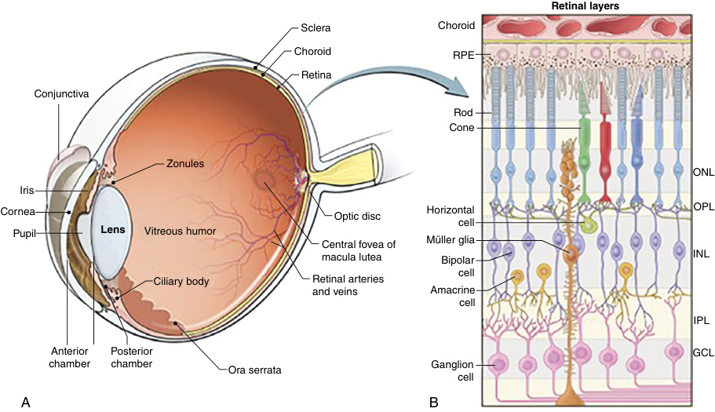

# Chapter 22: Late-Onset Blindness — Board-Style Self-Assessment MCQs
**Section III: Neuro-Sensory Disorders** | [📖 Read Wiki Chapter](../chapters/022_Late_Onset_Blindness.md) | [🃏 Chapter Flashcards](../flashcards/022_flashcards.md) | [🏠 Course Master Index](../../index.md)

Total questions: **14** *(Click "Show Answer & Rationale" beneath each question)*

### Question 1 (Clinical Vignette & Syndrome Diagnosis)
A pediatric patient is evaluated in the medical genetics clinic with the following clinical and molecular profile: Mode of Inheritance: Autosomal recessive — Stargardt disease is a genetic retinal disorder caused by variants in the causative gene which is crucial for the transport of vitamin A derivatives in photoreceptor cells of the retina.. Which of the following rare disorders is the most likely diagnosis?

- **A.** Stargardt disease; 248200
- **B.** Friedreich ataxia
- **C.** Optic atrophy and multisystem neurological disorder
- **D.** Jalili syndrome

<b>Show Answer & Rationale</b>

**Correct Answer: A** — Stargardt disease; 248200

**Rationale:** **Stargardt disease; 248200** caused by pathogenic variants in **`ABCA4`** presents with: Mode of Inheritance: Autosomal recessive — Stargardt disease is a genetic retinal disorder caused by variants in ABCA4 which is crucial for the transport of vitamin A derivatives in photoreceptor cells of the retina..

**Why Other Options Are Incorrect:** **Friedreich ataxia** is incorrect (associated with GAA — Caudal to rostral ataxia progression, posterior column sensory loss, absent deep tendon reflexes, bilateral Ba). **Optic atrophy and multisystem neurological disorder** is incorrect (associated with NDUFS1 — r Genes Identifi: AR or XLD — ied in Patients W: No). **Jalili syndrome** is incorrect (associated with CNNM4 — Amelogenesis imperfecta — Pathogenesis: Metal transport protein).

### Question 2 (Clinical Vignette & Syndrome Diagnosis)
A pediatric patient is evaluated in the medical genetics clinic with the following clinical and molecular profile: Mode of Inheritance: Autosomal recessive. Which of the following rare disorders is the most likely diagnosis?

- **A.** Doyne honeycomb retinal dystrophy; 126600
- **B.** Macular dystrophy with central cone involvement; 616170
- **C.** Mainzer–Saldino syndrome
- **D.** Progressive bifocal chorioretinal atrophy; 600790

<b>Show Answer & Rationale</b>

**Correct Answer: B** — Macular dystrophy with central cone involvement; 616170

**Rationale:** **Macular dystrophy with central cone involvement; 616170** caused by pathogenic variants in **`MFSD8`** presents with: Mode of Inheritance: Autosomal recessive.

**Why Other Options Are Incorrect:** **Doyne honeycomb retinal dystrophy; 126600** is incorrect (associated with EFEMP1 — Mode of Inheritance: Autosomal dominant). **Mainzer–Saldino syndrome** is incorrect (associated with IFT140 — Renal dysplasia Cerebellar ataxia Skeletal dysplasia Cone-shaped epiphyses — Pathogenesis: Ciliopathy). **Progressive bifocal chorioretinal atrophy; 600790** is incorrect (associated with PRMD13 — Mode of Inheritance: Autosomal dominant — Affected Gene: Noncoding variant upstream of PRMD13).

### Question 3 (Clinical Vignette & Syndrome Diagnosis)
A pediatric patient is evaluated in the medical genetics clinic with the following clinical and molecular profile: Mode of Inheritance: Autosomal recessive — It is caused by pathogenic variants in the causative gene , which leads to the accumulation of lipofuscin (a fatty pigment) in the retinal pigment epithelium.. Which of the following rare disorders is the most likely diagnosis?

- **A.** Doyne honeycomb retinal dystrophy; 126600
- **B.** Autosomal recessive bestrophinopathy; 611809
- **C.** Best macular dystrophy; 153700
- **D.** Autosomal dominant bull’s-eye macular dystrophy; 608051

<b>Show Answer & Rationale</b>

**Correct Answer: B** — Autosomal recessive bestrophinopathy; 611809

**Rationale:** **Autosomal recessive bestrophinopathy; 611809** caused by pathogenic variants in **`BEST1`** presents with: Mode of Inheritance: Autosomal recessive — It is caused by pathogenic variants in BEST1 , which leads to the accumulation of lipofuscin (a fatty pigment) in the retinal pigment epithelium..

**Why Other Options Are Incorrect:** **Doyne honeycomb retinal dystrophy; 126600** is incorrect (associated with EFEMP1 — Mode of Inheritance: Autosomal dominant). **Best macular dystrophy; 153700** is incorrect (associated with BEST1 — Mode of Inheritance: Autosomal dominant — It is caused by pathogenic variants in BEST1 , which leads to the ac). **Autosomal dominant bull’s-eye macular dystrophy; 608051** is incorrect (associated with PROM1 — Mode of Inheritance: Autosomal dominant).

### Question 4 (Clinical Vignette & Syndrome Diagnosis)
A pediatric patient is evaluated in the medical genetics clinic with the following clinical and molecular profile: Mode of Inheritance: Autosomal dominant. Which of the following rare disorders is the most likely diagnosis?

- **A.** Stickler 3
- **B.** Autosomal recessive (atypical) vitelliform dystrophy; 616151
- **C.** Wolfram syndrome 2
- **D.** Stargardt-like macular dystrophy; 600110

<b>Show Answer & Rationale</b>

**Correct Answer: D** — Stargardt-like macular dystrophy; 600110

**Rationale:** **Stargardt-like macular dystrophy; 600110** caused by pathogenic variants in **`ELOVL4`** presents with: Mode of Inheritance: Autosomal dominant.

**Why Other Options Are Incorrect:** **Stickler 3** is incorrect (associated with COL11A2 — COL11A2 — Systemic: Arthropathy, cleft palate, hearing impairment). **Autosomal recessive (atypical) vitelliform dystrophy; 616151** is incorrect (associated with IMPG1 — Mode of Inheritance: Autosomal recessive). **Wolfram syndrome 2** is incorrect (associated with CISD2 — r Genes Identifi: AR — ied in Patients W: No).

### Question 5 (Molecular & Genomic Etiology)
A child is diagnosed with **Stargardt disease; 248200** after presenting with Mode of Inheritance: Autosomal recessive — Stargardt disease is a genetic retinal disorder caused by variants in the causative gene which is crucial for the transport of vitamin A derivatives in photoreceptor c. Pathogenic variants in which of the following genes are the primary molecular etiology of this disorder?

- **A.** IKBKG
- **B.** ABCA4
- **C.** B4GALT7
- **D.** NPHP1

<b>Show Answer & Rationale</b>

**Correct Answer: B** — ABCA4

**Rationale:** Pathogenic variants in **`ABCA4`** (AR) cause **Stargardt disease; 248200**, characterized by Mode of Inheritance: Autosomal recessive — Stargardt disease is a genetic retinal disorder caused by variants in ABCA4 which is crucial for the transport of vitamin A derivatives in photoreceptor cells of the retina..

**Why Other Options Are Incorrect:** **IKBKG** is incorrect (associated with Incontinentia pigmenti (IP)). **B4GALT7** is incorrect (associated with Spondylodysplastic (spEDS-B4GALT7or spEDS-B3GALT6 depending on the causative pathogenic variant)). **NPHP1** is incorrect (associated with Joubert syndrome).

### Question 6 (Molecular & Genomic Etiology)
A child is diagnosed with **Macular dystrophy with central cone involvement; 616170** after presenting with Mode of Inheritance: Autosomal recessive. Pathogenic variants in which of the following genes are the primary molecular etiology of this disorder?

- **A.** SAMHD1
- **B.** C4B
- **C.** FXN
- **D.** MFSD8

<b>Show Answer & Rationale</b>

**Correct Answer: D** — MFSD8

**Rationale:** Pathogenic variants in **`MFSD8`** (AR) cause **Macular dystrophy with central cone involvement; 616170**, characterized by Mode of Inheritance: Autosomal recessive.

**Why Other Options Are Incorrect:** **SAMHD1** is incorrect (associated with Congenital-onset glaucoma). **C4B** is incorrect (associated with Streptococcus pneumoniae). **FXN** is incorrect (associated with Friedreich ataxia (229300), AR).

### Question 7 (Molecular & Genomic Etiology)
A child is diagnosed with **Autosomal recessive bestrophinopathy; 611809** after presenting with Mode of Inheritance: Autosomal recessive — It is caused by pathogenic variants in the causative gene , which leads to the accumulation of lipofuscin (a fatty pigment) in the retinal pigment epithelium.. Pathogenic variants in which of the following genes are the primary molecular etiology of this disorder?

- **A.** KCNH2
- **B.** BEST1
- **C.** IVD
- **D.** CD40LG

<b>Show Answer & Rationale</b>

**Correct Answer: B** — BEST1

**Rationale:** Pathogenic variants in **`BEST1`** (AR) cause **Autosomal recessive bestrophinopathy; 611809**, characterized by Mode of Inheritance: Autosomal recessive — It is caused by pathogenic variants in BEST1 , which leads to the accumulation of lipofuscin (a fatty pigment) in the retinal pigment epithelium..

**Why Other Options Are Incorrect:** **KCNH2** is incorrect (associated with LQT2). **IVD** is incorrect (associated with Isovaleric Acidemia). **CD40LG** is incorrect (associated with Pseudomonas).

### Question 8 (Molecular & Genomic Etiology)
A child is diagnosed with **Autosomal recessive (atypical) vitelliform dystrophy; 616151** after presenting with Mode of Inheritance: Autosomal recessive. Pathogenic variants in which of the following genes are the primary molecular etiology of this disorder?

- **A.** KCNQ3
- **B.** IMPG1
- **C.** NOD2
- **D.** DNAI1

<b>Show Answer & Rationale</b>

**Correct Answer: B** — IMPG1

**Rationale:** Pathogenic variants in **`IMPG1`** (AR) cause **Autosomal recessive (atypical) vitelliform dystrophy; 616151**, characterized by Mode of Inheritance: Autosomal recessive.

**Why Other Options Are Incorrect:** **NOD2** is incorrect (associated with and/or). **DNAI1** is incorrect (associated with Primary ciliary dyskinesia).

### Question 9 (Molecular & Genomic Etiology)
A child is diagnosed with **Stargardt-like macular dystrophy; 600110** after presenting with Mode of Inheritance: Autosomal dominant. Pathogenic variants in which of the following genes are the primary molecular etiology of this disorder?

- **A.** H19
- **B.** IFNGR1
- **C.** ELOVL4
- **D.** SAMD9L

<b>Show Answer & Rationale</b>

**Correct Answer: C** — ELOVL4

**Rationale:** Pathogenic variants in **`ELOVL4`** (AD) cause **Stargardt-like macular dystrophy; 600110**, characterized by Mode of Inheritance: Autosomal dominant.

**Why Other Options Are Incorrect:** **H19** is incorrect (associated with Silver-Russell syndrome). **IFNGR1** is incorrect (associated with Salmonella). **SAMD9L** is incorrect (associated with Familial mosaic monosomy 7).

### Question 10 (Visual & Diagnostic Imaging Vignette)

A pediatric patient undergoes diagnostic evaluation for **Late-Onset Blindness**, yielding the clinical, neuroimaging, or molecular finding shown below. Which of the following best characterizes the illustrated disorder or mechanism?

- **A.** Retinography and fundus autofluorescence (FAF) of a patient with cone dystrophy. Central hyperautofluorescence is a key diagnostic feature of this condition.
- **B.** Venn diagram of currently identified genes associated with retinitis pigmentosa (RP) and their genetic overlap with other inherited retinal dystrophies. For example, variants in the RHO gene
- **C.** Cross-sectional images of the human eye (A) and the light-sensitive retina (B). Eye field specification starts at around 3 weeks gestation in the anterior neural plate, followed by the formation
- **D.** Retinography, fundus autofluorescence (FAF), and macular optic coherence tomography (OCT) of a patient with Stargardt disease. There is a marked macular atrophy expressed as a characteristic

<b>Show Answer & Rationale</b>

**Correct Answer: C** — Cross-sectional images of the human eye (A) and the light-sensitive retina (B). Eye field specification starts at around 3 weeks gestation in the anterior neural plate, followed by the formation

**Rationale:** **Fig. 22.1**: Cross-sectional images of the human eye (A) and the light-sensitive retina (B). Eye field specification starts at around 3 weeks gestation in the anterior neural plate, followed by the formation of optic vesicle, lens, cornea, and retina at various stages. GCL, Ganglion cell layer; INL, inner nuclear layer; IPL, inner plexiform layer; ONL, outer nuclear layer; OPL, outer plexiform layer. (Modified from Chen HY, Lehmann OJ, Swaroop A. Genetics and therapy for pediatric eye disease. EBioMedicine . 2021;67:103360 [Fig. 1A, B].)

### Question 11 (Diagnostic Criteria (Ocular Manifestations in Type 1 and Type 2 Stickler Syndrome))
During a multidisciplinary genetics evaluation for **Ocular Manifestations in Type 1 and Type 2 Stickler Syndrome**, which clinical entity or diagnostic phenomenon is defined by the following profile?
"lso common, typically bilateral lamellar cortical opacity."

- **A.** Prader-Willi syndrome (PWS)
- **B.** Isolated LHON phenotype or childhood-onset Leigh syndrome
- **C.** Cataract
- **D.** Optic atrophy and hypoplasia, encephalopathy, myopathy (EMPF1)

<b>Show Answer & Rationale</b>

**Correct Answer: C** — Cataract

**Rationale:** Cataract is also common, typically bilateral lamellar cortical opacity.

### Question 12 (Diagnostic Criteria (Ocular Manifestations in Type 1 and Type 2 Stickler Syndrome))
During a multidisciplinary genetics evaluation for **Ocular Manifestations in Type 1 and Type 2 Stickler Syndrome**, which clinical entity or diagnostic phenomenon is defined by the following profile?
"lso higher than in the general population."

- **A.** Usher syndrome type 2
- **B.** heredopathia atactica polyneuritiformis
- **C.** Angelman syndrome (AS)
- **D.** glaucoma

<b>Show Answer & Rationale</b>

**Correct Answer: D** — glaucoma

**Rationale:** glaucoma is also higher than in the general population.

### Question 13 (Diagnostic Criteria (Abetalipoproteinemia))
During a multidisciplinary genetics evaluation for **Abetalipoproteinemia**, which clinical entity or diagnostic phenomenon is defined by the following profile?
"is a rare genetic disorder that affects the body’s ability to absorb dietary fats, cholesterol, and liposoluble vitamins (A, D, E, K)."

- **A.** Stickler 3
- **B.** Doyne honeycomb retinal dystrophy; 126600
- **C.** Bassen-Kornzweig syndrome
- **D.** Juvenile retinoschisis; 312700

<b>Show Answer & Rationale</b>

**Correct Answer: C** — Bassen-Kornzweig syndrome

**Rationale:** Bassen-Kornzweig syndrome , is a rare genetic disorder that affects the body’s ability to absorb dietary fats, cholesterol, and liposoluble vitamins (A, D, E, K).

### Question 14 (Clinical & Pathophysiologic Mastery (Late-Onset Blindness))
When counseling a family and planning diagnostic management for **Late-Onset Blindness** (*Late-Onset Blindness*), which of the following clinical-genetic principles is **ACCURATE**?

- **A.** Other diseases included in IRD are vitreo-retinal dystrophies such as X-linked juvenile retinoschisis, familial exudative vitreoretinopathy and Stickler syndrome or retinal pigment epithelium or choroidal
- **B.** The condition is a benign, self-limiting physiologic variant that requires neither longitudinal surveillance nor genetic counseling.
- **C.** Inheritance is exclusively holandric (Y-linked) with complete penetrance restricted to male offspring.
- **D.** Pathogenesis is driven exclusively by maternal mitochondrial DNA deletions without nuclear gene involvement.

<b>Show Answer & Rationale</b>

**Correct Answer: A** — Other diseases included in IRD are vitreo-retinal dystrophies such as X-linked juvenile retinoschisis, familial exudative vitreoretinopathy and Stickler syndrome or retinal pigment epithelium or choroidal

**Rationale:** **Clinical & Molecular Principle (Late-Onset Blindness):** Other diseases included in IRD are vitreo-retinal dystrophies such as X-linked juvenile retinoschisis, familial exudative vitreoretinopathy and Stickler syndrome or retinal pigment epithelium or choroidal diseases like Best disease or choroideremia.

