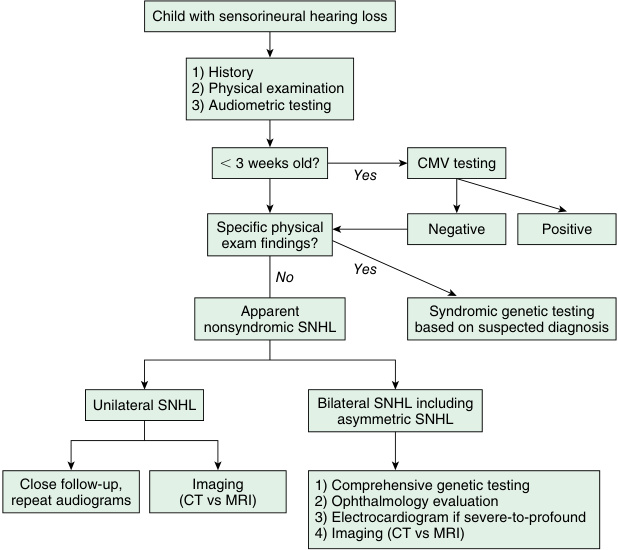

# Chapter 23: Sensorineural Hearing Loss — Board-Style Self-Assessment MCQs
**Section III: Neuro-Sensory Disorders** | [📖 Read Wiki Chapter](../chapters/023_Sensorineural_Hearing_Loss.md) | [🃏 Chapter Flashcards](../flashcards/023_flashcards.md) | [🏠 Course Master Index](../../index.md)

Total questions: **14** *(Click "Show Answer & Rationale" beneath each question)*

### Question 1 (Clinical Vignette & Syndrome Diagnosis)
A pediatric patient is evaluated in the medical genetics clinic with the following clinical and molecular profile: Characteristics: Generally prelingual and range from mild-to- moderate to severe to profound — N Genes: 76 — Genes: the causative gene, the causative gene, the causative gene, the causative gene, the causative gene, the causative gene, CEACAM16, CIB2. Which of the following rare disorders is the most likely diagnosis?

- **A.** Autosomal recessive
- **B.** Norrie disease
- **C.** Branchiootorenal syndrome (BOR)
- **D.** Jervell and Lange- Nielsen syndrome

<b>Show Answer & Rationale</b>

**Correct Answer: A** — Autosomal recessive

**Rationale:** **Autosomal recessive** caused by pathogenic variants in **`ADCY1, BDP1, BSND, CABP2, CDC14A, CDH23`** presents with: Characteristics: Generally prelingual and range from mild-to- moderate to severe to profound — N Genes: 76 — Genes: ADCY1, BDP1, BSND, CABP2, CDC14A, CDH23, CEACAM16, CIB2, CLDN14, CLDN9, CLIC5, COL11A2, DCDC2, ELMOD3, EPS8, EPS8L2, ESPN, ESRP1, ESRRB, FAM65B, GAB1, GIPC3, GJB2, GJB6, GPSM2, GRAP, GRXCR1, GRXCR2, HGF, ILDR1, KARS, LHFPL5,.

**Why Other Options Are Incorrect:** **Norrie disease** is incorrect (associated with NDP — Details: Progressive SNHL and rapidly progressive blindness, neurodegenerative disease — N Genes: 2). **Branchiootorenal syndrome (BOR)** is incorrect (associated with EYA1, SIX1, SIX5 — Inheritance: Autosomal dominant — Details: Branchial cleft anomalies, outer, middle and inner ear structural a). **Jervell and Lange- Nielsen syndrome** is incorrect (associated with KCNE1, KCNQ1 — Details: Hearing loss and long QT syndrome — N Genes: 2 — Gene Names: KCNE1, KCNQ1).

### Question 2 (Clinical Vignette & Syndrome Diagnosis)
A pediatric patient is evaluated in the medical genetics clinic with the following clinical and molecular profile: Characteristics: Generally postlingual and progressive — N Genes: 48 — Genes: the causative gene, the causative gene, the causative gene, the causative gene, COCH, the causative gene, the causative gene, CRYM, DIAPH1, DMXL2, EYA4, GJB2, GJB3, GJB6, G. Which of the following rare disorders is the most likely diagnosis?

- **A.** Jervell and Lange- Nielsen syndrome
- **B.** Norrie disease
- **C.** X-linked
- **D.** Autosomal dominant

<b>Show Answer & Rationale</b>

**Correct Answer: D** — Autosomal dominant

**Rationale:** **Autosomal dominant** caused by pathogenic variants in **`ACTG1, CCDC50, CD164, CEACAM16, COL11A1, COL11A2`** presents with: Characteristics: Generally postlingual and progressive — N Genes: 48 — Genes: ACTG1, CCDC50, CD164, CEACAM16, COCH, COL11A1, COL11A2, CRYM, DIAPH1, DMXL2, EYA4, GJB2, GJB3, GJB6, GRHL2, DFNA5, HOMER2, IFNLR1, KCNQ4, KITLG, LMX1A, MCM2, MIRN96, MYH14, MYH9, MYO3A, MYO6, MYO7A, NLRP3, OSBPL2, P2RX2, PDE1C, PLS1, POU4F3, PTPRQ, REST, SCD5, S.

**Why Other Options Are Incorrect:** **Jervell and Lange- Nielsen syndrome** is incorrect (associated with KCNE1, KCNQ1 — Details: Hearing loss and long QT syndrome — N Genes: 2 — Gene Names: KCNE1, KCNQ1). **Norrie disease** is incorrect (associated with NDP — Details: Progressive SNHL and rapidly progressive blindness, neurodegenerative disease — N Genes: 2). **X-linked** is incorrect (associated with AIFM1, COL4A6, POU3F4, PRPS1 — Characteristics: Generally progressive — N Genes: 5 — Genes: AIFM1, COL4A6, POU3F4, PRPS1, SMPX).

### Question 3 (Clinical Vignette & Syndrome Diagnosis)
A pediatric patient is evaluated in the medical genetics clinic with the following clinical and molecular profile: Characteristics: Generally progressive — N Genes: 5 — Genes: the causative gene, the causative gene, the causative gene, the causative gene, SMPX. Which of the following rare disorders is the most likely diagnosis?

- **A.** Waardenburg syndrome
- **B.** Autosomal dominant
- **C.** X-linked
- **D.** Stickler syndrome

<b>Show Answer & Rationale</b>

**Correct Answer: C** — X-linked

**Rationale:** **X-linked** caused by pathogenic variants in **`AIFM1, COL4A6, POU3F4, PRPS1`** presents with: Characteristics: Generally progressive — N Genes: 5 — Genes: AIFM1, COL4A6, POU3F4, PRPS1, SMPX.

**Why Other Options Are Incorrect:** **Waardenburg syndrome** is incorrect (associated with PAX3, SNAI2, EDN3, SOX10 — Details: Unilateral or bilateral SNHL, pigmentary anomalies (e.g., white forelock, heterochromia iridis, prema). **Autosomal dominant** is incorrect (associated with ACTG1, CCDC50, CD164, CEACAM16, COL11A1, COL11A2 — Characteristics: Generally postlingual and progressive — N Genes: 48 — Genes: ACTG1, CCDC50, CD164, CEACAM16, ). **Stickler syndrome** is incorrect (associated with COL11A1, COL11A2, COL2A1 — Vitreous degeneration, high myopia, retinal detachment — Common Extraocular Findings: Cleft palate/Pierre-Robi).

### Question 4 (Clinical Vignette & Syndrome Diagnosis)
A pediatric patient is evaluated in the medical genetics clinic with the following clinical and molecular profile: Inher: Autos rec — itance: omal essive — Details: Type I:congenital, prelingual severe to profound hearing loss with vestibular deficit and visual impairment starting in first decade of life Type II:progressive hearing loss with normal vestibular fun. Which of the following rare disorders is the most likely diagnosis?

- **A.** Pendred syndrome
- **B.** Usher syndrome
- **C.** Waardenburg syndrome
- **D.** Deafness Dystonia Optic Atrophy (DDON) syndrome

<b>Show Answer & Rationale</b>

**Correct Answer: B** — Usher syndrome

**Rationale:** **Usher syndrome** caused by pathogenic variants in **`CDH23, MYO7A, PCDH15, USH1C, ADGRV1, USH2A`** presents with: Inher: Autos rec — itance: omal essive — Details: Type I:congenital, prelingual severe to profound hearing loss with vestibular deficit and visual impairment starting in first decade of life Type II:progressive hearing loss with normal vestibular function and visual impairment starting in second decade of life Type III:variable onset prog.

**Why Other Options Are Incorrect:** **Pendred syndrome** is incorrect (associated with FOXI1, KCNJ10, SLC26A4 — Details: Temporal bone anomalies, hearing loss, and thyroid dysfunction/goiter — N Genes: 3 — Gene Names: FOXI). **Waardenburg syndrome** is incorrect (associated with PAX3, SNAI2, EDN3, SOX10 — Details: Unilateral or bilateral SNHL, pigmentary anomalies (e.g., white forelock, heterochromia iridis, prema). **Deafness Dystonia Optic Atrophy (DDON) syndrome** is incorrect (associated with TIMM8A — Details: Mohr-Tranebjaerg syndrome. Neurodegenerative syndrome characterized by progressive SNHL, vision loss,).

### Question 5 (Clinical Vignette & Syndrome Diagnosis)
A pediatric patient is evaluated in the medical genetics clinic with the following clinical and molecular profile: Details: Temporal bone anomalies, hearing loss, and thyroid dysfunction/goiter — N Genes: 3 — Gene Names: the causative gene, the causative gene, the causative gene. Which of the following rare disorders is the most likely diagnosis?

- **A.** Pendred syndrome
- **B.** Norrie disease
- **C.** Stickler syndrome
- **D.** Autosomal recessive

<b>Show Answer & Rationale</b>

**Correct Answer: A** — Pendred syndrome

**Rationale:** **Pendred syndrome** caused by pathogenic variants in **`FOXI1, KCNJ10, SLC26A4`** presents with: Details: Temporal bone anomalies, hearing loss, and thyroid dysfunction/goiter — N Genes: 3 — Gene Names: FOXI1, KCNJ10, SLC26A4.

**Why Other Options Are Incorrect:** **Norrie disease** is incorrect (associated with NDP — Details: Progressive SNHL and rapidly progressive blindness, neurodegenerative disease — N Genes: 2). **Stickler syndrome** is incorrect (associated with COL11A1, COL11A2, COL2A1 — Vitreous degeneration, high myopia, retinal detachment — Common Extraocular Findings: Cleft palate/Pierre-Robi). **Autosomal recessive** is incorrect (associated with ADCY1, BDP1, BSND, CABP2, CDC14A, CDH23 — Characteristics: Generally prelingual and range from mild-to- moderate to severe to profound — N Genes: 76 — G).

### Question 6 (Molecular & Genomic Etiology)
A child is diagnosed with **Autosomal recessive** after presenting with Characteristics: Generally prelingual and range from mild-to- moderate to severe to profound — N Genes: 76 — Genes: the causative gene, the causative gene, the causative gene, the causative gene, the causative . Pathogenic variants in which of the following genes are the primary molecular etiology of this disorder?

- **A.** TH
- **B.** ACTG2
- **C.** AICDA
- **D.** ADCY1

<b>Show Answer & Rationale</b>

**Correct Answer: D** — ADCY1

**Rationale:** Pathogenic variants in **`ADCY1`** (AR) cause **Autosomal recessive**, characterized by Characteristics: Generally prelingual and range from mild-to- moderate to severe to profound — N Genes: 76 — Genes: ADCY1, BDP1, BSND, CABP2, CDC14A, CDH23, CEACAM16, CIB2, CLDN14, CLDN9, CLIC5, COL11A2, DCDC2, ELMOD3, EPS8, EPS8L2, ESPN, ESRP1, ESRRB, FAM65B, GAB1, GIPC3, GJB2, GJB6, GPSM2, GRAP, GRXCR1, GRXCR2, HGF, ILDR1, KARS, LHFPL5,.

**Why Other Options Are Incorrect:** **TH** is incorrect (associated with Complex and). **ACTG2** is incorrect (associated with Familial visceral myopathy; megacystis-microcolonintestinal hypoperistalsis syndrome). **AICDA** is incorrect (associated with Hyper-IgM syndrome).

### Question 7 (Molecular & Genomic Etiology)
A child is diagnosed with **Autosomal dominant** after presenting with Characteristics: Generally postlingual and progressive — N Genes: 48 — Genes: the causative gene, the causative gene, the causative gene, the causative gene, COCH, the causative gene, the causative gene, CRYM, . Pathogenic variants in which of the following genes are the primary molecular etiology of this disorder?

- **A.** ACTG1
- **B.** BBS10
- **C.** DCAF17
- **D.** MYD88

<b>Show Answer & Rationale</b>

**Correct Answer: A** — ACTG1

**Rationale:** Pathogenic variants in **`ACTG1`** (AD) cause **Autosomal dominant**, characterized by Characteristics: Generally postlingual and progressive — N Genes: 48 — Genes: ACTG1, CCDC50, CD164, CEACAM16, COCH, COL11A1, COL11A2, CRYM, DIAPH1, DMXL2, EYA4, GJB2, GJB3, GJB6, GRHL2, DFNA5, HOMER2, IFNLR1, KCNQ4, KITLG, LMX1A, MCM2, MIRN96, MYH14, MYH9, MYO3A, MYO6, MYO7A, NLRP3, OSBPL2, P2RX2, PDE1C, PLS1, POU4F3, PTPRQ, REST, SCD5, S.

**Why Other Options Are Incorrect:** **BBS10** is incorrect (associated with 11q13.2 12q21.2). **DCAF17** is incorrect (associated with Woodhouse-Sakati syndrome (WSS)). **MYD88** is incorrect (associated with Pseudomonas).

### Question 8 (Molecular & Genomic Etiology)
A child is diagnosed with **X-linked** after presenting with Characteristics: Generally progressive — N Genes: 5 — Genes: the causative gene, the causative gene, the causative gene, the causative gene, SMPX. Pathogenic variants in which of the following genes are the primary molecular etiology of this disorder?

- **A.** TJP2
- **B.** MMACHC
- **C.** TH
- **D.** AIFM1

<b>Show Answer & Rationale</b>

**Correct Answer: D** — AIFM1

**Rationale:** Pathogenic variants in **`AIFM1`** (X-Linked) cause **X-linked**, characterized by Characteristics: Generally progressive — N Genes: 5 — Genes: AIFM1, COL4A6, POU3F4, PRPS1, SMPX.

**Why Other Options Are Incorrect:** **TJP2** is incorrect (associated with TJP2 deficiency). **TH** is incorrect (associated with Complex and).

### Question 9 (Molecular & Genomic Etiology)
A child is diagnosed with **Usher syndrome** after presenting with Inher: Autos rec — itance: omal essive — Details: Type I:congenital, prelingual severe to profound hearing loss with vestibular deficit and visual impairment starting in first decade of life Type II:progressive. Pathogenic variants in which of the following genes are the primary molecular etiology of this disorder?

- **A.** CDH23
- **B.** SCN5A
- **C.** PMM2
- **D.** SCNN1B

<b>Show Answer & Rationale</b>

**Correct Answer: A** — CDH23

**Rationale:** Pathogenic variants in **`CDH23`** (Genetic) cause **Usher syndrome**, characterized by Inher: Autos rec — itance: omal essive — Details: Type I:congenital, prelingual severe to profound hearing loss with vestibular deficit and visual impairment starting in first decade of life Type II:progressive hearing loss with normal vestibular function and visual impairment starting in second decade of life Type III:variable onset prog.

**Why Other Options Are Incorrect:** **SCN5A** is incorrect (associated with Pompe disease • Multisystem involvement, especially progressive skeletal muscle weakness • Enzyme replacement ). **PMM2** is incorrect (associated with Phosphomannomutase 2). **SCNN1B** is incorrect (associated with Liddle syndrome).

### Question 10 (Visual & Diagnostic Imaging Vignette)

A pediatric patient undergoes diagnostic evaluation for **Sensorineural Hearing Loss**, yielding the clinical, neuroimaging, or molecular finding shown below. Which of the following best characterizes the illustrated disorder or mechanism?

- **A.** Hearing loss is the most common congenital sensory impairment in humans, occurring in 2–3 per 1,000 live births.
- **B.** Diagnostic algorithm for pediatric sensorineural hearing loss.
- **C.** CMV hearing loss is often isolated and is characterized by phenotypic variability and is often asymmetric and progressive.
- **D.** By far the most common congenital infection causing SNHL is cytomegalovirus (CMV), which may result in SNHL alone or in more severe systemic manifestations.

<b>Show Answer & Rationale</b>

**Correct Answer: B** — Diagnostic algorithm for pediatric sensorineural hearing loss.

**Rationale:** **Fig. 23.1**: Diagnostic algorithm for pediatric sensorineural hearing loss.

### Question 11 (Diagnostic Criteria (Imaging and Other Testing))
During a multidisciplinary genetics evaluation for **Imaging and Other Testing**, which clinical entity or diagnostic phenomenon is defined by the following profile?
"ndicated for any newborn that is diagnosed with permanent hearing loss."

- **A.** congenital CMV
- **B.** Norrie disease
- **C.** Prader-Willi syndrome (PWS)
- **D.** Jervell and Lange- Nielsen syndrome

<b>Show Answer & Rationale</b>

**Correct Answer: A** — congenital CMV

**Rationale:** congenital CMV is indicated for any newborn that is diagnosed with permanent hearing loss.

### Question 12 (Diagnostic Criteria (Imaging and Other Testing))
During a multidisciplinary genetics evaluation for **Imaging and Other Testing**, which clinical entity or diagnostic phenomenon is defined by the following profile?
"may initially be suspected on physical exam of the retina, especially in slightly older children."

- **A.** Silver-Russell syndrome (SRS)
- **B.** Usher syndrome
- **C.** Jervell and Lange- Nielsen syndrome
- **D.** Autosomal recessive

<b>Show Answer & Rationale</b>

**Correct Answer: B** — Usher syndrome

**Rationale:** Usher syndrome , may initially be suspected on physical exam of the retina, especially in slightly older children.

### Question 13 (Diagnostic Criteria (GJB2))
During a multidisciplinary genetics evaluation for **GJB2**, which clinical entity or diagnostic phenomenon is defined by the following profile?
"KID (keratitis ichthyosis deafness) syndrome, and Vohwinkel syndrome ."

- **A.** Usher syndrome
- **B.** Bart-Humphrey syndrome
- **C.** X-linked
- **D.** Branchiootorenal syndrome (BOR)

<b>Show Answer & Rationale</b>

**Correct Answer: B** — Bart-Humphrey syndrome

**Rationale:** Bart-Humphrey syndrome , KID (keratitis ichthyosis deafness) syndrome, and Vohwinkel syndrome .

### Question 14 (Clinical & Pathophysiologic Mastery (Sensorineural Hearing Loss))
When counseling a family and planning diagnostic management for **Sensorineural Hearing Loss** (*Sensorineural Hearing Loss*), which of the following clinical-genetic principles is **ACCURATE**?

- **A.** The condition is a benign, self-limiting physiologic variant that requires neither longitudinal surveillance nor genetic counseling.
- **B.** Hearing loss is the most common congenital sensory impairment in humans, occurring in 2–3 per 1,000 live births.
- **C.** First-line diagnostic confirmation relies solely on conventional Giemsa-banded karyotyping rather than sequencing or targeted assays.
- **D.** Pathogenesis is driven exclusively by maternal mitochondrial DNA deletions without nuclear gene involvement.

<b>Show Answer & Rationale</b>

**Correct Answer: B** — Hearing loss is the most common congenital sensory impairment in humans, occurring in 2–3 per 1,000 live births.

**Rationale:** **Clinical & Molecular Principle (Sensorineural Hearing Loss):** Hearing loss is the most common congenital sensory impairment in humans, occurring in 2–3 per 1,000 live births.

