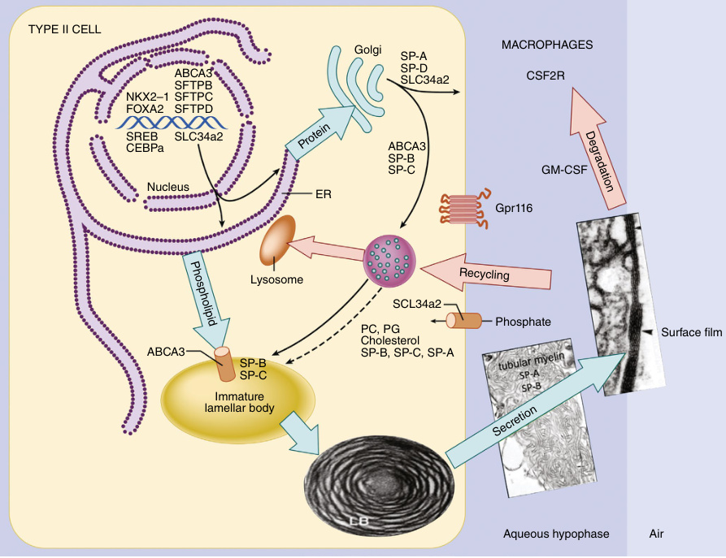

# Chapter 26: Pulmonary Alveolar Proteinosis — Board-Style Self-Assessment MCQs
**Section IV: Cardiopulmonary Disorders** | [📖 Read Wiki Chapter](../chapters/026_Pulmonary_Alveolar_Proteinosis.md) | [🃏 Chapter Flashcards](../flashcards/026_flashcards.md) | [🏠 Course Master Index](../../index.md)

Total questions: **14** *(Click "Show Answer & Rationale" beneath each question)*

### Question 1 (Clinical Vignette & Syndrome Diagnosis)
A pediatric patient is evaluated in the medical genetics clinic with the following clinical and molecular profile: SP-B Deficiency SMDP1: the causative gene — the causative gene Deficiency SMDP3: the causative gene — SP-C Dysfunction SMDP2: the causative gene — the causative gene–1 — Hereditary PAP SMDP4: the causative gene — Hereditary PAP SMDP5: the causative g. Which of the following rare disorders is the most likely diagnosis?

- **A.** Autosomal dominant mental retardation-34 (MRD34)
- **B.** Gene
- **C.** GEFS+3
- **D.** TRIF deficiency

<b>Show Answer & Rationale</b>

**Correct Answer: B** — Gene

**Rationale:** **Gene** caused by pathogenic variants in **`SFTPB, ABCA3, SFTPC, NKX2, CSF2RA, CSF2RB`** presents with: SP-B Deficiency SMDP1: SFTPB — ABCA3 Deficiency SMDP3: ABCA3 — SP-C Dysfunction SMDP2: SFTPC — NKX2–1 — Hereditary PAP SMDP4: CSF2RA — Hereditary PAP SMDP5: CSF2RB.

**Why Other Options Are Incorrect:** **Autosomal dominant mental retardation-34 (MRD34)** is incorrect (associated with MRD34, COL4A3BP, COL4 — Collagen Type: COL4 — Genetic Alteration: MRD34 (#616351) is caused by heterozygous variant in COL4A3BP(*60467). **GEFS+3** is incorrect (associated with GABRG2 — Inheritance: AD — Cytogenetic Location: 5q34 — Phenotype MIM no. (#): 607681 — De novo GABRG2 mutations associ). **TRIF deficiency** is incorrect (associated with TICAM1 — Inheritance: AD AR — Affected Function: TRIF-dependent IFN-α,β, and γ response — These include autosomal-reces).

### Question 2 (Clinical Vignette & Syndrome Diagnosis)
A pediatric patient is evaluated in the medical genetics clinic with the following clinical and molecular profile: SP-B Deficiency SMDP1: the causative gene hyperplasia Mesenchymal thickening Proteinaceous material and macrophages in distal air spaces — ABCA3 Deficiency SMDP3: the causative gene hyperplasia Mesenchymal thickening Proteinaceous material and macrop. Which of the following rare disorders is the most likely diagnosis?

- **A.** Interleukin-10 and interleukin- 10-receptor defects
- **B.** Loeys-Dietz syndrome
- **C.** Ectodermal dysplasia with or without hypohidrosis, not yet OMIM-listed
- **D.** Pathology features

<b>Show Answer & Rationale</b>

**Correct Answer: D** — Pathology features

**Rationale:** **Pathology features** caused by pathogenic variants in **`AEC2`** presents with: SP-B Deficiency SMDP1: AEC2 hyperplasia Mesenchymal thickening Proteinaceous material and macrophages in distal air spaces — ABCA3 Deficiency SMDP3: AEC2 hyperplasia Mesenchymal thickening Proteinaceous material and macrophages in distal air spaces — SP-C Dysfunction SMDP2: AEC2 hyperplasia Mesenchymal thickening Proteinaceous material an.

**Why Other Options Are Incorrect:** **Interleukin-10 and interleukin- 10-receptor defects** is incorrect (associated with STAT3, IL10RA, IL10RB — Early onset enterocolitis with IBD-like disease and perianal abscess and fistulas. — Molecular Defect: Abnorma). **Loeys-Dietz syndrome** is incorrect (associated with TGFBR1, TGFBR2, SMAD3, TGFB2, TGFB3, SMAD2 — TGFBR1, TGFBR2,* SMAD3, TGFB2, TGFB3, SMAD2 — Clinical Features: TAA, branch vessel aneurysms, AD, arterial to). **Ectodermal dysplasia with or without hypohidrosis, not yet OMIM-listed** is incorrect (associated with LEF1 — i Hypodontia:  — i Hair Abnormalities:  — Nail Feature:  — ).

### Question 3 (Clinical Vignette & Syndrome Diagnosis)
A pediatric patient is evaluated in the medical genetics clinic with the following clinical and molecular profile: SP-B Deficiency SMDP1: Loss-of-function Impaired processing of proSP-C Abnormal lamellar bodies — ABCA3 Deficiency SMDP3: Loss-of-function Surfactant deficiency the causative gene injury Abnormal lamellar bodies — SP-C Dysfunction SMDP2: Toxic gain-o. Which of the following rare disorders is the most likely diagnosis?

- **A.** Decaprenyl-diphosphate synthase subunit 2
- **B.** GM2 gangliosidosis
- **C.** PTEN hamartoma tumor syndrome
- **D.** Pathogenesis

<b>Show Answer & Rationale</b>

**Correct Answer: D** — Pathogenesis

**Rationale:** **Pathogenesis** caused by pathogenic variants in **`AEC2`** presents with: SP-B Deficiency SMDP1: Loss-of-function Impaired processing of proSP-C Abnormal lamellar bodies — ABCA3 Deficiency SMDP3: Loss-of-function Surfactant deficiency AEC2 injury Abnormal lamellar bodies — SP-C Dysfunction SMDP2: Toxic gain-of-function Dominant negative ER stress and activation of UPR Impaired autophagy — Haploinsufficiency Alt.

**Why Other Options Are Incorrect:** **Decaprenyl-diphosphate synthase subunit 2** is incorrect (associated with PDSS2 — Inheritance: AR — Locus: 6q21 — Phenotypes: Leigh syndrome, CoQ10 deficiency, FSGS — Defects of five nuclear g). **GM2 gangliosidosis** is incorrect (associated with GM2 — Symptoms: Psychiatric, cognitive impairment, macula — Biological Test: Hexoaminidases). **PTEN hamartoma tumor syndrome** is incorrect (associated with PTEN — Inheritance: AD — Polyposis (ganglioneuromas, hamartomas, adenomas), thyroid cancer (epithelial/follicular), m).

### Question 4 (Molecular & Genomic Etiology)
A child is diagnosed with **Gene** after presenting with SP-B Deficiency SMDP1: the causative gene — the causative gene Deficiency SMDP3: the causative gene — SP-C Dysfunction SMDP2: the causative gene — the causative gene–1 — Hereditary PAP SMDP4: the causative gene. Pathogenic variants in which of the following genes are the primary molecular etiology of this disorder?

- **A.** SMN1
- **B.** PGM3
- **C.** SFTPB
- **D.** DLK1

<b>Show Answer & Rationale</b>

**Correct Answer: C** — SFTPB

**Rationale:** Pathogenic variants in **`SFTPB`** (Genetic) cause **Gene**, characterized by SP-B Deficiency SMDP1: SFTPB — ABCA3 Deficiency SMDP3: ABCA3 — SP-C Dysfunction SMDP2: SFTPC — NKX2–1 — Hereditary PAP SMDP4: CSF2RA — Hereditary PAP SMDP5: CSF2RB.

**Why Other Options Are Incorrect:** **PGM3** is incorrect (associated with NOS 13-0170). **DLK1** is incorrect (associated with Kagami–Ogata syndrome).

### Question 5 (Molecular & Genomic Etiology)
A child is diagnosed with **Pathology features** after presenting with SP-B Deficiency SMDP1: the causative gene hyperplasia Mesenchymal thickening Proteinaceous material and macrophages in distal air spaces — ABCA3 Deficiency SMDP3: the causative gene hyperplasia Mesenchymal thic. Pathogenic variants in which of the following genes are the primary molecular etiology of this disorder?

- **A.** PLA2G6
- **B.** AEC2
- **C.** BLNK
- **D.** TP63

<b>Show Answer & Rationale</b>

**Correct Answer: B** — AEC2

**Rationale:** Pathogenic variants in **`AEC2`** (Genetic) cause **Pathology features**, characterized by SP-B Deficiency SMDP1: AEC2 hyperplasia Mesenchymal thickening Proteinaceous material and macrophages in distal air spaces — ABCA3 Deficiency SMDP3: AEC2 hyperplasia Mesenchymal thickening Proteinaceous material and macrophages in distal air spaces — SP-C Dysfunction SMDP2: AEC2 hyperplasia Mesenchymal thickening Proteinaceous material an.

**Why Other Options Are Incorrect:** **PLA2G6** is incorrect (associated with PLA2G6-associated neurodegeneration (PLAN)). **BLNK** is incorrect (associated with Agammaglobulinemia X-linked or AR). **TP63** is incorrect (associated with Acro–dermato–ungual–lacrimal–tooth syndrome (ADULT)).

### Question 6 (Molecular & Genomic Etiology)
A child is diagnosed with **OAS1** after presenting with the causative gene — the causative gene — FARSA — FARSB — the causative gene — A well-described association with PAP includes pathogenic variants in the causative gene .. Pathogenic variants in which of the following genes are the primary molecular etiology of this disorder?

- **A.** GNAS
- **B.** NF1
- **C.** TH
- **D.** SLC7A7

<b>Show Answer & Rationale</b>

**Correct Answer: D** — SLC7A7

**Rationale:** Pathogenic variants in **`SLC7A7`** (Genetic) cause **OAS1**, characterized by SLC7A7 — MARS1 — FARSA — FARSB — GATA2 — A well-described association with PAP includes pathogenic variants in GATA2 ..

**Why Other Options Are Incorrect:** **GNAS** is incorrect (associated with Pseudohypoparathyroidism1A (PHP1A)/PHP1C). **NF1** is incorrect (associated with NOS 30-0090). **TH** is incorrect (associated with Complex and).

### Question 7 (Molecular & Genomic Etiology)
A child is diagnosed with **Interferon-induced hyperinflammatory response of macrophages and B cells Macrophage dysfunction** after presenting with Abnormal arginine transport Alveolar macrophage dysfunction — Abnormal ligation of methionine to transfer RNA Abnormal protein biosynthesis — Unknown, likely related to tissue specific impaired protein synthesi. Pathogenic variants in which of the following genes are the primary molecular etiology of this disorder?

- **A.** GATA2
- **B.** ADA2
- **C.** GJB1
- **D.** CTLA4

<b>Show Answer & Rationale</b>

**Correct Answer: A** — GATA2

**Rationale:** Pathogenic variants in **`GATA2`** (Genetic) cause **Interferon-induced hyperinflammatory response of macrophages and B cells Macrophage dysfunction**, characterized by Abnormal arginine transport Alveolar macrophage dysfunction — Abnormal ligation of methionine to transfer RNA Abnormal protein biosynthesis — Unknown, likely related to tissue specific impaired protein synthesis — Unknown, likely related to tissue specific impaired protein synthesis — GATA2 regulates the phagocytosis of alveolar macrophag.

**Why Other Options Are Incorrect:** **GJB1** is incorrect (associated with Xq12q13.3 duplication syndrome). **CTLA4** is incorrect (associated with CTLA4 deficiency (CTLA4)).

### Question 8 (Molecular Pathogenesis)
In a patient evaluated for **Primary PAP—Autoimmune**, which causative gene accurately completes the following clinical-molecular relationship?
"SPB and SP-C are trafficked from the endoplasmic reticulum (ER) to lamellar bodies via the Golgi complex and multivesicular body (MVB); in contrast, surfactant phospholipids are likely directly transported from the ER to specific lipid importers ([GENE]) in the lamellar body–limiting membrane."

- **A.** MVK
- **B.** DICER1
- **C.** GJB1
- **D.** ABCA3

<b>Show Answer & Rationale</b>

**Correct Answer: D** — ABCA3

**Rationale:** **`ABCA3`** — SPB and SP-C are trafficked from the endoplasmic reticulum (ER) to lamellar bodies via the Golgi complex and multivesicular body (MVB); in contrast, surfactant phospholipids are likely directly transported from the ER to specific lipid importers (ABCA3) in the lamellar body–limiting membrane.

**Why Other Options Are Incorrect:** **MVK** is incorrect (associated with Mevalonate kinase deficiency(MVK)). **DICER1** is incorrect (associated with DICER1 syndrome). **GJB1** is incorrect (associated with Xq12q13.3 duplication syndrome).

### Question 9 (Molecular Pathogenesis)
In a patient evaluated for **Primary PAP—Autoimmune**, which causative gene accurately completes the following clinical-molecular relationship?
"[GENE]-1, FOXA2, SREBP, and CEBPα are transcription factors regulating surfactant protein and lipid synthesis."

- **A.** SCN2A
- **B.** NEUROG3
- **C.** TJP2
- **D.** NKX2

<b>Show Answer & Rationale</b>

**Correct Answer: D** — NKX2

**Rationale:** **`NKX2`** — NKX2-1, FOXA2, SREBP, and CEBPα are transcription factors regulating surfactant protein and lipid synthesis.

**Why Other Options Are Incorrect:** **SCN2A** is incorrect (associated with Complex). **NEUROG3** is incorrect (associated with Enteric anendocrinosis). **TJP2** is incorrect (associated with TJP2 deficiency).

### Question 10 (Visual & Diagnostic Imaging Vignette)

A pediatric patient undergoes diagnostic evaluation for **Pulmonary Alveolar Proteinosis**, yielding the clinical, neuroimaging, or molecular finding shown below. Which of the following best characterizes the illustrated disorder or mechanism?

- **A.** Algorithm for the differential diagnosis of PAP. The presence of pulmonary alveolar proteinosis (PAP) is suspected on the basis of a compatible history, typical radiological findings, and br
- **B.** Surfactant dysfunction related to ABCA3 pathogenic variant in a 4-week-old term female. (A) Frontal chest radiograph shows diffuse bilateral hazy pulmonary opacities in a pattern resembling
- **C.** Biosynthesis of surfactant involves distinct pathways for surfactant proteins and lipids. SPB and SP-C are trafficked from the endoplasmic reticulum (ER) to lamellar bodies via the Golgi complex
- **D.** PAP pathogenesis. In normal surfactant homeostasis (bottom right), surfactant is synthesized by type II alveolar epithelial cells and secreted into the alveolar space to generate a thin laye

<b>Show Answer & Rationale</b>

**Correct Answer: C** — Biosynthesis of surfactant involves distinct pathways for surfactant proteins and lipids. SPB and SP-C are trafficked from the endoplasmic reticulum (ER) to lamellar bodies via the Golgi complex

**Rationale:** **Fig. 26.1**: Biosynthesis of surfactant involves distinct pathways for surfactant proteins and lipids. SPB and SP-C are trafficked from the endoplasmic reticulum (ER) to lamellar bodies via the Golgi complex and multivesicular body (MVB); in contrast, surfactant phospholipids are likely directly transported from the ER to specific lipid importers (ABCA3) in the lamellar body–limiting membrane. Surfactant proteins and lipids are assembled into bilayer membranes that are secreted into the alveolar airspace, where they form a surface film at the air–liquid interface. Cyclical expansion and compression of the bioactive film results in the incorporation and loss of lipids and proteins from the multilayered surface film. Surfactant components removed from the film are degraded in alveolar macrophages or are taken up by type II epithelial cells for recycling or degradation in the lysosome. The MVB plays a key part in the integration of pathways for surfactant synthesis, recycling, and degradation. NKX2-1, FOXA2, SREBP, and CEBPα are transcription factors regulating surfactant protein and lipid synthesis. SLC34a2 is a phosphate transporter. Gpr116 is a membrane receptor regulating surfactant secretion. ABCA3, ATP-binding cassette transporter A3; GM-CSF, granulocyte-macrophage colony-stimulating factor; PC, phosphatidylcholine; PG, phosphatidylglycerol; SP, surfactant proteins. (From Polin RA, Abman SH, Rowitch DH, Benits WE, eds. Fetal and Neonatal Physiology . 6th ed

### Question 11 (Diagnostic Criteria (Clinical Presentation))
During a multidisciplinary genetics evaluation for **Clinical Presentation**, which clinical entity or diagnostic phenomenon is defined by the following profile?
"more commonly described in older adolescents and adults; it has been reported in children as young as 3 years of age."

- **A.** Gene
- **B.** Beckwith-Wiedemann syndrome (BWS)
- **C.** primary hereditary PAP
- **D.** Primary autoimmune PAP

<b>Show Answer & Rationale</b>

**Correct Answer: D** — Primary autoimmune PAP

**Rationale:** Primary autoimmune PAP is more commonly described in older adolescents and adults; it has been reported in children as young as 3 years of age.

### Question 12 (Diagnostic Criteria (Clinical Presentation))
During a multidisciplinary genetics evaluation for **Clinical Presentation**, which clinical entity or diagnostic phenomenon is defined by the following profile?
"not well established, given its rarity."

- **A.** Pathogenesis
- **B.** Sotos syndrome
- **C.** Primary autoimmune PAP
- **D.** primary hereditary PAP

<b>Show Answer & Rationale</b>

**Correct Answer: D** — primary hereditary PAP

**Rationale:** primary hereditary PAP are not well established, given its rarity.

### Question 13 (Clinical & Pathophysiologic Mastery (Pulmonary Alveolar Proteinosis))
When counseling a family and planning diagnostic management for **Pulmonary Alveolar Proteinosis** (*Pulmonary Alveolar Proteinosis*), which of the following clinical-genetic principles is **ACCURATE**?

- **A.** The condition is a benign, self-limiting physiologic variant that requires neither longitudinal surveillance nor genetic counseling.
- **B.** Inheritance is exclusively holandric (Y-linked) with complete penetrance restricted to male offspring.
- **C.** Enzyme activity and protein expression remain completely normal across all affected tissues, excluding a monogenic etiology.
- **D.** Pulmonary alveolar proteinosis (PAP) is a rare disease characterized by abnormal accumulation of pulmonary surfactant within alveoli.

<b>Show Answer & Rationale</b>

**Correct Answer: D** — Pulmonary alveolar proteinosis (PAP) is a rare disease characterized by abnormal accumulation of pulmonary surfactant within alveoli.

**Rationale:** **Clinical & Molecular Principle (Pulmonary Alveolar Proteinosis):** Pulmonary alveolar proteinosis (PAP) is a rare disease characterized by abnormal accumulation of pulmonary surfactant within alveoli.

### Question 14 (Clinical & Pathophysiologic Mastery (PAP Classifications))
When counseling a family and planning diagnostic management for **PAP Classifications** (*Pulmonary Alveolar Proteinosis*), which of the following clinical-genetic principles is **ACCURATE**?

- **A.** Enzyme activity and protein expression remain completely normal across all affected tissues, excluding a monogenic etiology.
- **B.** First-line diagnostic confirmation relies solely on conventional Giemsa-banded karyotyping rather than sequencing or targeted assays.
- **C.** Primary PAP is characterized by disruption or dysfunction of GM-CSF signaling pathway, while secondary PAP occurs when pulmonary disease develops in the setting of underlying medical conditions or exposure
- **D.** Inheritance is exclusively holandric (Y-linked) with complete penetrance restricted to male offspring.

<b>Show Answer & Rationale</b>

**Correct Answer: C** — Primary PAP is characterized by disruption or dysfunction of GM-CSF signaling pathway, while secondary PAP occurs when pulmonary disease develops in the setting of underlying medical conditions or exposure

**Rationale:** **Clinical & Molecular Principle (PAP Classifications):** Primary PAP is characterized by disruption or dysfunction of GM-CSF signaling pathway, while secondary PAP occurs when pulmonary disease develops in the setting of underlying medical conditions or exposures (Tables 26.1 and 26.2).

