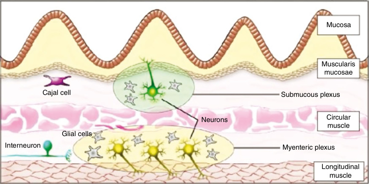

# Chapter 32: Pediatric Intestinal Pseudo-Obstruction — Board-Style Self-Assessment MCQs
**Section V: Gastrointestinal and Hepatic Disorders** | [📖 Read Wiki Chapter](../chapters/032_Pediatric_Intestinal_Pseudo_Obstruction.md) | [🃏 Chapter Flashcards](../flashcards/032_flashcards.md) | [🏠 Course Master Index](../../index.md)

Total questions: **14** *(Click "Show Answer & Rationale" beneath each question)*

### Question 1 (Clinical Vignette & Syndrome Diagnosis)
A pediatric patient is evaluated in the medical genetics clinic with the following clinical and molecular profile: Inheritance: Autosomal dominant — Phenotype: Peripheral neuropathy with hypomyelination, sensorineural deafness and pseudo-obstruction — Age of Onset: Neonatal period. Which of the following rare disorders is the most likely diagnosis?

- **A.** Type IV Waardenburg syndrome
- **B.** Megacystis-microcolonintestinal hypoperistalsis syndrome
- **C.** Multiple endocrine neoplasia type 2B
- **D.** Chronic idiopathic intestinal pseudo-obstruction (CIIPX)

<b>Show Answer & Rationale</b>

**Correct Answer: A** — Type IV Waardenburg syndrome

**Rationale:** **Type IV Waardenburg syndrome** caused by pathogenic variants in **`SOX10`** presents with: Inheritance: Autosomal dominant — Phenotype: Peripheral neuropathy with hypomyelination, sensorineural deafness and pseudo-obstruction — Age of Onset: Neonatal period.

**Why Other Options Are Incorrect:** **Megacystis-microcolonintestinal hypoperistalsis syndrome** is incorrect (associated with MYH11 — MYH11(myosin heavy chain 11) — Inheritance: Autosomal recessive — Phenotype: Abnormal MYH11 in smooth muscle m). **Multiple endocrine neoplasia type 2B** is incorrect (associated with RET — RET protoonco gene (receptor tyrosine kinase) — Inheritance: Autosomal dominant — Phenotype: Gain-of-function ). **Chronic idiopathic intestinal pseudo-obstruction (CIIPX)** is incorrect (associated with FLNA — FLNA(filamin A) — Inheritance: X-linked recessive — Phenotype: Abnormal filamin A leads to cytoskeletal abnorm).

### Question 2 (Clinical Vignette & Syndrome Diagnosis)
A pediatric patient is evaluated in the medical genetics clinic with the following clinical and molecular profile: the causative gene(filamin A) — Inheritance: X-linked recessive — Phenotype: Abnormal filamin A leads to cytoskeletal abnormalities and potentially disrupts enteric-neuron structure and function. Seizures and progressive abdominal distension and obst. Which of the following rare disorders is the most likely diagnosis?

- **A.** Chronic idiopathic intestinal pseudo-obstruction (CIIPX)
- **B.** Type IV Waardenburg syndrome
- **C.** Malrotation hypoperistalsis, atonic bladder
- **D.** Mungan syndrome

<b>Show Answer & Rationale</b>

**Correct Answer: A** — Chronic idiopathic intestinal pseudo-obstruction (CIIPX)

**Rationale:** **Chronic idiopathic intestinal pseudo-obstruction (CIIPX)** caused by pathogenic variants in **`FLNA`** presents with: FLNA(filamin A) — Inheritance: X-linked recessive — Phenotype: Abnormal filamin A leads to cytoskeletal abnormalities and potentially disrupts enteric-neuron structure and function. Seizures and progressive abdominal distension and obstruction — Age of Onset: Neonatal period.

**Why Other Options Are Incorrect:** **Type IV Waardenburg syndrome** is incorrect (associated with SOX10 — Inheritance: Autosomal dominant — Phenotype: Peripheral neuropathy with hypomyelination, sensorineural deafnes). **Malrotation hypoperistalsis, atonic bladder** is incorrect (associated with ACTA2 — ACTA2 (multisystem smooth muscle dysfunction syndrome) — Inheritance: Autosomal dominant — Phenotype: Smooth m). **Mungan syndrome** is incorrect (associated with RAD21 — Inheritance: Autosomal recessive — Phenotype: Pseudo-obstruction, megaduodenum, long segment Barrett esophagus).

### Question 3 (Clinical Vignette & Syndrome Diagnosis)
A pediatric patient is evaluated in the medical genetics clinic with the following clinical and molecular profile: the causative gene(myosin heavy chain 11) — Inheritance: Autosomal recessive — Phenotype: Abnormal the causative gene in smooth muscle myosin leads to impaired contractility — Age of Onset: Neonatal to third decade in life. Which of the following rare disorders is the most likely diagnosis?

- **A.** Malrotation hypoperistalsis, atonic bladder
- **B.** Megacystis-microcolonintestinal hypoperistalsis syndrome
- **C.** Type IV Waardenburg syndrome
- **D.** Multiple endocrine neoplasia type 2B

<b>Show Answer & Rationale</b>

**Correct Answer: B** — Megacystis-microcolonintestinal hypoperistalsis syndrome

**Rationale:** **Megacystis-microcolonintestinal hypoperistalsis syndrome** caused by pathogenic variants in **`MYH11`** presents with: MYH11(myosin heavy chain 11) — Inheritance: Autosomal recessive — Phenotype: Abnormal MYH11 in smooth muscle myosin leads to impaired contractility — Age of Onset: Neonatal to third decade in life.

**Why Other Options Are Incorrect:** **Malrotation hypoperistalsis, atonic bladder** is incorrect (associated with ACTA2 — ACTA2 (multisystem smooth muscle dysfunction syndrome) — Inheritance: Autosomal dominant — Phenotype: Smooth m). **Type IV Waardenburg syndrome** is incorrect (associated with SOX10 — Inheritance: Autosomal dominant — Phenotype: Peripheral neuropathy with hypomyelination, sensorineural deafnes). **Multiple endocrine neoplasia type 2B** is incorrect (associated with RET — RET protoonco gene (receptor tyrosine kinase) — Inheritance: Autosomal dominant — Phenotype: Gain-of-function ).

### Question 4 (Clinical Vignette & Syndrome Diagnosis)
A pediatric patient is evaluated in the medical genetics clinic with the following clinical and molecular profile: the causative gene (leiomodin 1) — Inheritance: Sporadic — Phenotype: Abnormal the causative gene leads to impaired intestinal smooth muscle contractility — Age of Onset: Neonatal to third decade in life. Which of the following rare disorders is the most likely diagnosis?

- **A.** Megacystis-microcolonintestinal hypoperistalsis syndrome
- **B.** Type IV Waardenburg syndrome
- **C.** Mungan syndrome
- **D.** Malrotation hypoperistalsis, atonic bladder

<b>Show Answer & Rationale</b>

**Correct Answer: A** — Megacystis-microcolonintestinal hypoperistalsis syndrome

**Rationale:** **Megacystis-microcolonintestinal hypoperistalsis syndrome** caused by pathogenic variants in **`LMOD1`** presents with: LMOD1 (leiomodin 1) — Inheritance: Sporadic — Phenotype: Abnormal LMOD1 leads to impaired intestinal smooth muscle contractility — Age of Onset: Neonatal to third decade in life.

**Why Other Options Are Incorrect:** **Type IV Waardenburg syndrome** is incorrect (associated with SOX10 — Inheritance: Autosomal dominant — Phenotype: Peripheral neuropathy with hypomyelination, sensorineural deafnes). **Mungan syndrome** is incorrect (associated with RAD21 — Inheritance: Autosomal recessive — Phenotype: Pseudo-obstruction, megaduodenum, long segment Barrett esophagus). **Malrotation hypoperistalsis, atonic bladder** is incorrect (associated with ACTA2 — ACTA2 (multisystem smooth muscle dysfunction syndrome) — Inheritance: Autosomal dominant — Phenotype: Smooth m).

### Question 5 (Clinical Vignette & Syndrome Diagnosis)
A pediatric patient is evaluated in the medical genetics clinic with the following clinical and molecular profile: the causative gene(myosin regulatory light chain 9) — Inheritance: Autosomal recessive — Phenotype: Abnormal the causative gene leads to impaired intestinal smooth muscle contractility — Age of Onset: Neonatal to third decade in life. Which of the following rare disorders is the most likely diagnosis?

- **A.** Congenital myopathy and gastrointestinal pseudo-obstruction
- **B.** Malrotation hypoperistalsis, atonic bladder
- **C.** Megacystis-microcolonintestinal hypoperistalsis syndrome
- **D.** Type IV Waardenburg syndrome

<b>Show Answer & Rationale</b>

**Correct Answer: C** — Megacystis-microcolonintestinal hypoperistalsis syndrome

**Rationale:** **Megacystis-microcolonintestinal hypoperistalsis syndrome** caused by pathogenic variants in **`MYL9`** presents with: MYL9(myosin regulatory light chain 9) — Inheritance: Autosomal recessive — Phenotype: Abnormal MYL9 leads to impaired intestinal smooth muscle contractility — Age of Onset: Neonatal to third decade in life.

**Why Other Options Are Incorrect:** **Congenital myopathy and gastrointestinal pseudo-obstruction** is incorrect (associated with POLG1 — POLG1(DNApolymerase gamma) — Inheritance: Autosomal recessive — Phenotype: Associated with mitochondrial deple). **Malrotation hypoperistalsis, atonic bladder** is incorrect (associated with ACTA2 — ACTA2 (multisystem smooth muscle dysfunction syndrome) — Inheritance: Autosomal dominant — Phenotype: Smooth m). **Type IV Waardenburg syndrome** is incorrect (associated with SOX10 — Inheritance: Autosomal dominant — Phenotype: Peripheral neuropathy with hypomyelination, sensorineural deafnes).

### Question 6 (Molecular & Genomic Etiology)
A child is diagnosed with **Type IV Waardenburg syndrome** after presenting with Inheritance: Autosomal dominant — Phenotype: Peripheral neuropathy with hypomyelination, sensorineural deafness and pseudo-obstruction — Age of Onset: Neonatal period. Pathogenic variants in which of the following genes are the primary molecular etiology of this disorder?

- **A.** GRIN2B
- **B.** PSEN1
- **C.** LMNA
- **D.** SOX10

<b>Show Answer & Rationale</b>

**Correct Answer: D** — SOX10

**Rationale:** Pathogenic variants in **`SOX10`** (AD) cause **Type IV Waardenburg syndrome**, characterized by Inheritance: Autosomal dominant — Phenotype: Peripheral neuropathy with hypomyelination, sensorineural deafness and pseudo-obstruction — Age of Onset: Neonatal period.

**Why Other Options Are Incorrect:** **GRIN2B** is incorrect (associated with Autosomal dominant intellectual disability 6). **PSEN1** is incorrect (associated with Early-onset dystonia-parkinsonism). **LMNA** is incorrect (associated with Hutchinson-Gilford syndrome).

### Question 7 (Molecular & Genomic Etiology)
A child is diagnosed with **Congenital myopathy and gastrointestinal pseudo-obstruction** after presenting with the causative gene(DNApolymerase gamma) — Inheritance: Autosomal recessive — Phenotype: Associated with mitochondrial depletion and deletions. Severe hypotonia and generalized muscle weakness, severe abdominal . Pathogenic variants in which of the following genes are the primary molecular etiology of this disorder?

- **A.** POLG1
- **B.** BSND
- **C.** DYNC2H1
- **D.** CYBA

<b>Show Answer & Rationale</b>

**Correct Answer: A** — POLG1

**Rationale:** Pathogenic variants in **`POLG1`** (AR) cause **Congenital myopathy and gastrointestinal pseudo-obstruction**, characterized by POLG1(DNApolymerase gamma) — Inheritance: Autosomal recessive — Phenotype: Associated with mitochondrial depletion and deletions. Severe hypotonia and generalized muscle weakness, severe abdominal distension and hypoactive bowel — Age of Onset: Neonatal period.

**Why Other Options Are Incorrect:** **BSND** is incorrect (associated with Autosomal recessive). **DYNC2H1** is incorrect (associated with Short rib–polydactyly syndromes). **CYBA** is incorrect (associated with Phagocytic defects).

### Question 8 (Molecular & Genomic Etiology)
A child is diagnosed with **Chronic idiopathic intestinal pseudo-obstruction (CIIPX)** after presenting with the causative gene(filamin A) — Inheritance: X-linked recessive — Phenotype: Abnormal filamin A leads to cytoskeletal abnormalities and potentially disrupts enteric-neuron structure and function. Seizures and p. Pathogenic variants in which of the following genes are the primary molecular etiology of this disorder?

- **A.** FLNA
- **B.** SLC4A1
- **C.** PKLR
- **D.** SNRPN

<b>Show Answer & Rationale</b>

**Correct Answer: A** — FLNA

**Rationale:** Pathogenic variants in **`FLNA`** (XLR) cause **Chronic idiopathic intestinal pseudo-obstruction (CIIPX)**, characterized by FLNA(filamin A) — Inheritance: X-linked recessive — Phenotype: Abnormal filamin A leads to cytoskeletal abnormalities and potentially disrupts enteric-neuron structure and function. Seizures and progressive abdominal distension and obstruction — Age of Onset: Neonatal period.

**Why Other Options Are Incorrect:** **SLC4A1** is incorrect (associated with HS-3). **SNRPN** is incorrect (associated with Prader–Willi syndrome).

### Question 9 (Molecular & Genomic Etiology)
A child is diagnosed with **Hydrocephalus with stenosis of the aqueduct of Sylvius (HSAS) and congenital idiopathic intestinal pseudo-obst** after presenting with the causative gene(L1 cell adhesion molecule) — Inheritance: Autosomal recessive — Phenotype: Defect in the differentiation of the interstitial cells of Cajal leading to progressive distension and intermittent . Pathogenic variants in which of the following genes are the primary molecular etiology of this disorder?

- **A.** NPHS2
- **B.** OFD1
- **C.** L1CAM
- **D.** FANCA

<b>Show Answer & Rationale</b>

**Correct Answer: C** — L1CAM

**Rationale:** Pathogenic variants in **`L1CAM`** (AR) cause **Hydrocephalus with stenosis of the aqueduct of Sylvius (HSAS) and congenital idiopathic intestinal pseudo-obst**, characterized by L1CAM(L1 cell adhesion molecule) — Inheritance: Autosomal recessive — Phenotype: Defect in the differentiation of the interstitial cells of Cajal leading to progressive distension and intermittent episodes of obstruction — Age of Onset: Neonatal period.

**Why Other Options Are Incorrect:** **NPHS2** is incorrect (associated with NPHS2). **OFD1** is incorrect (associated with Orofaciodigital syndrome type I). **FANCA** is incorrect (associated with Fanconi anemia).

### Question 10 (Visual & Diagnostic Imaging Vignette)

A pediatric patient undergoes diagnostic evaluation for **Pediatric Intestinal Pseudo-Obstruction**, yielding the clinical, neuroimaging, or molecular finding shown below. Which of the following best characterizes the illustrated disorder or mechanism?

- **A.** A normal fasting high-resolution antroduodenal manometry in a child. The cold colors (blue) depict low pressure, and hot colors (red) depict high pressure. In the top left-hand corner red st
- **B.** However, a few studies have reported a familial pattern of inheritance including autosomal dominant, autosomal recessive, and X-linked recessive forms of both neuropathies and myopathies.
- **C.** Schematic representation of the enteric nervous system and connections between the neurons in the submucosal and myenteric plexus. The submucosal plexus is mainly responsible for regulating bowel
- **D.** Synoptic view of the chronic intestinal pseudo-obstruction (CIPO) spectrum. (A and B) The most severe pediatric cases with antenatal (in utero) evidence of multivisceral dilation, often gut

<b>Show Answer & Rationale</b>

**Correct Answer: C** — Schematic representation of the enteric nervous system and connections between the neurons in the submucosal and myenteric plexus. The submucosal plexus is mainly responsible for regulating bowel

**Rationale:** **Fig. 32.1**: Schematic representation of the enteric nervous system and connections between the neurons in the submucosal and myenteric plexus. The submucosal plexus is mainly responsible for regulating bowel secretions and blood supply. The myenteric plexus, which is located between the circular and longitudinal smooth muscle layers, regulates the bowel motor function. The interstitial cells of Cajal act as the pacemaker cells for the intestinal myocytes. The gastrointestinal tract also receives innervation from the autonomic nervous system (not shown).

### Question 11 (Diagnostic Criteria (Etiology))
During a multidisciplinary genetics evaluation for **Etiology**, which clinical entity or diagnostic phenomenon is defined by the following profile?
"can also present with features of intestinal pseudo-obstruction."

- **A.** Congenital myopathy and gastrointestinal pseudo-obstruction
- **B.** Prader-Willi syndrome (PWS)
- **C.** Chronic atrial and intestinal dysrhythmia (CAID)
- **D.** Mitochondrial myopathies

<b>Show Answer & Rationale</b>

**Correct Answer: D** — Mitochondrial myopathies

**Rationale:** Mitochondrial myopathies can also present with features of intestinal pseudo-obstruction.

### Question 12 (Diagnostic Criteria (Primary Pediatric Intestinal Pseudo-Obstruction With Identified Genetic Pathogenic Variants—cont’d))
During a multidisciplinary genetics evaluation for **Primary Pediatric Intestinal Pseudo-Obstruction With Identified Genetic Pathogenic Variants—cont’d**, which clinical entity or diagnostic phenomenon is defined by the following profile?
"disorders associated with defects of neural crest cell development."

- **A.** Neurocristopathies
- **B.** Sotos syndrome
- **C.** Mungan syndrome
- **D.** Muscularis propria malformations

<b>Show Answer & Rationale</b>

**Correct Answer: A** — Neurocristopathies

**Rationale:** Neurocristopathies are disorders associated with defects of neural crest cell development.

### Question 13 (Diagnostic Criteria (Primary Pediatric Intestinal Pseudo-Obstruction With Identified Genetic Pathogenic Variants—cont’d))
During a multidisciplinary genetics evaluation for **Primary Pediatric Intestinal Pseudo-Obstruction With Identified Genetic Pathogenic Variants—cont’d**, which clinical entity or diagnostic phenomenon is defined by the following profile?
"form of neurocristopathy characterized by absence of ganglion cells in the submucosal and myenteric plexuses over a variable length of the distal part of the gut leading to signs of intestinal obstruction."

- **A.** Megacystis-microcolonintestinal hypoperistalsis syndrome
- **B.** Neuronal intranuclear inclusion disease
- **C.** Hirschsprung disease (HD)
- **D.** Diffuse intestinal ganglioneuromatosis

<b>Show Answer & Rationale</b>

**Correct Answer: C** — Hirschsprung disease (HD)

**Rationale:** Hirschsprung disease (HD) is a form of neurocristopathy characterized by absence of ganglion cells in the submucosal and myenteric plexuses over a variable length of the distal part of the gut leading to signs of intestinal obstruction.

### Question 14 (Clinical & Pathophysiologic Mastery (Etiology))
When counseling a family and planning diagnostic management for **Etiology** (*Pediatric Intestinal Pseudo-Obstruction*), which of the following clinical-genetic principles is **ACCURATE**?

- **A.** First-line diagnostic confirmation relies solely on conventional Giemsa-banded karyotyping rather than sequencing or targeted assays.
- **B.** However, a few studies have reported a familial pattern of inheritance including autosomal dominant, autosomal recessive, and X-linked recessive forms of both neuropathies and myopathies.
- **C.** Pathogenesis is driven exclusively by maternal mitochondrial DNA deletions without nuclear gene involvement.
- **D.** The condition is a benign, self-limiting physiologic variant that requires neither longitudinal surveillance nor genetic counseling.

<b>Show Answer & Rationale</b>

**Correct Answer: B** — However, a few studies have reported a familial pattern of inheritance including autosomal dominant, autosomal recessive, and X-linked recessive forms of both neuropathies and myopathies.

**Rationale:** **Clinical & Molecular Principle (Etiology):** However, a few studies have reported a familial pattern of inheritance including autosomal dominant, autosomal recessive, and X-linked recessive forms of both neuropathies and myopathies.

