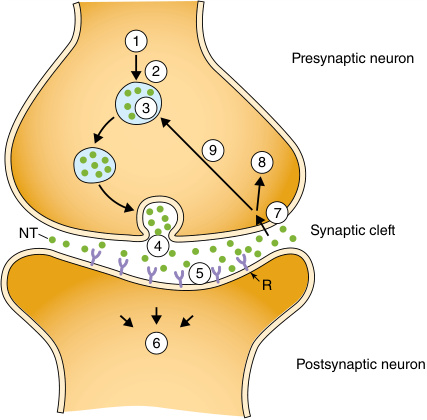

# Chapter 44: Genetic Disorders of Neurotransmitters — Board-Style Self-Assessment MCQs
**Section VIII: Metabolic Disorders** | [📖 Read Wiki Chapter](../chapters/044_Genetic_Disorders_of_Neurotransmitters.md) | [🃏 Chapter Flashcards](../flashcards/044_flashcards.md) | [🏠 Course Master Index](../../index.md)

Total questions: **14** *(Click "Show Answer & Rationale" beneath each question)*

### Question 1 (Clinical Vignette & Syndrome Diagnosis)
A pediatric patient is evaluated in the medical genetics clinic with the following clinical and molecular profile: Without hyperphenylalaninemia 1. Autosomal dominant GTP cyclohydrolase deficiency (Dopa-responsive dystonia, Segawa disease, AD-GTPCH) 2. Sepiapterin reductase deficiency (SR) — Associated Genes: the causative gene the causative gene. Which of the following rare disorders is the most likely diagnosis?

- **A.** Disorders of Serine metabolism
- **B.** Monoamine synthesis defects
- **C.** BH4 deficiencies
- **D.** Disorders of Glycine metabolism

<b>Show Answer & Rationale</b>

**Correct Answer: C** — BH4 deficiencies

**Rationale:** **BH4 deficiencies** caused by pathogenic variants in **`BH4, GCH1, SPR`** presents with: Without hyperphenylalaninemia 1. Autosomal dominant GTP cyclohydrolase deficiency (Dopa-responsive dystonia, Segawa disease, AD-GTPCH) 2. Sepiapterin reductase deficiency (SR) — Associated Genes: GCH1 SPR.

**Why Other Options Are Incorrect:** **Disorders of Serine metabolism** is incorrect (associated with PSAT1 — 1. Serine biosynthetic enzyme defects (PGDH, PSAT, PSPH) — Associated Genes: PHGDH, PSAT1, PSPH). **Monoamine synthesis defects** is incorrect (associated with TH, DDC — 1. Aromatic L-amino acid decarboxylase deficiency (AADC) 2. Tyrosine hydroxylase deficiency (TH) — Associated ). **Disorders of Glycine metabolism** is incorrect (associated with LIPT2, BOLA3, GLRX5, IBA57, NFU1 — 1. Glycine encephalopathy or Nonketotic hyperglycinemia (NKH) 2. Lipoate deficiency (Glycine cleavage system c).

### Question 2 (Clinical Vignette & Syndrome Diagnosis)
A pediatric patient is evaluated in the medical genetics clinic with the following clinical and molecular profile: 1. Aromatic L-amino acid decarboxylase deficiency (AADC) 2. Tyrosine hydroxylase deficiency (the causative gene) — Associated Genes: the causative gene the causative gene. Which of the following rare disorders is the most likely diagnosis?

- **A.** Disorders of GABA metabolism
- **B.** DNAJC12 deficiency
- **C.** Monoamine synthesis defects
- **D.** Chaperone-associated defect

<b>Show Answer & Rationale</b>

**Correct Answer: C** — Monoamine synthesis defects

**Rationale:** **Monoamine synthesis defects** caused by pathogenic variants in **`TH, DDC`** presents with: 1. Aromatic L-amino acid decarboxylase deficiency (AADC) 2. Tyrosine hydroxylase deficiency (TH) — Associated Genes: DDC TH.

**Why Other Options Are Incorrect:** **Disorders of GABA metabolism** is incorrect (associated with ALDH5A1 — 1. GABA Transaminase deficiency 2. Succinic semialdehyde dehydrogenase deficiency (SSADH) — Associated Genes: ). **DNAJC12 deficiency** is incorrect (associated with DNAJC12 — DNAJC12 — g: Juvenile parkinsonism, dystonia, autism, intellectual disability, attention deficit hyperactivity). **Chaperone-associated defect** is incorrect (associated with DNAJC12 — 1. DNAJC12 deficiency — Associated Genes: DNAJC12 — DNAJC12 deficiency a very rare autosomal recessive conditi).

### Question 3 (Clinical Vignette & Syndrome Diagnosis)
A pediatric patient is evaluated in the medical genetics clinic with the following clinical and molecular profile: 1. Dopamine transporter deficiency (DAT) 2. Vesicular monoamine transporter 2 deficiency (the causative gene) — Associated Genes: the causative gene the causative gene. Which of the following rare disorders is the most likely diagnosis?

- **A.** Monoamine transport defects
- **B.** Disorders of GABA metabolism
- **C.** Disorders of Glycine metabolism
- **D.** AR-GCH1

<b>Show Answer & Rationale</b>

**Correct Answer: A** — Monoamine transport defects

**Rationale:** **Monoamine transport defects** caused by pathogenic variants in **`VMAT2, SLC6A3, SLC18A2`** presents with: 1. Dopamine transporter deficiency (DAT) 2. Vesicular monoamine transporter 2 deficiency (VMAT2) — Associated Genes: SLC6A3 SLC18A2.

**Why Other Options Are Incorrect:** **Disorders of GABA metabolism** is incorrect (associated with ALDH5A1 — 1. GABA Transaminase deficiency 2. Succinic semialdehyde dehydrogenase deficiency (SSADH) — Associated Genes: ). **Disorders of Glycine metabolism** is incorrect (associated with LIPT2, BOLA3, GLRX5, IBA57, NFU1 — 1. Glycine encephalopathy or Nonketotic hyperglycinemia (NKH) 2. Lipoate deficiency (Glycine cleavage system c). **AR-GCH1** is incorrect (associated with GCH1 — AR GCH1 — Clinical Features: Truncal hypotonia, parkinsonism, feeding/swallowing difficulties, dystonia, exces).

### Question 4 (Clinical Vignette & Syndrome Diagnosis)
A pediatric patient is evaluated in the medical genetics clinic with the following clinical and molecular profile: 1. the causative gene deficiency — Associated Genes: the causative gene — the causative gene deficiency a very rare autosomal recessive condition that causes elevation of Phe and low levels of dopamine and serotonin.. Which of the following rare disorders is the most likely diagnosis?

- **A.** AD-GCH1
- **B.** Chaperone-associated defect
- **C.** PCD deficiency
- **D.** AADC

<b>Show Answer & Rationale</b>

**Correct Answer: B** — Chaperone-associated defect

**Rationale:** **Chaperone-associated defect** caused by pathogenic variants in **`DNAJC12`** presents with: 1. DNAJC12 deficiency — Associated Genes: DNAJC12 — DNAJC12 deficiency a very rare autosomal recessive condition that causes elevation of Phe and low levels of dopamine and serotonin..

**Why Other Options Are Incorrect:** **AD-GCH1** is incorrect (associated with GCH1 — AD GCH1 — Clinical Features: Parkinsonism, dystonia, motor delay, diurnal fluctuation, truncal hypotonia, hype). **PCD deficiency** is incorrect (associated with PCBD1 — Clinical Features: No severe neurological symptoms and transient and benign hyperphenylalaninemia). **AADC** is incorrect (associated with DDC — DDC — g: Truncal hypotonia, developmental delay, intellectual disability, oculogyric crises, dystonia, dysarth).

### Question 5 (Clinical Vignette & Syndrome Diagnosis)
A pediatric patient is evaluated in the medical genetics clinic with the following clinical and molecular profile: 1. Glycine encephalopathy or Nonketotic hyperglycinemia (NKH) 2. Lipoate deficiency (Glycine cleavage system cofactor deficiency) — Associated Genes: AMT, GLDC, GCSH LIAS, the causative gene, the causative gene, the causative gene, the causative gene. Which of the following rare disorders is the most likely diagnosis?

- **A.** AADC
- **B.** Monoamine transport defects
- **C.** Disorders of GABA metabolism
- **D.** Disorders of Glycine metabolism

<b>Show Answer & Rationale</b>

**Correct Answer: D** — Disorders of Glycine metabolism

**Rationale:** **Disorders of Glycine metabolism** caused by pathogenic variants in **`LIPT2, BOLA3, GLRX5, IBA57, NFU1`** presents with: 1. Glycine encephalopathy or Nonketotic hyperglycinemia (NKH) 2. Lipoate deficiency (Glycine cleavage system cofactor deficiency) — Associated Genes: AMT, GLDC, GCSH LIAS, LIPT2, BOLA3, GLRX5, IBA57, NFU1.

**Why Other Options Are Incorrect:** **AADC** is incorrect (associated with DDC — DDC — g: Truncal hypotonia, developmental delay, intellectual disability, oculogyric crises, dystonia, dysarth). **Monoamine transport defects** is incorrect (associated with VMAT2, SLC6A3, SLC18A2 — 1. Dopamine transporter deficiency (DAT) 2. Vesicular monoamine transporter 2 deficiency (VMAT2) — Associated ). **Disorders of GABA metabolism** is incorrect (associated with ALDH5A1 — 1. GABA Transaminase deficiency 2. Succinic semialdehyde dehydrogenase deficiency (SSADH) — Associated Genes: ).

### Question 6 (Molecular & Genomic Etiology)
A child is diagnosed with **BH4 deficiencies** after presenting with Without hyperphenylalaninemia 1. Autosomal dominant GTP cyclohydrolase deficiency (Dopa-responsive dystonia, Segawa disease, AD-GTPCH) 2. Sepiapterin reductase deficiency (SR) — Associated Genes: the causative . Pathogenic variants in which of the following genes are the primary molecular etiology of this disorder?

- **A.** FLNA
- **B.** SOS1
- **C.** BH4
- **D.** RYR2

<b>Show Answer & Rationale</b>

**Correct Answer: C** — BH4

**Rationale:** Pathogenic variants in **`BH4`** (AD) cause **BH4 deficiencies**, characterized by Without hyperphenylalaninemia 1. Autosomal dominant GTP cyclohydrolase deficiency (Dopa-responsive dystonia, Segawa disease, AD-GTPCH) 2. Sepiapterin reductase deficiency (SR) — Associated Genes: GCH1 SPR.

**Why Other Options Are Incorrect:** **FLNA** is incorrect (associated with EDS with periventricular nodular heterotopia (PVNH)). **SOS1** is incorrect (associated with Noonan syndrome). **RYR2** is incorrect (associated with CPVT1).

### Question 7 (Molecular & Genomic Etiology)
A child is diagnosed with **Monoamine synthesis defects** after presenting with 1. Aromatic L-amino acid decarboxylase deficiency (AADC) 2. Tyrosine hydroxylase deficiency (the causative gene) — Associated Genes: the causative gene the causative gene. Pathogenic variants in which of the following genes are the primary molecular etiology of this disorder?

- **A.** ATP7B
- **B.** TH
- **C.** SH2D1A
- **D.** DNAH11

<b>Show Answer & Rationale</b>

**Correct Answer: B** — TH

**Rationale:** Pathogenic variants in **`TH`** (Genetic) cause **Monoamine synthesis defects**, characterized by 1. Aromatic L-amino acid decarboxylase deficiency (AADC) 2. Tyrosine hydroxylase deficiency (TH) — Associated Genes: DDC TH.

**Why Other Options Are Incorrect:** **ATP7B** is incorrect (associated with Complex). **SH2D1A** is incorrect (associated with X-linked lymphoproliferative disorder type 1 (XLP1)). **DNAH11** is incorrect (associated with Primary ciliary dyskinesia).

### Question 8 (Molecular & Genomic Etiology)
A child is diagnosed with **Monoamine transport defects** after presenting with 1. Dopamine transporter deficiency (DAT) 2. Vesicular monoamine transporter 2 deficiency (the causative gene) — Associated Genes: the causative gene the causative gene. Pathogenic variants in which of the following genes are the primary molecular etiology of this disorder?

- **A.** MYD88
- **B.** VMAT2
- **C.** C19ORF12
- **D.** BMP1

<b>Show Answer & Rationale</b>

**Correct Answer: B** — VMAT2

**Rationale:** Pathogenic variants in **`VMAT2`** (Genetic) cause **Monoamine transport defects**, characterized by 1. Dopamine transporter deficiency (DAT) 2. Vesicular monoamine transporter 2 deficiency (VMAT2) — Associated Genes: SLC6A3 SLC18A2.

**Why Other Options Are Incorrect:** **MYD88** is incorrect (associated with Pseudomonas). **C19ORF12** is incorrect (associated with Mitochondrial membrane protein-associated neurodegeneration (MPAN)). **BMP1** is incorrect (associated with Osteogenesis imperfecta, progressively deforming (Sillence type 3), BMP1-related).

### Question 9 (Molecular & Genomic Etiology)
A child is diagnosed with **Chaperone-associated defect** after presenting with 1. the causative gene deficiency — Associated Genes: the causative gene — the causative gene deficiency a very rare autosomal recessive condition that causes elevation of Phe and low levels of dopamine and sero. Pathogenic variants in which of the following genes are the primary molecular etiology of this disorder?

- **A.** SMN2
- **B.** DNAJC12
- **C.** ELANE
- **D.** ANOS1

<b>Show Answer & Rationale</b>

**Correct Answer: B** — DNAJC12

**Rationale:** Pathogenic variants in **`DNAJC12`** (AR) cause **Chaperone-associated defect**, characterized by 1. DNAJC12 deficiency — Associated Genes: DNAJC12 — DNAJC12 deficiency a very rare autosomal recessive condition that causes elevation of Phe and low levels of dopamine and serotonin..

**Why Other Options Are Incorrect:** **ELANE** is incorrect (associated with Severe congenital). **ANOS1** is incorrect (associated with Kallman Syndrome).

### Question 10 (Visual & Diagnostic Imaging Vignette)

A pediatric patient undergoes diagnostic evaluation for **Genetic Disorders of Neurotransmitters**, yielding the clinical, neuroimaging, or molecular finding shown below. Which of the following best characterizes the illustrated disorder or mechanism?

- **A.** GABA metabolic pathway. γ-Aminobutyric acid (GABA), the predominantly inhibitory NT in the central nervous system, is synthesized in GABAergic neurons from glutamate (the principal excitator
- **B.** Simplified schematic illustration of chemical neurotransmission. Neurotransmitters (NT) are synthesized (1) in the presynaptic neuron, transported into the synaptic vesicle (2), and stored in the
- **C.** Pathways of neurotransmitter and biopterin synthesis, degradation, and recycling. 5-HIAA, 5-hydroxyindoleacetic acid; 5-HIAL, 5hydroxyindoleacetaldehyde; BH4, tetrahydrobiopterin; DHPR, dihy
- **D.** Glycine cleavage pathway. Glycine degradation occurs via four (H, T, P, L) proteins. H protein interacts with the three other proteins acting as a shuttle for intermediary products in glycin

<b>Show Answer & Rationale</b>

**Correct Answer: B** — Simplified schematic illustration of chemical neurotransmission. Neurotransmitters (NT) are synthesized (1) in the presynaptic neuron, transported into the synaptic vesicle (2), and stored in the

**Rationale:** **Fig. 44.1**: Simplified schematic illustration of chemical neurotransmission. Neurotransmitters (NT) are synthesized (1) in the presynaptic neuron, transported into the synaptic vesicle (2), and stored in the synaptic vesicle (3) until a depolarization signal triggers release of the NT (4). Once enough NT accumulates in the synaptic cleft, postsynaptic receptors (R) are activated (5), triggering a number of postsynaptic neuron modifications (6) (depolarization, long term synaptic plasticity, intracellular signal transduction). NT reuptake (7) occurs through membrane bound NT transporters into the presynaptic neuron, where it will be either degraded/ catabolized (8) or re-utilized by storage in the synaptic vesicle (9).

### Question 11 (Diagnostic Criteria (Genetic Disorders of Neurotransmitters))
During a multidisciplinary genetics evaluation for **Genetic Disorders of Neurotransmitters**, which clinical entity or diagnostic phenomenon is defined by the following profile?
"facilitate direct ionic communication through ion channels, which permit bidirectional flow of current between neurons."

- **A.** Electrical synapses
- **B.** Sotos syndrome
- **C.** Chaperone-associated defect
- **D.** Monoamine transport defects

<b>Show Answer & Rationale</b>

**Correct Answer: A** — Electrical synapses

**Rationale:** Electrical synapses facilitate direct ionic communication through ion channels, which permit bidirectional flow of current between neurons.

### Question 12 (Diagnostic Criteria (Genetic Disorders of Neurotransmitters))
During a multidisciplinary genetics evaluation for **Genetic Disorders of Neurotransmitters**, which clinical entity or diagnostic phenomenon is defined by the following profile?
"occurs when one neuron’s signal is sent through chemical messengers called neurotransmitters."

- **A.** Chemical transmission
- **B.** AADC
- **C.** Monoamine transport defects
- **D.** Beckwith-Wiedemann syndrome (BWS)

<b>Show Answer & Rationale</b>

**Correct Answer: A** — Chemical transmission

**Rationale:** Chemical transmission occurs when one neuron’s signal is sent through chemical messengers called neurotransmitters.

### Question 13 (Diagnostic Criteria (Etiology))
During a multidisciplinary genetics evaluation for **Etiology**, which clinical entity or diagnostic phenomenon is defined by the following profile?
"(DRD) or Segawa disease , is caused by heterozygous pathogenic variants in GCH1 ."

- **A.** infantile form
- **B.** Disorders of Serine metabolism
- **C.** doparesponsive dystonia
- **D.** Sotos syndrome

<b>Show Answer & Rationale</b>

**Correct Answer: C** — doparesponsive dystonia

**Rationale:** doparesponsive dystonia (DRD) or Segawa disease , is caused by heterozygous pathogenic variants in GCH1 .

### Question 14 (Clinical & Pathophysiologic Mastery (Genetic Disorders of Neurotransmitters))
When counseling a family and planning diagnostic management for **Genetic Disorders of Neurotransmitters** (*Genetic Disorders of Neurotransmitters*), which of the following clinical-genetic principles is **ACCURATE**?

- **A.** Inheritance is exclusively holandric (Y-linked) with complete penetrance restricted to male offspring.
- **B.** The most common biogenic amine neurotransmitter disorders involve defects in the synthesis, catabolism, metabolism or transport of dopamine and serotonin.
- **C.** The condition is a benign, self-limiting physiologic variant that requires neither longitudinal surveillance nor genetic counseling.
- **D.** Pathogenesis is driven exclusively by maternal mitochondrial DNA deletions without nuclear gene involvement.

<b>Show Answer & Rationale</b>

**Correct Answer: B** — The most common biogenic amine neurotransmitter disorders involve defects in the synthesis, catabolism, metabolism or transport of dopamine and serotonin.

**Rationale:** **Clinical & Molecular Principle (Genetic Disorders of Neurotransmitters):** The most common biogenic amine neurotransmitter disorders involve defects in the synthesis, catabolism, metabolism or transport of dopamine and serotonin.

