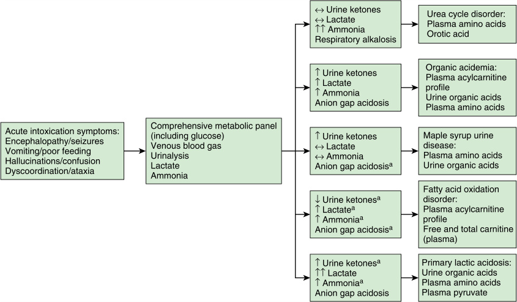

# Chapter 45: Metabolic Crisis With Inborn Errors of Metabolism — Board-Style Self-Assessment MCQs
**Section VIII: Metabolic Disorders** | [📖 Read Wiki Chapter](../chapters/045_Metabolic_Crisis_With_Inborn_Errors_of_Metabolism.md) | [🃏 Chapter Flashcards](../flashcards/045_flashcards.md) | [🏠 Course Master Index](../../index.md)

Total questions: **14** *(Click "Show Answer & Rationale" beneath each question)*

### Question 1 (Clinical Vignette & Syndrome Diagnosis)
A pediatric patient is evaluated in the medical genetics clinic with the following clinical and molecular profile: Laboratory Studies: Acidosis (metabolic; pH<7.20*, the causative gene <10 mmol, Pco2 — Other Features: With ketosis — Organic acidurias, MSUD MCD*, PC, RCD — Differential Diagnosis: Diabetes Intoxication Encephalitis. Which of the following rare disorders is the most likely diagnosis?

- **A.** Metabolic coma (without
- **B.** seizures, or intracranial hypertension)
- **C.** Urea Cycle Disorders
- **D.** focal neuroloical

<b>Show Answer & Rationale</b>

**Correct Answer: A** — Metabolic coma (without

**Rationale:** **Metabolic coma (without** caused by pathogenic variants in **`HCO3`** presents with: Laboratory Studies: Acidosis (metabolic; pH<7.20*, HCO3 <10 mmol, Pco2 — Other Features: With ketosis — Organic acidurias, MSUD MCD*, PC, RCD — Differential Diagnosis: Diabetes Intoxication Encephalitis.

**Why Other Options Are Incorrect:** **seizures, or intracranial hypertension)** is incorrect (associated with OTC — Laboratory Studies: moderate; see “Metabolic coma” — Other Features: Hemiplegia (hemianopsia) — MSUD, OTC, MMA). **Urea Cycle Disorders** is incorrect (associated with OTC — CPS1, n-acetylglutamate synthase, and OTC are all mitochondrially located (proximal UCDs).). **focal neuroloical** is incorrect (associated with MCT1 — Laboratory Studies: <25 mm) — Ketolysis defects, MCT1).

### Question 2 (Clinical Vignette & Syndrome Diagnosis)
A pediatric patient is evaluated in the medical genetics clinic with the following clinical and molecular profile: Laboratory Studies: <25 mm) — Ketolysis defects, the causative gene. Which of the following rare disorders is the most likely diagnosis?

- **A.** Methylmalonic Acidemia
- **B.** focal neuroloical
- **C.** Urea Cycle Disorders
- **D.** Propionic Acidemia

<b>Show Answer & Rationale</b>

**Correct Answer: B** — focal neuroloical

**Rationale:** **focal neuroloical** caused by pathogenic variants in **`MCT1`** presents with: Laboratory Studies: <25 mm) — Ketolysis defects, MCT1.

**Why Other Options Are Incorrect:** **Methylmalonic Acidemia** is incorrect (associated with MMUT — MMA is autosomal recessive, caused by pathogenic variants in one of several genes, MMUT, MMAA, MMAB, MCEE, and). **Urea Cycle Disorders** is incorrect (associated with OTC — CPS1, n-acetylglutamate synthase, and OTC are all mitochondrially located (proximal UCDs).). **Propionic Acidemia** is incorrect (associated with PCCB — Propionic acidemia (PA) is an autosomal recessive disorder of propionyl-CoA metabolism that results in the acc).

### Question 3 (Clinical Vignette & Syndrome Diagnosis)
A pediatric patient is evaluated in the medical genetics clinic with the following clinical and molecular profile: Laboratory Studies: Biological signs are very variable, can be absent or — Other Features: Cerebral edema — MSUD, the causative gene — Differential Diagnosis: Cerebral tumor Migraine Encephalitis. Which of the following rare disorders is the most likely diagnosis?

- **A.** Propionic Acidemia
- **B.** Neurological coma (with focal signs
- **C.** Urea Cycle Disorders
- **D.** N-Acetylglutamate Synthase Deficiency

<b>Show Answer & Rationale</b>

**Correct Answer: B** — Neurological coma (with focal signs

**Rationale:** **Neurological coma (with focal signs** caused by pathogenic variants in **`OTC`** presents with: Laboratory Studies: Biological signs are very variable, can be absent or — Other Features: Cerebral edema — MSUD, OTC — Differential Diagnosis: Cerebral tumor Migraine Encephalitis.

**Why Other Options Are Incorrect:** **Propionic Acidemia** is incorrect (associated with PCCB — Propionic acidemia (PA) is an autosomal recessive disorder of propionyl-CoA metabolism that results in the acc). **Urea Cycle Disorders** is incorrect (associated with OTC — CPS1, n-acetylglutamate synthase, and OTC are all mitochondrially located (proximal UCDs).). **N-Acetylglutamate Synthase Deficiency** is incorrect (associated with CPS1 — This enzyme forms N-acetylglutamate, an activator necessary for CPS1 to function; therefore the presentation o).

### Question 4 (Clinical Vignette & Syndrome Diagnosis)
A pediatric patient is evaluated in the medical genetics clinic with the following clinical and molecular profile: Laboratory Studies: moderate; see “Metabolic coma” — Other Features: Hemiplegia (hemianopsia) — MSUD, the causative gene, MMA, PA, PGK — Differential Diagnosis: Moyamoya syndrome. Which of the following rare disorders is the most likely diagnosis?

- **A.** Urea Cycle Disorders
- **B.** Isovaleric Acidemia
- **C.** Metabolic coma (without
- **D.** seizures, or intracranial hypertension)

<b>Show Answer & Rationale</b>

**Correct Answer: D** — seizures, or intracranial hypertension)

**Rationale:** **seizures, or intracranial hypertension)** caused by pathogenic variants in **`OTC`** presents with: Laboratory Studies: moderate; see “Metabolic coma” — Other Features: Hemiplegia (hemianopsia) — MSUD, OTC, MMA, PA, PGK — Differential Diagnosis: Moyamoya syndrome.

**Why Other Options Are Incorrect:** **Urea Cycle Disorders** is incorrect (associated with OTC — CPS1, n-acetylglutamate synthase, and OTC are all mitochondrially located (proximal UCDs).). **Isovaleric Acidemia** is incorrect (associated with IVD — Isovaleric acidemia (IVA) is an autosomal recessive disorder resulting from a defect in leucine metabolism, sp). **Metabolic coma (without** is incorrect (associated with HCO3 — Laboratory Studies: Acidosis (metabolic; pH<7.20*, HCO3 <10 mmol, Pco2 — Other Features: With ketosis — Organi).

### Question 5 (Clinical Vignette & Syndrome Diagnosis)
A pediatric patient is evaluated in the medical genetics clinic with the following clinical and molecular profile: this disorder (PA) is an autosomal recessive disorder of propionyl-CoA metabolism that results in the accumulation of toxic compounds due to defects in propionyl-CoA carboxylase (Fig. 45.2), encoded by the genes PCCA and the causative gene .. Which of the following rare disorders is the most likely diagnosis?

- **A.** N-Acetylglutamate Synthase Deficiency
- **B.** Metabolic coma (without
- **C.** Glutaric Aciduria Type I
- **D.** Propionic Acidemia

<b>Show Answer & Rationale</b>

**Correct Answer: D** — Propionic Acidemia

**Rationale:** **Propionic Acidemia** caused by pathogenic variants in **`PCCB`** presents with: Propionic acidemia (PA) is an autosomal recessive disorder of propionyl-CoA metabolism that results in the accumulation of toxic compounds due to defects in propionyl-CoA carboxylase (Fig. 45.2), encoded by the genes PCCA and PCCB ..

**Why Other Options Are Incorrect:** **N-Acetylglutamate Synthase Deficiency** is incorrect (associated with CPS1 — This enzyme forms N-acetylglutamate, an activator necessary for CPS1 to function; therefore the presentation o). **Metabolic coma (without** is incorrect (associated with HCO3 — Laboratory Studies: Acidosis (metabolic; pH<7.20*, HCO3 <10 mmol, Pco2 — Other Features: With ketosis — Organi). **Glutaric Aciduria Type I** is incorrect (associated with GCDH — Glutaric aciduria type I (GA1) is an autosomal recessive disorder involving a defect in lysine metabolism, spe).

### Question 6 (Molecular & Genomic Etiology)
A child is diagnosed with **Metabolic coma (without** after presenting with Laboratory Studies: Acidosis (metabolic; pH<7.20*, the causative gene <10 mmol, Pco2 — Other Features: With ketosis — Organic acidurias, MSUD MCD*, PC, RCD — Differential Diagnosis: Diabetes Intoxication Enceph. Pathogenic variants in which of the following genes are the primary molecular etiology of this disorder?

- **A.** SPTA1
- **B.** CDKN1C
- **C.** HCO3
- **D.** HNF1B

<b>Show Answer & Rationale</b>

**Correct Answer: C** — HCO3

**Rationale:** Pathogenic variants in **`HCO3`** (Genetic) cause **Metabolic coma (without**, characterized by Laboratory Studies: Acidosis (metabolic; pH<7.20*, HCO3 <10 mmol, Pco2 — Other Features: With ketosis — Organic acidurias, MSUD MCD*, PC, RCD — Differential Diagnosis: Diabetes Intoxication Encephalitis.

**Why Other Options Are Incorrect:** **SPTA1** is incorrect (associated with HS-4). **CDKN1C** is incorrect (associated with NOS 21-0210). **HNF1B** is incorrect (associated with 17q12 deletion/duplication syndromes).

### Question 7 (Molecular & Genomic Etiology)
A child is diagnosed with **focal neuroloical** after presenting with Laboratory Studies: <25 mm) — Ketolysis defects, the causative gene. Pathogenic variants in which of the following genes are the primary molecular etiology of this disorder?

- **A.** CD40LG
- **B.** CHST14
- **C.** MCT1
- **D.** RYR1

<b>Show Answer & Rationale</b>

**Correct Answer: C** — MCT1

**Rationale:** Pathogenic variants in **`MCT1`** (Genetic) cause **focal neuroloical**, characterized by Laboratory Studies: <25 mm) — Ketolysis defects, MCT1.

**Why Other Options Are Incorrect:** **CD40LG** is incorrect (associated with Pseudomonas). **CHST14** is incorrect (associated with Musculo-contractural (mcEDS-CHST14or mcEDS-DES depending on the causative pathogenic variant)). **RYR1** is incorrect (associated with Malignant hyperthermia susceptibility, exertional rhabdomyolysis, congenital myopathy).

### Question 8 (Molecular & Genomic Etiology)
A child is diagnosed with **Neurological coma (with focal signs** after presenting with Laboratory Studies: Biological signs are very variable, can be absent or — Other Features: Cerebral edema — MSUD, the causative gene — Differential Diagnosis: Cerebral tumor Migraine Encephalitis. Pathogenic variants in which of the following genes are the primary molecular etiology of this disorder?

- **A.** FANCA
- **B.** CPS1
- **C.** OTC
- **D.** DNAH11

<b>Show Answer & Rationale</b>

**Correct Answer: C** — OTC

**Rationale:** Pathogenic variants in **`OTC`** (Genetic) cause **Neurological coma (with focal signs**, characterized by Laboratory Studies: Biological signs are very variable, can be absent or — Other Features: Cerebral edema — MSUD, OTC — Differential Diagnosis: Cerebral tumor Migraine Encephalitis.

**Why Other Options Are Incorrect:** **FANCA** is incorrect (associated with Fanconi anemia). **CPS1** is incorrect (associated with Propionic Acidemia). **DNAH11** is incorrect (associated with Primary ciliary dyskinesia).

### Question 9 (Molecular & Genomic Etiology)
A child is diagnosed with **Propionic Acidemia** after presenting with Propionic acidemia (PA) is an autosomal recessive disorder of propionyl-CoA metabolism that results in the accumulation of toxic compounds due to defects in propionyl-CoA carboxylase (Fig. 45.2), encoded by the. Pathogenic variants in which of the following genes are the primary molecular etiology of this disorder?

- **A.** PCCB
- **B.** ACAN
- **C.** MYH7
- **D.** DNAI1

<b>Show Answer & Rationale</b>

**Correct Answer: A** — PCCB

**Rationale:** Pathogenic variants in **`PCCB`** (AR) cause **Propionic Acidemia**, characterized by Propionic acidemia (PA) is an autosomal recessive disorder of propionyl-CoA metabolism that results in the accumulation of toxic compounds due to defects in propionyl-CoA carboxylase (Fig. 45.2), encoded by the genes PCCA and PCCB ..

**Why Other Options Are Incorrect:** **ACAN** is incorrect (associated with Aggrecan). **DNAI1** is incorrect (associated with Primary ciliary dyskinesia).

### Question 10 (Visual & Diagnostic Imaging Vignette)

A pediatric patient undergoes diagnostic evaluation for **Metabolic Crisis With Inborn Errors of Metabolism**, yielding the clinical, neuroimaging, or molecular finding shown below. Which of the following best characterizes the illustrated disorder or mechanism?

- **A.** Axial T2 FLAIR (A) and axial DWI (B) from a 2-year-old with proprionic acidemia demonstrate disparate lesions from acute on subacute metabolic injury with subacute striatal edema showing T2
- **B.** Flow diagram describing the interpretation of basic, widely available laboratory findings in the setting of a metabolic emergency. The presence of symptoms of acute intoxication should promp
- **C.** Branched chain amino acid metabolism. Some reactions are not shown. Odd-chain fatty acids (i.e., propionate), threonine, and methionine also are catabolized to propionyl-CoA via alternate pa
- **D.** Flow diagram describing the interpretation of basic, widely available laboratory findings in the setting of a metabolic emergency. The presence of symptoms of acute intoxication should prompt obt

<b>Show Answer & Rationale</b>

**Correct Answer: D** — Flow diagram describing the interpretation of basic, widely available laboratory findings in the setting of a metabolic emergency. The presence of symptoms of acute intoxication should prompt obt

**Rationale:** **Fig. 45.1**: Flow diagram describing the interpretation of basic, widely available laboratory findings in the setting of a metabolic emergency. The presence of symptoms of acute intoxication should prompt obtaining these labs. Findings should prompt further investigation using specialty biochemical labs to aid in the diagnosis of the inborn error of metabolism. Variable based on age and/or severity.

### Question 11 (Diagnostic Criteria (Metabolic Crisis With Inborn Errors of Metabolism))
During a multidisciplinary genetics evaluation for **Metabolic Crisis With Inborn Errors of Metabolism**, which clinical entity or diagnostic phenomenon is defined by the following profile?
"the result of insufficiently functioning, or completely nonfunctioning, enzymes that lead to a deficiency of metabolites necessary for cellular function and to an accumulation of toxic metabolites that further perturb metabolism."

- **A.** cobalamin/ vitamin B12
- **B.** Females
- **C.** metabolic crisis
- **D.** Carbamoyl Phosphate Synthetase I

<b>Show Answer & Rationale</b>

**Correct Answer: C** — metabolic crisis

**Rationale:** metabolic crisis is the result of insufficiently functioning, or completely nonfunctioning, enzymes that lead to a deficiency of metabolites necessary for cellular function and to an accumulation of toxic metabolites that further perturb metabolism.

### Question 12 (Diagnostic Criteria (Metabolic Crisis With Inborn Errors of Metabolism))
During a multidisciplinary genetics evaluation for **Metabolic Crisis With Inborn Errors of Metabolism**, which clinical entity or diagnostic phenomenon is defined by the following profile?
"nclude: the onset of overnight fasting in infancy (or fasting for other reasons in later child/adulthood), illness, surgery, after ingestion of certain medications (i."

- **A.** orotic acid
- **B.** Isovaleric Acidemia
- **C.** catabolic stressors
- **D.** seizures, or intracranial hypertension)

<b>Show Answer & Rationale</b>

**Correct Answer: C** — catabolic stressors

**Rationale:** catabolic stressors include: the onset of overnight fasting in infancy (or fasting for other reasons in later child/adulthood), illness, surgery, after ingestion of certain medications (i.

### Question 13 (Diagnostic Criteria (Methylmalonic Acidemia))
During a multidisciplinary genetics evaluation for **Methylmalonic Acidemia**, which clinical entity or diagnostic phenomenon is defined by the following profile?
"the cofactor for methylmalonyl mutase, which involves MMAA, MMAB, and MMADHC; and combined they account for less than 40% of all patients with MMA."

- **A.** Angelman syndrome (AS)
- **B.** Sotos syndrome
- **C.** seizures, or intracranial hypertension)
- **D.** cobalamin/ vitamin B12

<b>Show Answer & Rationale</b>

**Correct Answer: D** — cobalamin/ vitamin B12

**Rationale:** cobalamin/ vitamin B12 , the cofactor for methylmalonyl mutase, which involves MMAA, MMAB, and MMADHC; and combined they account for less than 40% of all patients with MMA.

### Question 14 (Clinical & Pathophysiologic Mastery (Metabolic Crisis With Inborn Errors of Metabolism))
When counseling a family and planning diagnostic management for **Metabolic Crisis With Inborn Errors of Metabolism** (*Metabolic Crisis With Inborn Errors of Metabolism*), which of the following clinical-genetic principles is **ACCURATE**?

- **A.** The condition is a benign, self-limiting physiologic variant that requires neither longitudinal surveillance nor genetic counseling.
- **B.** Inheritance is exclusively holandric (Y-linked) with complete penetrance restricted to male offspring.
- **C.** A metabolic crisis is the result of insufficiently functioning, or completely nonfunctioning, enzymes that lead to a deficiency of metabolites necessary for cellular function and to an accumulation of toxi
- **D.** Enzyme activity and protein expression remain completely normal across all affected tissues, excluding a monogenic etiology.

<b>Show Answer & Rationale</b>

**Correct Answer: C** — A metabolic crisis is the result of insufficiently functioning, or completely nonfunctioning, enzymes that lead to a deficiency of metabolites necessary for cellular function and to an accumulation of toxi

**Rationale:** **Clinical & Molecular Principle (Metabolic Crisis With Inborn Errors of Metabolism):** A metabolic crisis is the result of insufficiently functioning, or completely nonfunctioning, enzymes that lead to a deficiency of metabolites necessary for cellular function and to an accumulation of toxic metabolites that further perturb metabolism.

