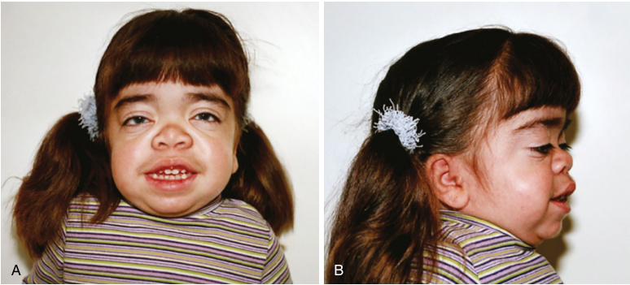

# Chapter 46: Differentiating Features of Storage Diseases — Board-Style Self-Assessment MCQs
**Section VIII: Metabolic Disorders** | [📖 Read Wiki Chapter](../chapters/046_Differentiating_Features_of_Storage_Diseases.md) | [🃏 Chapter Flashcards](../flashcards/046_flashcards.md) | [🏠 Course Master Index](../../index.md)

Total questions: **14** *(Click "Show Answer & Rationale" beneath each question)*

### Question 1 (Clinical Vignette & Syndrome Diagnosis)
A pediatric patient is evaluated in the medical genetics clinic with the following clinical and molecular profile: Deficient Enzyme: α-galactosidase A — Main Storage Material: Ceramide trihexoside — Estimated Incidence: 1:40,000– 120,000* — Severity: Mild/ intermediate — Clinical Symptoms: Acroparesthesia, gastroenteritis, nephropathy, cerebrovascular disease/str. Which of the following rare disorders is the most likely diagnosis?

- **A.** CLN8 disease (variant late infantile, vLINCL)
- **B.** GSD0b
- **C.** Fabry med Manfy (manfy54@yahoo.com) For personal use only. No other uses
- **D.** CLN7 disease (variant late infantile, vLINCL)

<b>Show Answer & Rationale</b>

**Correct Answer: C** — Fabry med Manfy (manfy54@yahoo.com) For personal use only. No other uses

**Rationale:** **Fabry med Manfy (manfy54@yahoo.com) For personal use only. No other uses** caused by pathogenic variants in **`GLA`** presents with: Deficient Enzyme: α-galactosidase A — Main Storage Material: Ceramide trihexoside — Estimated Incidence: 1:40,000– 120,000* — Severity: Mild/ intermediate — Clinical Symptoms: Acroparesthesia, gastroenteritis, nephropathy, cerebrovascular disease/stroke, corneal opacities, left ventricular hypertrophy, cardiomyopathy and arrhythmia, renal.

**Why Other Options Are Incorrect:** **CLN8 disease (variant late infantile, vLINCL)** is incorrect (associated with CLN8 — Deficient Enzyme: CLN8 transmembrane protein in ER — Main Storage Material: Lipofuscin. Subunit c of ATPase — ). **GSD0b** is incorrect (associated with GYS1 — GYS1 — Enzyme or: Muscle glycogen synthase — AR — Exercise intolerance, hypertrophic cardiomyopathy sudden dea). **CLN7 disease (variant late infantile, vLINCL)** is incorrect (associated with MFSD8, CLN7 — Deficient Enzyme: CLN7/MFSD8 (major facilitator superfamily domain-containing protein 8, transporter) — Main S).

### Question 2 (Clinical Vignette & Syndrome Diagnosis)
A pediatric patient is evaluated in the medical genetics clinic with the following clinical and molecular profile: Deficient Enzyme: Glucocerebrosidase — Main Storage Material: Glucosy lceramide — Estimated Incidence: 1:30,000 — Severity: Mild/ intermediate — Clinical Symptoms: Type I: hepatosplenomegaly, thrombocytopenia, pancytopenia, bone disease, osteopenia, . Which of the following rare disorders is the most likely diagnosis?

- **A.** CLN5 disease (variant late infantile, vLINCL)
- **B.** GM2 gangliosidosis. Sandhoff
- **C.** Type I versity of Southern Califor ut permission. Copyright ©
- **D.** GSD I (von Gierke disease)

<b>Show Answer & Rationale</b>

**Correct Answer: C** — Type I versity of Southern Califor ut permission. Copyright ©

**Rationale:** **Type I versity of Southern Califor ut permission. Copyright ©** caused by pathogenic variants in **`GBA`** presents with: Deficient Enzyme: Glucocerebrosidase — Main Storage Material: Glucosy lceramide — Estimated Incidence: 1:30,000 — Severity: Mild/ intermediate — Clinical Symptoms: Type I: hepatosplenomegaly, thrombocytopenia, pancytopenia, bone disease, osteopenia, degenerative arthritis, and increased risk of myeloma — CNS. Affected: No — Age of Onset: .

**Why Other Options Are Incorrect:** **CLN5 disease (variant late infantile, vLINCL)** is incorrect (associated with CLN5 — Deficient Enzyme: CLN5. soluble lysosomal protein — Main Storage Material: Lipofuscin. Subunit c of ATPase — E). **GM2 gangliosidosis. Sandhoff** is incorrect (associated with GM2, HEXB — HEXB — i: Hexosaminidase B — Main Storage: GM2 gangliosides, glycosphingolipids, and oligosaccharides — Estima). **GSD I (von Gierke disease)** is incorrect (associated with SLC37A4 — G6PC1 (GSD Ia) and SLC37A4 (GSD Ib) — Enzyme or: G6Pase (GSD Ia) and G6PT (GSD Ib) — AR — Metabolic anomalies ).

### Question 3 (Clinical Vignette & Syndrome Diagnosis)
A pediatric patient is evaluated in the medical genetics clinic with the following clinical and molecular profile: the causative gene — i: Galactocerebrosidase — Main Storage: Galactosylceramide and galactosylsphingosine — Estimated: 1:100,000 — Severe — Clinical: Infantile: irritability, hypotonia, spasticity, feeding difficulties and psychomotor regression. Juv. Which of the following rare disorders is the most likely diagnosis?

- **A.** Krabbe
- **B.** MPS III A
- **C.** GM 1-gangliosidosis types I, II, & III
- **D.** HPS-5 HPS-6 HPS-7 HPS-8

<b>Show Answer & Rationale</b>

**Correct Answer: A** — Krabbe

**Rationale:** **Krabbe** caused by pathogenic variants in **`GALC`** presents with: GALC — i: Galactocerebrosidase — Main Storage: Galactosylceramide and galactosylsphingosine — Estimated: 1:100,000 — Severe — Clinical: Infantile: irritability, hypotonia, spasticity, feeding difficulties and psychomotor regression. Juvenile:variable onset and progression from childhood to adulthood, muscle weakness, vision loss and intel.

**Why Other Options Are Incorrect:** **MPS III A** is incorrect (associated with SGSH — Deficient Enzyme: N-sulfoglucosamine sulfohydrolase — Main Storage Material: HS — Estimated Incidence: 1:100,0). **GM 1-gangliosidosis types I, II, & III** is incorrect (associated with GM1 — GLBI — Deficient Enzyme: β-Galactosidase — Main Storage Material: GM1 gangliosides, KS, glycolipids, and oligo). **HPS-5 HPS-6 HPS-7 HPS-8** is incorrect (associated with HPS5, HPS6, DTNBP1, BLOC1S3, BLOS3 — HPS5 HPS6 DTNBP1 (dysbindin) BLOC1S3 (BLOS3) — Deficient Enzyme: BLOC-2 subunit BLOC-2 subunit BLOC-1 subunit ).

### Question 4 (Clinical Vignette & Syndrome Diagnosis)
A pediatric patient is evaluated in the medical genetics clinic with the following clinical and molecular profile: the causative gene — i: Arylsulfatase A — Main Storage: Sulfatide — Estimated: 1:40,000– 160,000 (50% cases) — Severe — Clinical: Ataxia, weakness, loss of speech and cherry-red macula, cognitive decline — CNS.: Yes — Age of: 3 years — Life: <5 years. Which of the following rare disorders is the most likely diagnosis?

- **A.** Late-infantile MLD
- **B.** GSD XV
- **C.** HPS-4
- **D.** Niemann-Pick Type A

<b>Show Answer & Rationale</b>

**Correct Answer: A** — Late-infantile MLD

**Rationale:** **Late-infantile MLD** caused by pathogenic variants in **`ARSA`** presents with: ARSA — i: Arylsulfatase A — Main Storage: Sulfatide — Estimated: 1:40,000– 160,000 (50% cases) — Severe — Clinical: Ataxia, weakness, loss of speech and cherry-red macula, cognitive decline — CNS.: Yes — Age of: 3 years — Life: <5 years — Approved: HSCT/ HSC-GT Europe.

**Why Other Options Are Incorrect:** **GSD XV** is incorrect (associated with GYG1 — Genes: GYG1 — Enzyme or Transporter: Glycogen in 1 (muscle isoform) — Inheritance: AR — Clinical Features: Wea). **HPS-4** is incorrect (associated with HPS4 — Deficient Enzyme: BLOC-3 subunit — Clinical Symptoms: cardiomyopathy, lung i). **Niemann-Pick Type A** is incorrect (associated with SMPD1 — SMPD1 — i: Sphingomyelinase — Main Storage: Sphingomyelin — Estimated: 1:100,000 — Severe — Clinical: Hepatosp).

### Question 5 (Clinical Vignette & Syndrome Diagnosis)
A pediatric patient is evaluated in the medical genetics clinic with the following clinical and molecular profile: the causative gene — i: Sphingomyelinase — Main Storage: Sphingomyelin — Estimated: 1:100,000 — Severe — Clinical: Hepatosplenomegaly, failure to thrive, psychomotor regression, interstitial lung disease, and cherry-red macula — CNS.: Yes — Age of: E. Which of the following rare disorders is the most likely diagnosis?

- **A.** Krabbe
- **B.** Early onset
- **C.** MPS I Hurler
- **D.** Niemann-Pick Type A

<b>Show Answer & Rationale</b>

**Correct Answer: D** — Niemann-Pick Type A

**Rationale:** **Niemann-Pick Type A** caused by pathogenic variants in **`SMPD1`** presents with: SMPD1 — i: Sphingomyelinase — Main Storage: Sphingomyelin — Estimated: 1:100,000 — Severe — Clinical: Hepatosplenomegaly, failure to thrive, psychomotor regression, interstitial lung disease, and cherry-red macula — CNS.: Yes — Age of: Early infancy — Life: 2–3 years — Approved: ERT.

**Why Other Options Are Incorrect:** **Krabbe** is incorrect (associated with GALC — GALC — i: Galactocerebrosidase — Main Storage: Galactosylceramide and galactosylsphingosine — Estimated: 1:100). **Early onset** is incorrect (associated with GAA — Deficient Enzyme: α-glucosidase — Main Storage Material: Glycogen — Estimated Incidence: 1:40,000 — Severity: ). **MPS I Hurler** is incorrect (associated with IDUA — IDUA — i: Alpha-L iduronidase — Main Storage: HS/DS — Estimated: 1:100,000 — Severe (57% of cases) — Clinical:).

### Question 6 (Molecular & Genomic Etiology)
A child is diagnosed with **Fabry med Manfy (manfy54@yahoo.com) For personal use only. No other uses** after presenting with Deficient Enzyme: α-galactosidase A — Main Storage Material: Ceramide trihexoside — Estimated Incidence: 1:40,000– 120,000* — Severity: Mild/ intermediate — Clinical Symptoms: Acroparesthesia, gastroenteritis, . Pathogenic variants in which of the following genes are the primary molecular etiology of this disorder?

- **A.** STAT1
- **B.** EPCAM
- **C.** GLA
- **D.** VPS13A

<b>Show Answer & Rationale</b>

**Correct Answer: C** — GLA

**Rationale:** Pathogenic variants in **`GLA`** (Genetic) cause **Fabry med Manfy (manfy54@yahoo.com) For personal use only. No other uses**, characterized by Deficient Enzyme: α-galactosidase A — Main Storage Material: Ceramide trihexoside — Estimated Incidence: 1:40,000– 120,000* — Severity: Mild/ intermediate — Clinical Symptoms: Acroparesthesia, gastroenteritis, nephropathy, cerebrovascular disease/stroke, corneal opacities, left ventricular hypertrophy, cardiomyopathy and arrhythmia, renal.

**Why Other Options Are Incorrect:** **STAT1** is incorrect (associated with IPEX-related disorders (X-linked immune dysregulation, polyendocrinopathy, enteropathy)). **EPCAM** is incorrect (associated with Lynch syndrome—a hereditary non-polyposis colon cancer syndrome Congenital tufting enteropathy). **VPS13A** is incorrect (associated with Chorea-acanthocytosis).

### Question 7 (Molecular & Genomic Etiology)
A child is diagnosed with **Type I versity of Southern Califor ut permission. Copyright ©** after presenting with Deficient Enzyme: Glucocerebrosidase — Main Storage Material: Glucosy lceramide — Estimated Incidence: 1:30,000 — Severity: Mild/ intermediate — Clinical Symptoms: Type I: hepatosplenomegaly, thrombocytopenia, . Pathogenic variants in which of the following genes are the primary molecular etiology of this disorder?

- **A.** NDP
- **B.** BBS10
- **C.** MVK
- **D.** GBA

<b>Show Answer & Rationale</b>

**Correct Answer: D** — GBA

**Rationale:** Pathogenic variants in **`GBA`** (Genetic) cause **Type I versity of Southern Califor ut permission. Copyright ©**, characterized by Deficient Enzyme: Glucocerebrosidase — Main Storage Material: Glucosy lceramide — Estimated Incidence: 1:30,000 — Severity: Mild/ intermediate — Clinical Symptoms: Type I: hepatosplenomegaly, thrombocytopenia, pancytopenia, bone disease, osteopenia, degenerative arthritis, and increased risk of myeloma — CNS. Affected: No — Age of Onset: .

**Why Other Options Are Incorrect:** **NDP** is incorrect (associated with Norrie disease). **BBS10** is incorrect (associated with 11q13.2 12q21.2). **MVK** is incorrect (associated with Mevalonate kinase deficiency(MVK)).

### Question 8 (Molecular & Genomic Etiology)
A child is diagnosed with **Krabbe** after presenting with the causative gene — i: Galactocerebrosidase — Main Storage: Galactosylceramide and galactosylsphingosine — Estimated: 1:100,000 — Severe — Clinical: Infantile: irritability, hypotonia, spasticity, feeding diff. Pathogenic variants in which of the following genes are the primary molecular etiology of this disorder?

- **A.** ARSA
- **B.** C5
- **C.** SPR
- **D.** GALC

<b>Show Answer & Rationale</b>

**Correct Answer: D** — GALC

**Rationale:** Pathogenic variants in **`GALC`** (Genetic) cause **Krabbe**, characterized by GALC — i: Galactocerebrosidase — Main Storage: Galactosylceramide and galactosylsphingosine — Estimated: 1:100,000 — Severe — Clinical: Infantile: irritability, hypotonia, spasticity, feeding difficulties and psychomotor regression. Juvenile:variable onset and progression from childhood to adulthood, muscle weakness, vision loss and intel.

**Why Other Options Are Incorrect:** **ARSA** is incorrect (associated with Metachromatic leukodystrophy (250100), AR). **C5** is incorrect (associated with Isovaleric acidemia (IVA)). **SPR** is incorrect (associated with Complex and).

### Question 9 (Molecular & Genomic Etiology)
A child is diagnosed with **Late-infantile MLD** after presenting with the causative gene — i: Arylsulfatase A — Main Storage: Sulfatide — Estimated: 1:40,000– 160,000 (50% cases) — Severe — Clinical: Ataxia, weakness, loss of speech and cherry-red macula, cognitive decline — CNS.. Pathogenic variants in which of the following genes are the primary molecular etiology of this disorder?

- **A.** ARSA
- **B.** NAGLU
- **C.** PANK2
- **D.** IRAK4

<b>Show Answer & Rationale</b>

**Correct Answer: A** — ARSA

**Rationale:** Pathogenic variants in **`ARSA`** (Genetic) cause **Late-infantile MLD**, characterized by ARSA — i: Arylsulfatase A — Main Storage: Sulfatide — Estimated: 1:40,000– 160,000 (50% cases) — Severe — Clinical: Ataxia, weakness, loss of speech and cherry-red macula, cognitive decline — CNS.: Yes — Age of: 3 years — Life: <5 years — Approved: HSCT/ HSC-GT Europe.

**Why Other Options Are Incorrect:** **NAGLU** is incorrect (associated with Mucopolysaccharidosis type 3, NAGLU-related (type 3B)). **PANK2** is incorrect (associated with Pantothenate kinase-associated neurodegeneration (PKAN)). **IRAK4** is incorrect (associated with Pseudomonas).

### Question 10 (Visual & Diagnostic Imaging Vignette)

A pediatric patient undergoes diagnostic evaluation for **Differentiating Features of Storage Diseases**, yielding the clinical, neuroimaging, or molecular finding shown below. Which of the following best characterizes the illustrated disorder or mechanism?

- **A.** A six-year-old female with Hurler syndrome. Note course facies
- **B.** Congenital dermal melanocytosis. A diffuse pigmentation in a normal child. When widespread, dermal melanocytosis may be associated with lysosomal storage disease.
- **C.** Collodion membrane in one-day-old infant
- **D.** Angiokeratomas of Fabry disease. Multiple dark red to red–brown macules and papules located on the lower trunk.

<b>Show Answer & Rationale</b>

**Correct Answer: A** — A six-year-old female with Hurler syndrome. Note course facies

**Rationale:** **Fig. 46.1**: A six-year-old female with Hurler syndrome. Note course facies

### Question 11 (Diagnostic Criteria (Differentiating Features of Storage Diseases))
During a multidisciplinary genetics evaluation for **Differentiating Features of Storage Diseases**, which clinical entity or diagnostic phenomenon is defined by the following profile?
"from a deficiency of a lysosomal enzyme leading to the lysosomal storage of glycogen and is classified as GSD type II."

- **A.** CLN 12 disease
- **B.** Danon disease
- **C.** Pompe disease
- **D.** PGK deficiency

<b>Show Answer & Rationale</b>

**Correct Answer: C** — Pompe disease

**Rationale:** Pompe disease arises from a deficiency of a lysosomal enzyme leading to the lysosomal storage of glycogen and is classified as GSD type II.

### Question 12 (Diagnostic Criteria (Retina))
During a multidisciplinary genetics evaluation for **Retina**, which clinical entity or diagnostic phenomenon is defined by the following profile?
"which results from the deposition of storage material around the macula."

- **A.** Hepatic GSD IX
- **B.** macular cherry red spot
- **C.** gibbus deformity
- **D.** Vascular abnormalities

<b>Show Answer & Rationale</b>

**Correct Answer: B** — macular cherry red spot

**Rationale:** macular cherry red spot , which results from the deposition of storage material around the macula.

### Question 13 (Diagnostic Criteria (Extraocular Movements))
During a multidisciplinary genetics evaluation for **Extraocular Movements**, which clinical entity or diagnostic phenomenon is defined by the following profile?
"characteristic finding in the chronic form of neuronopathic Gaucher disease (Gaucher disease type III), whereas vertical saccade deficiency/vertical supranuclear gaze palsy is observed in patients with Niemann-Pick C (NPC) disease."

- **A.** Horizontal saccade palsy
- **B.** Niemann-Pick Type B
- **C.** gibbus deformity
- **D.** Krabbe

<b>Show Answer & Rationale</b>

**Correct Answer: A** — Horizontal saccade palsy

**Rationale:** Horizontal saccade palsy is a characteristic finding in the chronic form of neuronopathic Gaucher disease (Gaucher disease type III), whereas vertical saccade deficiency/vertical supranuclear gaze palsy is observed in patients with Niemann-Pick C (NPC) disease.

### Question 14 (Clinical & Pathophysiologic Mastery (Differentiating Features of Storage Diseases))
When counseling a family and planning diagnostic management for **Differentiating Features of Storage Diseases** (*Differentiating Features of Storage Diseases*), which of the following clinical-genetic principles is **ACCURATE**?

- **A.** First-line diagnostic confirmation relies solely on conventional Giemsa-banded karyotyping rather than sequencing or targeted assays.
- **B.** Enzyme activity and protein expression remain completely normal across all affected tissues, excluding a monogenic etiology.
- **C.** Inheritance is exclusively holandric (Y-linked) with complete penetrance restricted to male offspring.
- **D.** There is overlap between the categories of LSDs and GSDs; for instance, Pompe disease arises from a deficiency of a lysosomal enzyme leading to the lysosomal storage of glycogen and is classified as GSD ty

<b>Show Answer & Rationale</b>

**Correct Answer: D** — There is overlap between the categories of LSDs and GSDs; for instance, Pompe disease arises from a deficiency of a lysosomal enzyme leading to the lysosomal storage of glycogen and is classified as GSD ty

**Rationale:** **Clinical & Molecular Principle (Differentiating Features of Storage Diseases):** There is overlap between the categories of LSDs and GSDs; for instance, Pompe disease arises from a deficiency of a lysosomal enzyme leading to the lysosomal storage of glycogen and is classified as GSD type II.

