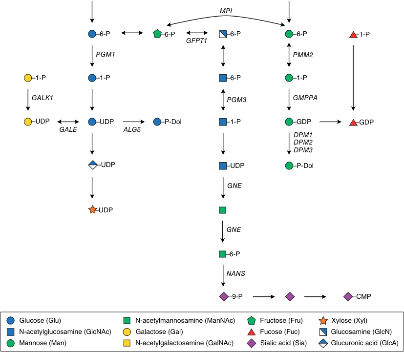

# Chapter 47: Congenital Disorders of Glycosylation — Board-Style Self-Assessment MCQs
**Section VIII: Metabolic Disorders** | [📖 Read Wiki Chapter](../chapters/047_Congenital_Disorders_of_Glycosylation.md) | [🃏 Chapter Flashcards](../flashcards/047_flashcards.md) | [🏠 Course Master Index](../../index.md)

Total questions: **14** *(Click "Show Answer & Rationale" beneath each question)*

### Question 1 (Clinical Vignette & Syndrome Diagnosis)
A pediatric patient is evaluated in the medical genetics clinic with the following clinical and molecular profile: Gene-CDG: the causative gene-CDG(ar) — Some CDG (e.g., DHDDS-, ALG8-, ALG9-, the causative gene-, and COG4-CDG) can be inherited in both an autosomal recessive and an autosomal dominant manner, albeit with different phenotypes.. Which of the following rare disorders is the most likely diagnosis?

- **A.** Heart
- **B.** Lysosomal enzyme trafficking factor TMEM251 deficiency
- **C.** Kidney
- **D.** Subunit STT3A (OST complex) deficiency

<b>Show Answer & Rationale</b>

**Correct Answer: D** — Subunit STT3A (OST complex) deficiency

**Rationale:** **Subunit STT3A (OST complex) deficiency** caused by pathogenic variants in **`STT3A`** presents with: Gene-CDG: STT3A-CDG(ar) — Some CDG (e.g., DHDDS-, ALG8-, ALG9-, STT3A-, and COG4-CDG) can be inherited in both an autosomal recessive and an autosomal dominant manner, albeit with different phenotypes..

**Why Other Options Are Incorrect:** **Heart** is incorrect (associated with ALG1, PGM1, POMT1, PMM2 — Clinical Features: Cardiomyopathy — Gene Associated With CDG: ALG1, PGM1, POMT1, PMM2, GMPPB, DOLK). **Lysosomal enzyme trafficking factor TMEM251 deficiency** is incorrect (associated with TMEM251 — Gene-CDG: LYSET-CDG). **Kidney** is incorrect (associated with DCDC2 — • ARC syndrome (proximal tubulopathy) • Peroxisomal disease (renal cysts) • 3β-HSD deficiency (renal cysts) • ).

### Question 2 (Clinical Vignette & Syndrome Diagnosis)
A pediatric patient is evaluated in the medical genetics clinic with the following clinical and molecular profile: Gene-CDG: the causative gene-CDG — There are two alternative STT3 proteins, STT3A, which catalyzes the co-translational glycosylation of the vast majority of proteins, and the causative gene, which mediates post-translational glycosylation of a speci. Which of the following rare disorders is the most likely diagnosis?

- **A.** Translocon associated protein complex subunit SSR3 deficiency
- **B.** Lung
- **C.** Prenatal
- **D.** Subunit STT3B (OST complex) deficiency

<b>Show Answer & Rationale</b>

**Correct Answer: D** — Subunit STT3B (OST complex) deficiency

**Rationale:** **Subunit STT3B (OST complex) deficiency** caused by pathogenic variants in **`STT3B`** presents with: Gene-CDG: STT3B-CDG — There are two alternative STT3 proteins, STT3A, which catalyzes the co-translational glycosylation of the vast majority of proteins, and STT3B, which mediates post-translational glycosylation of a specific subset of proteins that elude STT3A..

**Why Other Options Are Incorrect:** **Translocon associated protein complex subunit SSR3 deficiency** is incorrect (associated with SSR3 — Gene-CDG: SSR3-CDG). **Lung** is incorrect (associated with PMM2, STT3B, MGAT2, POMT1, B3GALT6, DPM2 — Clinical Features: Respiratory distress — Gene Associated With CDG: PMM2, STT3B, MOGS, MGAT2, POMT1, B3GALT6, ). **Prenatal** is incorrect (associated with EXT2, EXTL3, SLC26A2, DPM2, SLC35D1 — Clinical Features: Polyhydramnios — Gene Associated With CDG: MOGS, B3GLCT, EXT2, EXTL3, SLC26A2, SLC26A2, PIG).

### Question 3 (Clinical Vignette & Syndrome Diagnosis)
A pediatric patient is evaluated in the medical genetics clinic with the following clinical and molecular profile: Clinical Features: Cerebellar hypoplasia — Gene Associated With CDG: the causative gene, the causative gene, the causative gene, the causative gene, B4GALT1, the causative gene, the causative gene, POMGNT1, POMGNT2, B3GALNT2, POMK, CRPPA, FKTN, FKRP,. Which of the following rare disorders is the most likely diagnosis?

- **A.** Gastrointestinal
- **B.** Brain
- **C.** Lung
- **D.** Infectious

<b>Show Answer & Rationale</b>

**Correct Answer: B** — Brain

**Rationale:** **Brain** caused by pathogenic variants in **`PMM2, DPAGT1, ALG12, MAN1B1, POMT1, POMT2`** presents with: Clinical Features: Cerebellar hypoplasia — Gene Associated With CDG: PMM2, DPAGT1, ALG12, MAN1B1, B4GALT1, POMT1, POMT2, POMGNT1, POMGNT2, B3GALNT2, POMK, CRPPA, FKTN, FKRP, RXYLT1, B4GAT1, LARGE1, GMPPB, PIGG, GPAA1, DPM2, ATP6V0A2, ATP6V1A, ATP6V1E1.

**Why Other Options Are Incorrect:** **Gastrointestinal** is incorrect (associated with PMM2, MPI, DPM1, ALG1, ALG3, COG2 — Clinical Features: Liver disease — Gene Associated With CDG: PMM2, MPI, DPM1, ALG1, ALG3, COG2, EOGT, NGLY1, T). **Lung** is incorrect (associated with PMM2, STT3B, MGAT2, POMT1, B3GALT6, DPM2 — Clinical Features: Respiratory distress — Gene Associated With CDG: PMM2, STT3B, MOGS, MGAT2, POMT1, B3GALT6, ). **Infectious** is incorrect (associated with ALG1, ALG3, SLC35C1, PGM3, COG7, MAN2B2 — Clinical Features: Recurrent infections — Gene Associated With CDG: ALG1, ALG3, SLC35C1, PGM3, COG7, MAN2B2).

### Question 4 (Molecular & Genomic Etiology)
A child is diagnosed with **ALG10 alpha-1,2-glucosyltransferase deficiency** after presenting with Gene-CDG: the causative gene-CDG. Pathogenic variants in which of the following genes are the primary molecular etiology of this disorder?

- **A.** ALG10
- **B.** COL2A1
- **C.** RYR1
- **D.** GAA

<b>Show Answer & Rationale</b>

**Correct Answer: A** — ALG10

**Rationale:** Pathogenic variants in **`ALG10`** (Genetic) cause **ALG10 alpha-1,2-glucosyltransferase deficiency**, characterized by Gene-CDG: ALG10-CDG.

**Why Other Options Are Incorrect:** **COL2A1** is incorrect (associated with Legg-Calve-Perthes disease (LCPD)). **RYR1** is incorrect (associated with Malignant hyperthermia susceptibility, exertional rhabdomyolysis, congenital myopathy). **GAA** is incorrect (associated with Friedreich ataxia).

### Question 5 (Molecular & Genomic Etiology)
A child is diagnosed with **Subunit STT3A (OST complex) deficiency** after presenting with Gene-CDG: the causative gene-CDG(ar) — Some CDG (e.g., DHDDS-, ALG8-, ALG9-, the causative gene-, and COG4-CDG) can be inherited in both an autosomal recessive and an autosomal dominant manner, albeit with diff. Pathogenic variants in which of the following genes are the primary molecular etiology of this disorder?

- **A.** XIAP
- **B.** STT3A
- **C.** L1CAM
- **D.** IDS

<b>Show Answer & Rationale</b>

**Correct Answer: B** — STT3A

**Rationale:** Pathogenic variants in **`STT3A`** (AR) cause **Subunit STT3A (OST complex) deficiency**, characterized by Gene-CDG: STT3A-CDG(ar) — Some CDG (e.g., DHDDS-, ALG8-, ALG9-, STT3A-, and COG4-CDG) can be inherited in both an autosomal recessive and an autosomal dominant manner, albeit with different phenotypes..

**Why Other Options Are Incorrect:** **XIAP** is incorrect (associated with X-linked lymphoproliferative syndrome 2(XIAP)). **L1CAM** is incorrect (associated with Hydrocephalus with stenosis of the aqueduct of Sylvius (HSAS) and congenital idiopathic intestinal pseudo-obst). **IDS** is incorrect (associated with NOS 22-0020).

### Question 6 (Molecular & Genomic Etiology)
A child is diagnosed with **Subunit STT3B (OST complex) deficiency** after presenting with Gene-CDG: the causative gene-CDG — There are two alternative STT3 proteins, STT3A, which catalyzes the co-translational glycosylation of the vast majority of proteins, and the causative gene, which mediates pos. Pathogenic variants in which of the following genes are the primary molecular etiology of this disorder?

- **A.** STT3B
- **B.** CBL
- **C.** TMEM67
- **D.** AICDA

<b>Show Answer & Rationale</b>

**Correct Answer: A** — STT3B

**Rationale:** Pathogenic variants in **`STT3B`** (Genetic) cause **Subunit STT3B (OST complex) deficiency**, characterized by Gene-CDG: STT3B-CDG — There are two alternative STT3 proteins, STT3A, which catalyzes the co-translational glycosylation of the vast majority of proteins, and STT3B, which mediates post-translational glycosylation of a specific subset of proteins that elude STT3A..

**Why Other Options Are Incorrect:** **CBL** is incorrect (associated with Kaposiform lymphangiomatosis (KLA)). **TMEM67** is incorrect (associated with Meckel-Gruber-syndrome). **AICDA** is incorrect (associated with Hyper-IgM syndrome).

### Question 7 (Molecular & Genomic Etiology)
A child is diagnosed with **SEC63 homolog, protein translocation regulator deficiency** after presenting with Gene-CDG: the causative gene-CDG. Pathogenic variants in which of the following genes are the primary molecular etiology of this disorder?

- **A.** FLNA
- **B.** SEC63
- **C.** KCNQ2
- **D.** NCF1

<b>Show Answer & Rationale</b>

**Correct Answer: B** — SEC63

**Rationale:** Pathogenic variants in **`SEC63`** (Genetic) cause **SEC63 homolog, protein translocation regulator deficiency**, characterized by Gene-CDG: SEC63-CDG.

**Why Other Options Are Incorrect:** **FLNA** is incorrect (associated with EDS with periventricular nodular heterotopia (PVNH)). **KCNQ2** is incorrect (associated with Complex). **NCF1** is incorrect (associated with Phagocytic defects).

### Question 8 (Molecular & Genomic Etiology)
A child is diagnosed with **Translocon associated protein complex subunit SSR3 deficiency** after presenting with Gene-CDG: the causative gene-CDG. Pathogenic variants in which of the following genes are the primary molecular etiology of this disorder?

- **A.** IGF2
- **B.** SSR3
- **C.** PCCB
- **D.** CFTR

<b>Show Answer & Rationale</b>

**Correct Answer: B** — SSR3

**Rationale:** Pathogenic variants in **`SSR3`** (Genetic) cause **Translocon associated protein complex subunit SSR3 deficiency**, characterized by Gene-CDG: SSR3-CDG.

**Why Other Options Are Incorrect:** **IGF2** is incorrect (associated with Silver-Russell syndrome). **PCCB** is incorrect (associated with Encephalopathy). **CFTR** is incorrect (associated with Cystic fibrosis).

### Question 9 (Molecular & Genomic Etiology)
A child is diagnosed with **Lysosomal enzyme trafficking factor TMEM251 deficiency** after presenting with Gene-CDG: LYSET-CDG. Pathogenic variants in which of the following genes are the primary molecular etiology of this disorder?

- **A.** SLC26A4
- **B.** TMEM251
- **C.** CD79B
- **D.** NDP

<b>Show Answer & Rationale</b>

**Correct Answer: B** — TMEM251

**Rationale:** Pathogenic variants in **`TMEM251`** (Genetic) cause **Lysosomal enzyme trafficking factor TMEM251 deficiency**, characterized by Gene-CDG: LYSET-CDG.

**Why Other Options Are Incorrect:** **SLC26A4** is incorrect (associated with Pendred syndrome). **CD79B** is incorrect (associated with Igb deficiency). **NDP** is incorrect (associated with Norrie disease).

### Question 10 (Visual & Diagnostic Imaging Vignette)

A pediatric patient undergoes diagnostic evaluation for **Congenital Disorders of Glycosylation**, yielding the clinical, neuroimaging, or molecular finding shown below. Which of the following best characterizes the illustrated disorder or mechanism?

- **A.** Biosynthesis of the activated sugar donors UPD-GlcNAc, GDP-Man, Dol-P-Man, Dol-P-Glc, UDP-Glc, UDP-Gal, and CMP-Sia. ALG5, Dolichyl-phosphate beta-glucosyltransferase; DPM1/2/3, dolicholphosphate
- **B.** Schematic representation of the major classes of mammalian glycoconjugates. EGF, Epidermal growth factor; GPI-anchor, glycosylphosphatidylinositol anchor; Ser, serine residue; S/T, serine or
- **C.** Biosynthesis of the activated sugar donors UPD-GlcNAc, GDP-Man, Dol-P-Man, Dol-P-Glc, UDP-Glc, UDP-Gal, and CMP-Sia. ALG5, Dolichyl-phosphate beta-glucosyltransferase; DPM1/2/3, dolicholphos
- **D.** Schematic representation of N-linked protein glycosylation. ASN, Asparagine; CMP, cytidine monophosphate; GDP, guanosine diphosphate; OST, oligosaccharyltransferase complex; UDP, uridine dip

<b>Show Answer & Rationale</b>

**Correct Answer: A** — Biosynthesis of the activated sugar donors UPD-GlcNAc, GDP-Man, Dol-P-Man, Dol-P-Glc, UDP-Glc, UDP-Gal, and CMP-Sia. ALG5, Dolichyl-phosphate beta-glucosyltransferase; DPM1/2/3, dolicholphosphate

**Rationale:** **Fig. 47.1**: Biosynthesis of the activated sugar donors UPD-GlcNAc, GDP-Man, Dol-P-Man, Dol-P-Glc, UDP-Glc, UDP-Gal, and CMP-Sia. ALG5, Dolichyl-phosphate beta-glucosyltransferase; DPM1/2/3, dolicholphosphate mannosyltransferase subunit 1/2/3; GALE, UDP-galactose 4-epimerase; GALK1, galactokinase 1; GDP, guanosine diphosphate; GFPT-1, glutamine-fructose-6-phosphate transaminase 1; GMPPA, GDP-mannose pyrophosphorylase; GNE, bifunctional UDP-N-acetylglucosamine 2-epimerase/ N-acetylmannosamine kinase; MPI, mannose-6 phosphate isomerase; NANS, N-acetylneuraminate synthase; PGM3, phosphoglucomutase 3; PMM2, phosphomannomutase 2; UDP, uridine diphosphate.

### Question 11 (Diagnostic Criteria (O-Linked Protein Glycosylation))
During a multidisciplinary genetics evaluation for **O-Linked Protein Glycosylation**, which clinical entity or diagnostic phenomenon is defined by the following profile?
"has been described for a limited number of client proteins expressed mainly in the nervous system and muscle tissue."

- **A.** Subunit STT3A (OST complex) deficiency
- **B.** Muscular
- **C.** SEC63 homolog, protein translocation regulator deficiency
- **D.** O-mannosylation

<b>Show Answer & Rationale</b>

**Correct Answer: D** — O-mannosylation

**Rationale:** O-mannosylation has been described for a limited number of client proteins expressed mainly in the nervous system and muscle tissue.

### Question 12 (Diagnostic Criteria (O-Linked Protein Glycosylation))
During a multidisciplinary genetics evaluation for **O-Linked Protein Glycosylation**, which clinical entity or diagnostic phenomenon is defined by the following profile?
"nitiated in the ER, while further extension and modification of the glycan occurs in the Golgi."

- **A.** dominant
- **B.** Hearing
- **C.** domain-specific glycosylation
- **D.** SLC35C1-CDG

<b>Show Answer & Rationale</b>

**Correct Answer: C** — domain-specific glycosylation

**Rationale:** domain-specific glycosylation is initiated in the ER, while further extension and modification of the glycan occurs in the Golgi.

### Question 13 (Diagnostic Criteria (Congenital Disorders of Glycosylation: Nomenclature and Classification (Partial List)—cont'd))
During a multidisciplinary genetics evaluation for **Congenital Disorders of Glycosylation: Nomenclature and Classification (Partial List)—cont'd**, which clinical entity or diagnostic phenomenon is defined by the following profile?
"the most prevalent disorder of N-glycosylation with over 1,000 patients identified worldwide."

- **A.** Skin
- **B.** PMM2-CDG
- **C.** SLC35A2-CDG
- **D.** Kidney

<b>Show Answer & Rationale</b>

**Correct Answer: B** — PMM2-CDG

**Rationale:** PMM2-CDG is the most prevalent disorder of N-glycosylation with over 1,000 patients identified worldwide.

### Question 14 (Clinical & Pathophysiologic Mastery (Congenital Disorders of Glycosylation DAISY RYMEN, PETER WITTERS, EVA MORAVA))
When counseling a family and planning diagnostic management for **Congenital Disorders of Glycosylation DAISY RYMEN, PETER WITTERS, EVA MORAVA** (*Congenital Disorders of Glycosylation*), which of the following clinical-genetic principles is **ACCURATE**?

- **A.** Instead, the structure of a glycan results from the interplay of hundreds of glycosyltransferases, glycosidases, monosaccharides, and transport molecules.
- **B.** The condition is a benign, self-limiting physiologic variant that requires neither longitudinal surveillance nor genetic counseling.
- **C.** Pathogenesis is driven exclusively by maternal mitochondrial DNA deletions without nuclear gene involvement.
- **D.** Inheritance is exclusively holandric (Y-linked) with complete penetrance restricted to male offspring.

<b>Show Answer & Rationale</b>

**Correct Answer: A** — Instead, the structure of a glycan results from the interplay of hundreds of glycosyltransferases, glycosidases, monosaccharides, and transport molecules.

**Rationale:** **Clinical & Molecular Principle (Congenital Disorders of Glycosylation DAISY RYMEN, PETER WITTERS, EVA MORAVA):** Instead, the structure of a glycan results from the interplay of hundreds of glycosyltransferases, glycosidases, monosaccharides, and transport molecules.

