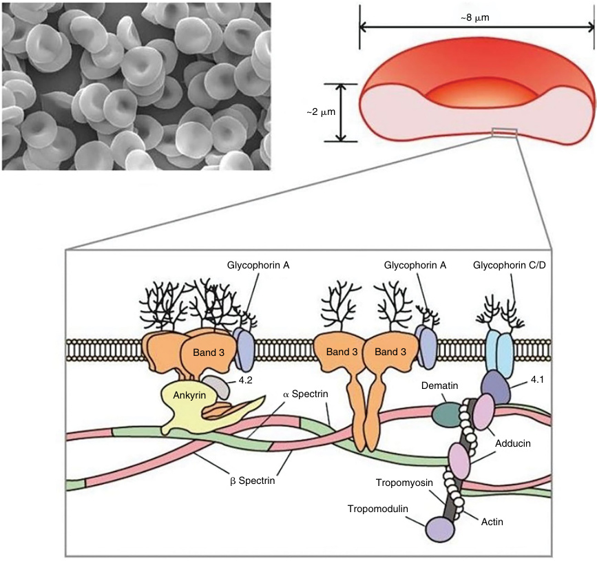

# Chapter 49: Nonimmune Hemolytic Anemias — Board-Style Self-Assessment MCQs
**Section IX: Hematologic Disorders** | [📖 Read Wiki Chapter](../chapters/049_Nonimmune_Hemolytic_Anemias.md) | [🃏 Chapter Flashcards](../flashcards/049_flashcards.md) | [🏠 Course Master Index](../../index.md)

Total questions: **14** *(Click "Show Answer & Rationale" beneath each question)*

### Question 1 (Clinical Vignette & Syndrome Diagnosis)
A pediatric patient is evaluated in the medical genetics clinic with the following clinical and molecular profile: Abnormal Protein: β-Spectrin — Gene/Chromosome: the causative gene/14q23-q24.1 — Frequency: 40–50% — Anemia RBC Morphology: Slight to moderate Spherocytes+acanthocytes. Which of the following rare disorders is the most likely diagnosis?

- **A.** Erythroenzymopathies
- **B.** HS-1
- **C.** Hereditary Elliptocytosis
- **D.** HS-2

<b>Show Answer & Rationale</b>

**Correct Answer: B** — HS-1

**Rationale:** **HS-1** caused by pathogenic variants in **`SPTB`** presents with: Abnormal Protein: β-Spectrin — Gene/Chromosome: SPTB/14q23-q24.1 — Frequency: 40–50% — Anemia RBC Morphology: Slight to moderate Spherocytes+acanthocytes.

**Why Other Options Are Incorrect:** **Erythroenzymopathies** is incorrect (associated with G6PD — Erythroenzymopathies, or defects in RBC enzymes (other than G6PD) are rare diseases leading to NIHA.). **Hereditary Elliptocytosis** is incorrect (associated with SPTA1 — The most frequently affected proteins are α- spectrin (SPTA1) in up to 65% of cases, β-spectrin (SPTB) in up t). **HS-2** is incorrect (associated with ANK1 — Abnormal Protein: Ankyrin — Gene/Chromosome: ANK1/8p11.2 — Frequency: 20–30% — Anemia RBC Morphology: Slight t).

### Question 2 (Clinical Vignette & Syndrome Diagnosis)
A pediatric patient is evaluated in the medical genetics clinic with the following clinical and molecular profile: Abnormal Protein: Ankyrin — Gene/Chromosome: the causative gene/8p11.2 — Frequency: 20–30% — Anemia RBC Morphology: Slight to moderate Spherocytes. Which of the following rare disorders is the most likely diagnosis?

- **A.** Glucose-6-Phosphate Dehydrogenase Deficiency
- **B.** HS-2
- **C.** HS-1
- **D.** HS-3

<b>Show Answer & Rationale</b>

**Correct Answer: B** — HS-2

**Rationale:** **HS-2** caused by pathogenic variants in **`ANK1`** presents with: Abnormal Protein: Ankyrin — Gene/Chromosome: ANK1/8p11.2 — Frequency: 20–30% — Anemia RBC Morphology: Slight to moderate Spherocytes.

**Why Other Options Are Incorrect:** **Glucose-6-Phosphate Dehydrogenase Deficiency** is incorrect (associated with G6PD — Glucose-6-phosphate dehydrogenase (G6PD) deficiency involves the hexose monophosphate shunt and is the most fr). **HS-1** is incorrect (associated with SPTB — Abnormal Protein: β-Spectrin — Gene/Chromosome: SPTB/14q23-q24.1 — Frequency: 40–50% — Anemia RBC Morphology: ). **HS-3** is incorrect (associated with SLC4A1 — Abnormal Protein: Band 3 — Gene/Chromosome: SLC4A1/17q21 — Frequency: 15–20% — Anemia RBC Morphology: Slight t).

### Question 3 (Clinical Vignette & Syndrome Diagnosis)
A pediatric patient is evaluated in the medical genetics clinic with the following clinical and molecular profile: Abnormal Protein: Band 3 — Gene/Chromosome: the causative gene/17q21 — Frequency: 15–20% — Anemia RBC Morphology: Slight to moderate Spherocytes+pincered cells. Which of the following rare disorders is the most likely diagnosis?

- **A.** Hereditary Stomatocytosis (Abnormal RBC Membrane Permeability Syndromes)
- **B.** HS-3
- **C.** HS-4
- **D.** Glucose-6-Phosphate Dehydrogenase Deficiency

<b>Show Answer & Rationale</b>

**Correct Answer: B** — HS-3

**Rationale:** **HS-3** caused by pathogenic variants in **`SLC4A1`** presents with: Abnormal Protein: Band 3 — Gene/Chromosome: SLC4A1/17q21 — Frequency: 15–20% — Anemia RBC Morphology: Slight to moderate Spherocytes+pincered cells.

**Why Other Options Are Incorrect:** **Hereditary Stomatocytosis (Abnormal RBC Membrane Permeability Syndromes)** is incorrect (associated with PIEZO1 — Dehydrated hereditary stomatocytosis 1 (DHS1) is the more prevalent form and is caused by pathogenic variants ). **HS-4** is incorrect (associated with SPTA1 — Abnormal Protein: α-Spectrin — Gene/Chromosome: SPTA1/1q22-q23 — Frequency: 5–7% — Anemia RBC Morphology: Seve). **Glucose-6-Phosphate Dehydrogenase Deficiency** is incorrect (associated with G6PD — Glucose-6-phosphate dehydrogenase (G6PD) deficiency involves the hexose monophosphate shunt and is the most fr).

### Question 4 (Clinical Vignette & Syndrome Diagnosis)
A pediatric patient is evaluated in the medical genetics clinic with the following clinical and molecular profile: Abnormal Protein: α-Spectrin — Gene/Chromosome: the causative gene/1q22-q23 — Frequency: 5–7% — Anemia RBC Morphology: Severe Spherocytes+microspherocytes+ schistocytes. Which of the following rare disorders is the most likely diagnosis?

- **A.** HS-4
- **B.** HS-2
- **C.** Erythroenzymopathies
- **D.** HS-3

<b>Show Answer & Rationale</b>

**Correct Answer: A** — HS-4

**Rationale:** **HS-4** caused by pathogenic variants in **`SPTA1`** presents with: Abnormal Protein: α-Spectrin — Gene/Chromosome: SPTA1/1q22-q23 — Frequency: 5–7% — Anemia RBC Morphology: Severe Spherocytes+microspherocytes+ schistocytes.

**Why Other Options Are Incorrect:** **HS-2** is incorrect (associated with ANK1 — Abnormal Protein: Ankyrin — Gene/Chromosome: ANK1/8p11.2 — Frequency: 20–30% — Anemia RBC Morphology: Slight t). **Erythroenzymopathies** is incorrect (associated with G6PD — Erythroenzymopathies, or defects in RBC enzymes (other than G6PD) are rare diseases leading to NIHA.). **HS-3** is incorrect (associated with SLC4A1 — Abnormal Protein: Band 3 — Gene/Chromosome: SLC4A1/17q21 — Frequency: 15–20% — Anemia RBC Morphology: Slight t).

### Question 5 (Clinical Vignette & Syndrome Diagnosis)
A pediatric patient is evaluated in the medical genetics clinic with the following clinical and molecular profile: The most severe form of HS is a compound heterozygous condition wherein a pathogenic the causative gene variant coexists in trans with the null polymorphic α-LEPRA (Low Expression, Prague) allele, which allows for residual expression of small amounts. Which of the following rare disorders is the most likely diagnosis?

- **A.** Glucose-6-Phosphate Dehydrogenase Deficiency
- **B.** Hereditary Stomatocytosis (Abnormal RBC Membrane Permeability Syndromes)
- **C.** Hereditary Spherocytosis
- **D.** Erythroenzymopathies

<b>Show Answer & Rationale</b>

**Correct Answer: C** — Hereditary Spherocytosis

**Rationale:** **Hereditary Spherocytosis** caused by pathogenic variants in **`SPTA1`** presents with: The most severe form of HS is a compound heterozygous condition wherein a pathogenic SPTA1 variant coexists in trans with the null polymorphic α-LEPRA (Low Expression, Prague) allele, which allows for residual expression of small amounts of normal α-spectrin sufficient to avoid the lethality associa.

**Why Other Options Are Incorrect:** **Glucose-6-Phosphate Dehydrogenase Deficiency** is incorrect (associated with G6PD — Glucose-6-phosphate dehydrogenase (G6PD) deficiency involves the hexose monophosphate shunt and is the most fr). **Hereditary Stomatocytosis (Abnormal RBC Membrane Permeability Syndromes)** is incorrect (associated with PIEZO1 — Dehydrated hereditary stomatocytosis 1 (DHS1) is the more prevalent form and is caused by pathogenic variants ). **Erythroenzymopathies** is incorrect (associated with G6PD — Erythroenzymopathies, or defects in RBC enzymes (other than G6PD) are rare diseases leading to NIHA.).

### Question 6 (Molecular & Genomic Etiology)
A child is diagnosed with **HS-1** after presenting with Abnormal Protein: β-Spectrin — Gene/Chromosome: the causative gene/14q23-q24.1 — Frequency: 40–50% — Anemia RBC Morphology: Slight to moderate Spherocytes+acanthocytes. Pathogenic variants in which of the following genes are the primary molecular etiology of this disorder?

- **A.** ABCC8
- **B.** SPTB
- **C.** SFTPB
- **D.** EDAR

<b>Show Answer & Rationale</b>

**Correct Answer: B** — SPTB

**Rationale:** Pathogenic variants in **`SPTB`** (Genetic) cause **HS-1**, characterized by Abnormal Protein: β-Spectrin — Gene/Chromosome: SPTB/14q23-q24.1 — Frequency: 40–50% — Anemia RBC Morphology: Slight to moderate Spherocytes+acanthocytes.

**Why Other Options Are Incorrect:** **ABCC8** is incorrect (associated with Hyperinsulinism, with enteropathy and deafness). **SFTPB** is incorrect (associated with SFTPB). **EDAR** is incorrect (associated with Ectodermal dysplasia 10A and 10B, AD and AR (ECTD10A, B)).

### Question 7 (Molecular & Genomic Etiology)
A child is diagnosed with **HS-2** after presenting with Abnormal Protein: Ankyrin — Gene/Chromosome: the causative gene/8p11.2 — Frequency: 20–30% — Anemia RBC Morphology: Slight to moderate Spherocytes. Pathogenic variants in which of the following genes are the primary molecular etiology of this disorder?

- **A.** DGKE
- **B.** MAP2K2
- **C.** ANK1
- **D.** EDAR

<b>Show Answer & Rationale</b>

**Correct Answer: C** — ANK1

**Rationale:** Pathogenic variants in **`ANK1`** (Genetic) cause **HS-2**, characterized by Abnormal Protein: Ankyrin — Gene/Chromosome: ANK1/8p11.2 — Frequency: 20–30% — Anemia RBC Morphology: Slight to moderate Spherocytes.

**Why Other Options Are Incorrect:** **DGKE** is incorrect (associated with Diacylglycerol kinase-ε). **MAP2K2** is incorrect (associated with Cardio-facio-cutaneous syndrome). **EDAR** is incorrect (associated with Ectodermal dysplasia 10A and 10B, AD and AR (ECTD10A, B)).

### Question 8 (Molecular & Genomic Etiology)
A child is diagnosed with **HS-3** after presenting with Abnormal Protein: Band 3 — Gene/Chromosome: the causative gene/17q21 — Frequency: 15–20% — Anemia RBC Morphology: Slight to moderate Spherocytes+pincered cells. Pathogenic variants in which of the following genes are the primary molecular etiology of this disorder?

- **A.** PLOD1
- **B.** SLC4A1
- **C.** STX11
- **D.** C8A

<b>Show Answer & Rationale</b>

**Correct Answer: B** — SLC4A1

**Rationale:** Pathogenic variants in **`SLC4A1`** (Genetic) cause **HS-3**, characterized by Abnormal Protein: Band 3 — Gene/Chromosome: SLC4A1/17q21 — Frequency: 15–20% — Anemia RBC Morphology: Slight to moderate Spherocytes+pincered cells.

**Why Other Options Are Incorrect:** **PLOD1** is incorrect (associated with Ehlers-Danlos syndrome (EDS) subtypes). **STX11** is incorrect (associated with Type 4 (F-HLH 4)). **C8A** is incorrect (associated with Neisseria).

### Question 9 (Molecular & Genomic Etiology)
A child is diagnosed with **HS-4** after presenting with Abnormal Protein: α-Spectrin — Gene/Chromosome: the causative gene/1q22-q23 — Frequency: 5–7% — Anemia RBC Morphology: Severe Spherocytes+microspherocytes+ schistocytes. Pathogenic variants in which of the following genes are the primary molecular etiology of this disorder?

- **A.** KCNQ1
- **B.** PYGM
- **C.** SPTA1
- **D.** CDKN1C

<b>Show Answer & Rationale</b>

**Correct Answer: C** — SPTA1

**Rationale:** Pathogenic variants in **`SPTA1`** (Genetic) cause **HS-4**, characterized by Abnormal Protein: α-Spectrin — Gene/Chromosome: SPTA1/1q22-q23 — Frequency: 5–7% — Anemia RBC Morphology: Severe Spherocytes+microspherocytes+ schistocytes.

**Why Other Options Are Incorrect:** **KCNQ1** is incorrect (associated with Jervell and Lange- Nielsen syndrome). **PYGM** is incorrect (associated with V (McArdle) Myophosphorylase). **CDKN1C** is incorrect (associated with NOS 21-0210).

### Question 10 (Visual & Diagnostic Imaging Vignette)

A pediatric patient undergoes diagnostic evaluation for **Nonimmune Hemolytic Anemias**, yielding the clinical, neuroimaging, or molecular finding shown below. Which of the following best characterizes the illustrated disorder or mechanism?

- **A.** Osmoscan curve profile of different membranopathies. A clear distinction between normal control (green line) , hereditary spherocytosis (HS), hereditary elliptocytosis (HE), hereditary pyrop
- **B.** Red blood cell (RBC) shape and sizes. Structure of RBC membrane skeleton.
- **C.** Sodium dodecyl sulfate polyacrylamide gel electrophoresis (SDS-PAGE) of membrane
- **D.** May-Grünwald Giemsa-stained blood smear of a patient with hereditary spherocytosis. Top: two spherocytes (arrows) ; Bottom: pincer cell (arrow) .

<b>Show Answer & Rationale</b>

**Correct Answer: B** — Red blood cell (RBC) shape and sizes. Structure of RBC membrane skeleton.

**Rationale:** **Fig. 49.1**: Red blood cell (RBC) shape and sizes. Structure of RBC membrane skeleton.

### Question 11 (Diagnostic Criteria (Nonimmune Hemolytic Anemias))
During a multidisciplinary genetics evaluation for **Nonimmune Hemolytic Anemias**, which clinical entity or diagnostic phenomenon is defined by the following profile?
"heterogeneous group of rare diseases that primarily affect the integrity of the red blood cell (RBC), but that can also affect hematopoiesis."

- **A.** Angelman syndrome (AS)
- **B.** malaria
- **C.** Nonimmune hemolytic anemias (NIHAs)
- **D.** Hereditary Stomatocytosis (Abnormal RBC Membrane Permeability Syndromes)

<b>Show Answer & Rationale</b>

**Correct Answer: C** — Nonimmune hemolytic anemias (NIHAs)

**Rationale:** Nonimmune hemolytic anemias (NIHAs) are a heterogeneous group of rare diseases that primarily affect the integrity of the red blood cell (RBC), but that can also affect hematopoiesis.

### Question 12 (Diagnostic Criteria (Membranopathies))
During a multidisciplinary genetics evaluation for **Membranopathies**, which clinical entity or diagnostic phenomenon is defined by the following profile?
"due to failure of horizontal interactions; and (3) hereditary stomatocytosis , due to altered permeability of the RBC membrane that leads to either an increase or decrease in cellular hydration and volume, with a resultant change in shape (Table 49."

- **A.** hereditary elliptocytosis (HE)
- **B.** HS-5
- **C.** Beckwith-Wiedemann syndrome (BWS)
- **D.** Babesiosis

<b>Show Answer & Rationale</b>

**Correct Answer: A** — hereditary elliptocytosis (HE)

**Rationale:** hereditary elliptocytosis (HE) , due to failure of horizontal interactions; and (3) hereditary stomatocytosis , due to altered permeability of the RBC membrane that leads to either an increase or decrease in cellular hydration and volume, with a resultant change in shape (Table 49.

### Question 13 (Diagnostic Criteria (Hereditary Spherocytosis))
During a multidisciplinary genetics evaluation for **Hereditary Spherocytosis**, which clinical entity or diagnostic phenomenon is defined by the following profile?
"the most common RBC membrane disorder."

- **A.** Prader-Willi syndrome (PWS)
- **B.** Hereditary spherocytosis (HS)
- **C.** Erythroenzymopathies
- **D.** hemolytic uremic syndrome (HUS)

<b>Show Answer & Rationale</b>

**Correct Answer: B** — Hereditary spherocytosis (HS)

**Rationale:** Hereditary spherocytosis (HS) is the most common RBC membrane disorder.

### Question 14 (Clinical & Pathophysiologic Mastery (Nonimmune Hemolytic Anemias))
When counseling a family and planning diagnostic management for **Nonimmune Hemolytic Anemias** (*Nonimmune Hemolytic Anemias*), which of the following clinical-genetic principles is **ACCURATE**?

- **A.** First-line diagnostic confirmation relies solely on conventional Giemsa-banded karyotyping rather than sequencing or targeted assays.
- **B.** The condition is a benign, self-limiting physiologic variant that requires neither longitudinal surveillance nor genetic counseling.
- **C.** The hallmark of NIHA is a negative antihuman immunoglobulin test (i.e., direct Coombs test).
- **D.** Enzyme activity and protein expression remain completely normal across all affected tissues, excluding a monogenic etiology.

<b>Show Answer & Rationale</b>

**Correct Answer: C** — The hallmark of NIHA is a negative antihuman immunoglobulin test (i.e., direct Coombs test).

**Rationale:** **Clinical & Molecular Principle (Nonimmune Hemolytic Anemias):** The hallmark of NIHA is a negative antihuman immunoglobulin test (i.e., direct Coombs test).

