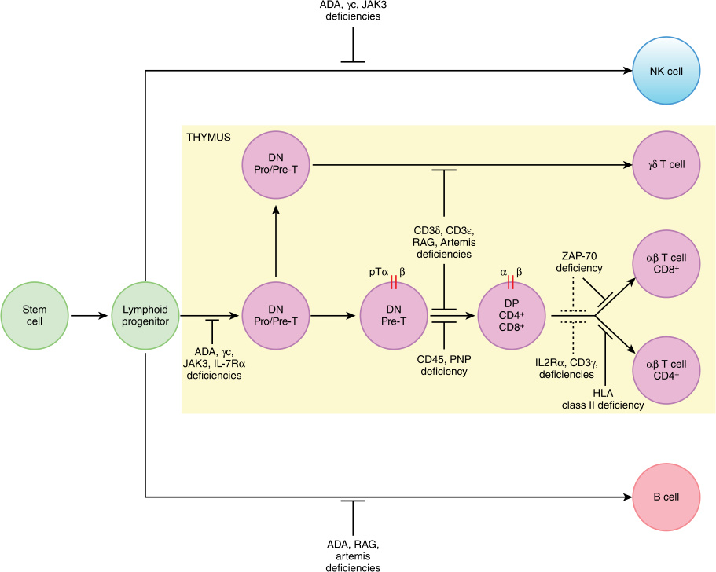

# Chapter 54: Primary T Cell Immunodeficiencies — Board-Style Self-Assessment MCQs
**Section X: Immune/Inflammatory Disorders** | [📖 Read Wiki Chapter](../chapters/054_Primary_T_Cell_Immunodeficiencies.md) | [🃏 Chapter Flashcards](../flashcards/054_flashcards.md) | [🏠 Course Master Index](../../index.md)

Total questions: **14** *(Click "Show Answer & Rationale" beneath each question)*

### Question 1 (Molecular & Genomic Etiology)
A child is diagnosed with **IL2RG** after presenting with ~30% — Most common (42%) — SCID Subtype: Common — Although most commonly associated with hypomorphic variants in RAG1/2 , other defects including DCLRE1C, LIG4, RMRP, ZAP70, the causative gene, IL7R , CD3D , an. Pathogenic variants in which of the following genes are the primary molecular etiology of this disorder?

- **A.** SUFU
- **B.** IL2RG
- **C.** NTRK1
- **D.** SLC5A1

<b>Show Answer & Rationale</b>

**Correct Answer: B** — IL2RG

**Rationale:** Pathogenic variants in **`IL2RG`** (Genetic) cause **IL2RG**, characterized by ~30% — Most common (42%) — SCID Subtype: Common — Although most commonly associated with hypomorphic variants in RAG1/2 , other defects including DCLRE1C, LIG4, RMRP, ZAP70, IL2RG, IL7R , CD3D , and ADA have all been associated with Omenn syndrome (Table 54.5)..

**Why Other Options Are Incorrect:** **SUFU** is incorrect (associated with Nevoid basal cell carcinoma syndrome (Gorlin syndrome)). **NTRK1** is incorrect (associated with HSAN4 (congenital insensitivity to pain with anhidrosis CIPA)). **SLC5A1** is incorrect (associated with Glucose-galactose malabsorption).

### Question 2 (Molecular & Genomic Etiology)
A child is diagnosed with **RAG1** after presenting with ~17% — Common — SCID Subtype: Most common (26%) — Most common (79%) — The recombination-activating genes the causative gene and RAG2 encode proteins that are critical for initiating V(D)J recombination.. Pathogenic variants in which of the following genes are the primary molecular etiology of this disorder?

- **A.** THBD
- **B.** ELP1
- **C.** SAMD9
- **D.** RAG1

<b>Show Answer & Rationale</b>

**Correct Answer: D** — RAG1

**Rationale:** Pathogenic variants in **`RAG1`** (Genetic) cause **RAG1**, characterized by ~17% — Common — SCID Subtype: Most common (26%) — Most common (79%) — The recombination-activating genes RAG1 and RAG2 encode proteins that are critical for initiating V(D)J recombination..

**Why Other Options Are Incorrect:** **THBD** is incorrect (associated with 20p11.21). **ELP1** is incorrect (associated with ELP1 related medulloblastoma). **SAMD9** is incorrect (associated with SAMD9/SAMD9L disorders).

### Question 3 (Molecular & Genomic Etiology)
A child is diagnosed with **IL7R** after presenting with ~7% — Common — Very rare — Interleukin-7 receptor-α (IL-7Rα) deficiency is an autosomal recessive disorder caused by variants in the IL-7Rα chain (encoded by the causative gene ).. Pathogenic variants in which of the following genes are the primary molecular etiology of this disorder?

- **A.** PANK2
- **B.** IL7R
- **C.** CHD2
- **D.** SPTB

<b>Show Answer & Rationale</b>

**Correct Answer: B** — IL7R

**Rationale:** Pathogenic variants in **`IL7R`** (AR) cause **IL7R**, characterized by ~7% — Common — Very rare — Interleukin-7 receptor-α (IL-7Rα) deficiency is an autosomal recessive disorder caused by variants in the IL-7Rα chain (encoded by IL7R )..

**Why Other Options Are Incorrect:** **PANK2** is incorrect (associated with Pantothenate kinase-associated neurodegeneration (PKAN)). **CHD2** is incorrect (associated with Childhood-onset epileptic encephalopathy). **SPTB** is incorrect (associated with HS-1).

### Question 4 (Molecular & Genomic Etiology)
A child is diagnosed with **DCLRE1C** after presenting with ~7% — Common — SCID Subtype: Rare — Although most commonly associated with hypomorphic variants in RAG1/2 , other defects including the causative gene, LIG4, RMRP, ZAP70, IL2RG, IL7R , CD3D , and ADA have all b. Pathogenic variants in which of the following genes are the primary molecular etiology of this disorder?

- **A.** TP53
- **B.** PTEN
- **C.** DCLRE1C
- **D.** AICDA

<b>Show Answer & Rationale</b>

**Correct Answer: C** — DCLRE1C

**Rationale:** Pathogenic variants in **`DCLRE1C`** (Genetic) cause **DCLRE1C**, characterized by ~7% — Common — SCID Subtype: Rare — Although most commonly associated with hypomorphic variants in RAG1/2 , other defects including DCLRE1C, LIG4, RMRP, ZAP70, IL2RG, IL7R , CD3D , and ADA have all been associated with Omenn syndrome (Table 54.5)..

**Why Other Options Are Incorrect:** **TP53** is incorrect (associated with Li-Fraumeni syndrome). **PTEN** is incorrect (associated with PTEN hamartoma tumor syndrome (Cowden syndrome, Bannayan- Riley-Ruvalcaba syndrome, and PTEN-related Proteus s). **AICDA** is incorrect (associated with Hyper-IgM syndrome).

### Question 5 (Molecular & Genomic Etiology)
A child is diagnosed with **JAK3** after presenting with ~5% — Common — SCID Subtype: Unusual — Janus kinase-3 (the causative gene) deficiency is an autosomal recessive disorder whose presentation closely resembles that of IL-2Rγc deficiency with loss of T and NK cel. Pathogenic variants in which of the following genes are the primary molecular etiology of this disorder?

- **A.** IDS
- **B.** KCNH2
- **C.** JAK3
- **D.** MPI

<b>Show Answer & Rationale</b>

**Correct Answer: C** — JAK3

**Rationale:** Pathogenic variants in **`JAK3`** (AR) cause **JAK3**, characterized by ~5% — Common — SCID Subtype: Unusual — Janus kinase-3 (JAK3) deficiency is an autosomal recessive disorder whose presentation closely resembles that of IL-2Rγc deficiency with loss of T and NK cells, but preservation of B cell development..

**Why Other Options Are Incorrect:** **IDS** is incorrect (associated with NOS 22-0020). **KCNH2** is incorrect (associated with LQT2). **MPI** is incorrect (associated with Congenital disorders of glycosylation (CDGs)).

### Question 6 (Molecular & Genomic Etiology)
A child is diagnosed with **RAG2** after presenting with ~4% — Unusual — SCID Subtype: Common — Common — The recombination-activating genes RAG1 and the causative gene encode proteins that are critical for initiating V(D)J recombination.. Pathogenic variants in which of the following genes are the primary molecular etiology of this disorder?

- **A.** RAG2
- **B.** F2
- **C.** ABCB11
- **D.** MVK

<b>Show Answer & Rationale</b>

**Correct Answer: A** — RAG2

**Rationale:** Pathogenic variants in **`RAG2`** (Genetic) cause **RAG2**, characterized by ~4% — Unusual — SCID Subtype: Common — Common — The recombination-activating genes RAG1 and RAG2 encode proteins that are critical for initiating V(D)J recombination..

**Why Other Options Are Incorrect:** **F2** is incorrect (associated with 11p11.2). **ABCB11** is incorrect (associated with Hepatocellular cholestasis). **MVK** is incorrect (associated with Mevalonate kinase deficiency(MVK)).

### Question 7 (Molecular & Genomic Etiology)
A child is diagnosed with **CD3D** after presenting with <2% — Unusual — SCID Subtype: Rare — Although most commonly associated with hypomorphic variants in RAG1/2 , other defects including DCLRE1C, LIG4, RMRP, ZAP70, IL2RG, IL7R , the causative gene , and ADA have a. Pathogenic variants in which of the following genes are the primary molecular etiology of this disorder?

- **A.** PIK3R1
- **B.** CD3D
- **C.** TMEM173
- **D.** NPC2

<b>Show Answer & Rationale</b>

**Correct Answer: B** — CD3D

**Rationale:** Pathogenic variants in **`CD3D`** (Genetic) cause **CD3D**, characterized by <2% — Unusual — SCID Subtype: Rare — Although most commonly associated with hypomorphic variants in RAG1/2 , other defects including DCLRE1C, LIG4, RMRP, ZAP70, IL2RG, IL7R , CD3D , and ADA have all been associated with Omenn syndrome (Table 54.5)..

**Why Other Options Are Incorrect:** **PIK3R1** is incorrect (associated with Diagnosis of Mosaic Overgrowth Disorders). **NPC2** is incorrect (associated with Niemann-Pick disease type C).

### Question 8 (Molecular & Genomic Etiology)
A child is diagnosed with **LIG4** after presenting with <1% — SCID Subtype: Rare — Although most commonly associated with hypomorphic variants in RAG1/2 , other defects including DCLRE1C, the causative gene, RMRP, ZAP70, IL2RG, IL7R , CD3D , and ADA have all been as. Pathogenic variants in which of the following genes are the primary molecular etiology of this disorder?

- **A.** GJB2
- **B.** C1QC
- **C.** MMACHC
- **D.** LIG4

<b>Show Answer & Rationale</b>

**Correct Answer: D** — LIG4

**Rationale:** Pathogenic variants in **`LIG4`** (Genetic) cause **LIG4**, characterized by <1% — SCID Subtype: Rare — Although most commonly associated with hypomorphic variants in RAG1/2 , other defects including DCLRE1C, LIG4, RMRP, ZAP70, IL2RG, IL7R , CD3D , and ADA have all been associated with Omenn syndrome (Table 54.5)..

**Why Other Options Are Incorrect:** **GJB2** is incorrect (associated with Keratitis–ichthyosis–deafness syndrome, AD (KID)). **C1QC** is incorrect (associated with Streptococcus pneumoniae).

### Question 9 (Molecular & Genomic Etiology)
A child is diagnosed with **NHEJ1** after presenting with <1% — SCID Subtype: Rare — Cernunnos, encoded by the causative gene , is an essential component of the non-homologous end joining (NHEJ) pathway and forms a complex with DNA ligase II and XRCC4 to repair double. Pathogenic variants in which of the following genes are the primary molecular etiology of this disorder?

- **A.** ADAR
- **B.** ATXN2
- **C.** NHEJ1
- **D.** NKX2-1

<b>Show Answer & Rationale</b>

**Correct Answer: C** — NHEJ1

**Rationale:** Pathogenic variants in **`NHEJ1`** (Genetic) cause **NHEJ1**, characterized by <1% — SCID Subtype: Rare — Cernunnos, encoded by NHEJ1 , is an essential component of the non-homologous end joining (NHEJ) pathway and forms a complex with DNA ligase II and XRCC4 to repair double strand brakes..

**Why Other Options Are Incorrect:** **ADAR** is incorrect (associated with Congenital-onset glaucoma). **ATXN2** is incorrect (associated with Spinocerebellar ataxia, AD, types 1, 2, 3, 7, 10, 12, 36; 14, 23, 27). **NKX2-1** is incorrect (associated with Thyroxine, thyroid-stimulating hormone).

### Question 10 (Visual & Diagnostic Imaging Vignette)

A pediatric patient undergoes diagnostic evaluation for **Primary T Cell Immunodeficiencies**, yielding the clinical, neuroimaging, or molecular finding shown below. Which of the following best characterizes the illustrated disorder or mechanism?

- **A.** T cell signaling. T cells are activated following T cell receptor engagement with peptide-major histocompatibility complex (MHC) or following engagement of interleukin (IL) receptors, co-rec
- **B.** Profound T cell deficiency arising from impaired maturation of T lineage cells in the thymus. Lymphoid progenitor cells from the bone marrow enter the thymus where they undergo differentiation an
- **C.** Profound T cell deficiency arising from impaired maturation of T lineage cells in the thymus. Lymphoid progenitor cells from the bone marrow enter the thymus where they undergo differentiati
- **D.** SCID is characterized by near complete absence of peripheral T cells and impaired B cell function with or without reduction in B cell numbers.

<b>Show Answer & Rationale</b>

**Correct Answer: B** — Profound T cell deficiency arising from impaired maturation of T lineage cells in the thymus. Lymphoid progenitor cells from the bone marrow enter the thymus where they undergo differentiation an

**Rationale:** **Fig. 54.1**: Profound T cell deficiency arising from impaired maturation of T lineage cells in the thymus. Lymphoid progenitor cells from the bone marrow enter the thymus where they undergo differentiation and maturation into functional T cells. Naïve thymocytes ( DN , double negative cells) undergo T cell receptor rearrangement, namely β-chain rearrangement and pairing of the β-chain with the pre-TCRα chain, giving rise to cells expressing both CD4 and CD8 ( DP , double positive cells). After positive and negative selection in the cortex, thymocytes downregulate the expression of either CD4 or CD8, resulting in single positive cells. These cells are exported from the thymus to the blood and secondary lymphatic organs, where they encounter antigens and exert their biological functions. Various defects in this process can cause profound T cell deficiencies. Blocked lines indicate specific stages impaired by known genetic abnormalities. Some defects may also interfere with maturation of B and natural killer (NK) cells. ADA, Adenosine deaminase deficiency; DN, double negative; γc, gamma common chain of the interleukin (IL) 2 receptor; IL2R α, alpha chain of the IL2 receptor; IL7R α, alpha chain of the IL7 receptor; JAK3, Janus activated kinase 3; MHC, major histocompatibility complex; PNP, purine nucleoside phosphorylase; RAG, recombination activating genes; ZAP-70, zeta chain associated protein kinase 70.

### Question 11 (Diagnostic Criteria (TTC7A Deficiency (MIA Syndrome)))
During a multidisciplinary genetics evaluation for **TTC7A Deficiency (MIA Syndrome)**, which clinical entity or diagnostic phenomenon is defined by the following profile?
"is an autosomal recessive condition that causes multiple obstructions in the bowel, intestinal inflammation, and diarrhea."

- **A.** Adenosine deaminase deficiency (TBNK)
- **B.** multiple intestinal atresia (MIA) syndrome
- **C.** Beckwith-Wiedemann syndrome (BWS)
- **D.** CARD11/BCL10/MALT1

<b>Show Answer & Rationale</b>

**Correct Answer: B** — multiple intestinal atresia (MIA) syndrome

**Rationale:** multiple intestinal atresia (MIA) syndrome , is an autosomal recessive condition that causes multiple obstructions in the bowel, intestinal inflammation, and diarrhea.

### Question 12 (Diagnostic Criteria (Combined Immunodeficiency With EBVLymphoproliferation))
During a multidisciplinary genetics evaluation for **Combined Immunodeficiency With EBVLymphoproliferation**, which clinical entity or diagnostic phenomenon is defined by the following profile?
"XLP-1 and XLP-2, result from variants in SH2DIA and BIRC4 , respectively, and occur in an X-linked manner."

- **A.** X-linked lymphoproliferative syndromes
- **B.** IL-2Rα/CD25 deficiency
- **C.** TTC7A deficiency
- **D.** CD45 deficiency (TBNK)

<b>Show Answer & Rationale</b>

**Correct Answer: A** — X-linked lymphoproliferative syndromes

**Rationale:** X-linked lymphoproliferative syndromes , XLP-1 and XLP-2, result from variants in SH2DIA and BIRC4 , respectively, and occur in an X-linked manner.

### Question 13 (Diagnostic Criteria (Moesin Deficiency))
During a multidisciplinary genetics evaluation for **Moesin Deficiency**, which clinical entity or diagnostic phenomenon is defined by the following profile?
"this condition is caused by pathogenic variants in the cytoskeletal protein moesin and is transmitted in an X-linked manner."

- **A.** IL-2Rα/CD25 deficiency
- **B.** X-linked lymphoproliferative syndromes
- **C.** X-linked moesin-associated immune deficiency (XMAID)
- **D.** multiple intestinal atresia (MIA) syndrome

<b>Show Answer & Rationale</b>

**Correct Answer: C** — X-linked moesin-associated immune deficiency (XMAID)

**Rationale:** X-linked moesin-associated immune deficiency (XMAID) , this condition is caused by pathogenic variants in the cytoskeletal protein moesin and is transmitted in an X-linked manner.

### Question 14 (Clinical & Pathophysiologic Mastery (Severe Combined Immunodeficiency (SCID)))
When counseling a family and planning diagnostic management for **Severe Combined Immunodeficiency (SCID)** (*Primary T Cell Immunodeficiencies*), which of the following clinical-genetic principles is **ACCURATE**?

- **A.** First-line diagnostic confirmation relies solely on conventional Giemsa-banded karyotyping rather than sequencing or targeted assays.
- **B.** SCID is characterized by near complete absence of peripheral T cells and impaired B cell function with or without reduction in B cell numbers.
- **C.** Inheritance is exclusively holandric (Y-linked) with complete penetrance restricted to male offspring.
- **D.** The condition is a benign, self-limiting physiologic variant that requires neither longitudinal surveillance nor genetic counseling.

<b>Show Answer & Rationale</b>

**Correct Answer: B** — SCID is characterized by near complete absence of peripheral T cells and impaired B cell function with or without reduction in B cell numbers.

**Rationale:** **Clinical & Molecular Principle (Severe Combined Immunodeficiency (SCID)):** SCID is characterized by near complete absence of peripheral T cells and impaired B cell function with or without reduction in B cell numbers.

