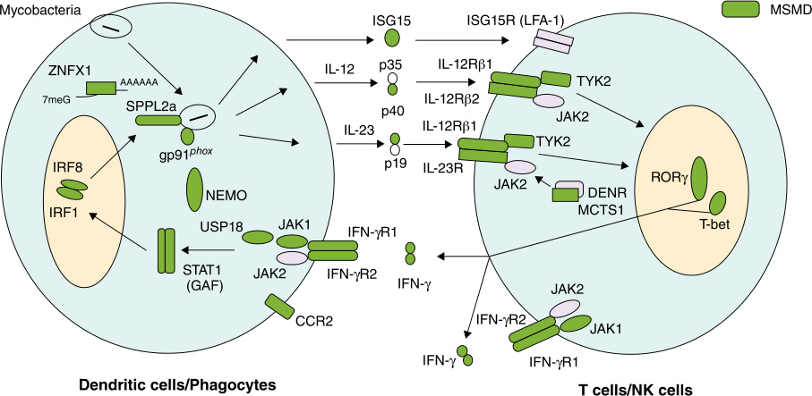

# Chapter 55: Innate Defects in Host Defenses Against Infections — Board-Style Self-Assessment MCQs
**Section X: Immune/Inflammatory Disorders** | [📖 Read Wiki Chapter](../chapters/055_Innate_Defects_in_Host_Defenses_Against_Infections.md) | [🃏 Chapter Flashcards](../flashcards/055_flashcards.md) | [🏠 Course Master Index](../../index.md)

Total questions: **14** *(Click "Show Answer & Rationale" beneath each question)*

### Question 1 (Clinical Vignette & Syndrome Diagnosis)
A pediatric patient is evaluated in the medical genetics clinic with the following clinical and molecular profile: Genes: the causative gene the causative gene — Pattern of: AD — (MSMD): 19 Genes — Neutropenia can be isolated or syndromic (with an extrahematopoietic involvement) and is caused by a number of genes (the causative gene, the causative gene, G6PC3, VP. Which of the following rare disorders is the most likely diagnosis?

- **A.** GATA2 deficiency
- **B.** Severe congenital
- **C.** Defects of Phagocyte Mo
- **D.** G-CSF receptor deficiency

<b>Show Answer & Rationale</b>

**Correct Answer: B** — Severe congenital

**Rationale:** **Severe congenital** caused by pathogenic variants in **`ELANE, GFI1`** presents with: Genes: ELANE GFI1 — Pattern of: AD — (MSMD): 19 Genes — Neutropenia can be isolated or syndromic (with an extrahematopoietic involvement) and is caused by a number of genes (ELANE, GFI1, G6PC3, VPS45, HAX1, G6PT1, WAS, LAMTOR2, TAZ, VPS13B, USB1, JAGN1, CLPB, CSF3R, SMARCD2, CEBPE, SBDS, DNAJC21, EFL1, HYOU1, SRP54, CXCR2) ..

**Why Other Options Are Incorrect:** **GATA2 deficiency** is incorrect (associated with GATA2, IRF3 — Genes: GATA2 — Pattern of: AD — i IRF3 deficiency i — Genes: IRF3 — Pattern of: AD — Germline heterozygous pat). **Defects of Phagocyte Mo** is incorrect (associated with MCTS1 — Genes: tility: 10 Genes — MCTS1 deficiency — Genes: MCTS1 — Pattern of: XL — Genetic dissection of MSMD has id). **G-CSF receptor deficiency** is incorrect (associated with CSF3R, ISG15 — Genes: CSF3R — Pattern of: AR — ISG15 deficiency — Genes: ISG15 — Pattern of: AR — Genetic dissection of MSMD ).

### Question 2 (Clinical Vignette & Syndrome Diagnosis)
A pediatric patient is evaluated in the medical genetics clinic with the following clinical and molecular profile: Genes: , G6PC3, the causative gene — Pattern of: AR — IL-12 and IL-23 receptor β1 chain deficiency — Genes: the causative gene — Pattern of: AR. Which of the following rare disorders is the most likely diagnosis?

- **A.** neutropenia
- **B.** STAT2 deficiency
- **C.** syndrome
- **D.** Disseminated BCG, NTM

<b>Show Answer & Rationale</b>

**Correct Answer: A** — neutropenia

**Rationale:** **neutropenia** caused by pathogenic variants in **`VPS45, IL12RB1`** presents with: Genes: , G6PC3, VPS45 — Pattern of: AR — IL-12 and IL-23 receptor β1 chain deficiency — Genes: IL12RB1 — Pattern of: AR.

**Why Other Options Are Incorrect:** **STAT2 deficiency** is incorrect (associated with STAT2 — Inheritance: AR — Affected Cells: Leukocytes and other cells — Affected Function: STAT2-dependent IFN-α/βandλ ). **syndrome** is incorrect (associated with SRP54 — Inheritance: AD — Affected Pathways: Co-translational protein modification — Shwachman-Diamond syndrome is a r). **Disseminated BCG, NTM** is incorrect (associated with IRF8 — IRF8 deficiency — Gene/Inheritance: IRF8/AD — Treatment: Antimycobacterials — Genetic dissection of MSMD has i).

### Question 3 (Clinical Vignette & Syndrome Diagnosis)
A pediatric patient is evaluated in the medical genetics clinic with the following clinical and molecular profile: Genes: the causative gene — Pattern of: AR — i IL-12p40 (IL-12 and IL-23) i — Genes: the causative gene — Pattern of: AR. Which of the following rare disorders is the most likely diagnosis?

- **A.** IL-17RC
- **B.** IRAK4 deficiency
- **C.** Severe congenital
- **D.** Kostmann disease

<b>Show Answer & Rationale</b>

**Correct Answer: D** — Kostmann disease

**Rationale:** **Kostmann disease** caused by pathogenic variants in **`HAX1, IL12B`** presents with: Genes: HAX1 — Pattern of: AR — i IL-12p40 (IL-12 and IL-23) i — Genes: IL12B — Pattern of: AR.

**Why Other Options Are Incorrect:** **IL-17RC** is incorrect (associated with IL17RC — Inheritance: AR — Fungal Species: CMC — These IEIs can be caused by LOF variants in IL17F, IL17RA, IL17RC, ACT). **IRAK4 deficiency** is incorrect (associated with IRAK4 — Gene/Inheritance: IRAK4,AR — Clinical Phenotype: Early-onset invasive pyogenic bacterial infections resolving ). **Severe congenital** is incorrect (associated with ELANE, GFI1 — Genes: ELANE GFI1 — Pattern of: AD — (MSMD): 19 Genes — Neutropenia can be isolated or syndromic (with an extr).

### Question 4 (Clinical Vignette & Syndrome Diagnosis)
A pediatric patient is evaluated in the medical genetics clinic with the following clinical and molecular profile: IL-12Rβ2 deficiency i — Genes: the causative gene — Pattern of: AR — Genetic dissection of MSMD has identified deleterious variants in 22 genes, including 19 autosomal ( IFNGR1, IFNGR2, IFNG, STAT1, JAK1, IRF8, IRF1, SPPL2A, TYK2, IL12B, IL12RB1, the. Which of the following rare disorders is the most likely diagnosis?

- **A.** TBNK1 deficiency
- **B.** TLR3 deficiency
- **C.** GATA2 deficiency
- **D.** type 1b

<b>Show Answer & Rationale</b>

**Correct Answer: D** — type 1b

**Rationale:** **type 1b** caused by pathogenic variants in **`IL12RB2`** presents with: IL-12Rβ2 deficiency i — Genes: IL12RB2 — Pattern of: AR — Genetic dissection of MSMD has identified deleterious variants in 22 genes, including 19 autosomal ( IFNGR1, IFNGR2, IFNG, STAT1, JAK1, IRF8, IRF1, SPPL2A, TYK2, IL12B, IL12RB1, IL12RB2, IL23R, TBX21, RORC, ZNFX1, CCR2, ISG15, and USP18 ) and three X-linked ( CYBB, NEMO, and MCTS1 .

**Why Other Options Are Incorrect:** **TBNK1 deficiency** is incorrect (associated with TBNK1 — Gene/Inheritance: TBNK1/AD — Clinical Phenotype: HSV encephalitis — Treatment: Antiviral prophylaxis). **TLR3 deficiency** is incorrect (associated with TLR3 — Inheritance: AD AR — Affected Cells: Central nervous system (CNS) resident cells and fibroblasts — Affected Fu). **GATA2 deficiency** is incorrect (associated with GATA2, IRF3 — Genes: GATA2 — Pattern of: AD — i IRF3 deficiency i — Genes: IRF3 — Pattern of: AD — Germline heterozygous pat).

### Question 5 (Clinical Vignette & Syndrome Diagnosis)
A pediatric patient is evaluated in the medical genetics clinic with the following clinical and molecular profile: Genes: WAS the causative gene — Pattern of: XL AR — IL-23R deficiency IFN-γreceptor 1 deficiency — Genes: the causative gene the causative gene — Pattern of: AR AR, AD. Which of the following rare disorders is the most likely diagnosis?

- **A.** TLR3 deficiency
- **B.** type II)
- **C.** MyD88 deficiency
- **D.** X-linked neutropenia P14/LAMTOR2 deficiency

<b>Show Answer & Rationale</b>

**Correct Answer: D** — X-linked neutropenia P14/LAMTOR2 deficiency

**Rationale:** **X-linked neutropenia P14/LAMTOR2 deficiency** caused by pathogenic variants in **`LAMTOR2, IL23R, IFNGR1`** presents with: Genes: WAS LAMTOR2 — Pattern of: XL AR — IL-23R deficiency IFN-γreceptor 1 deficiency — Genes: IL23R IFNGR1 — Pattern of: AR AR, AD.

**Why Other Options Are Incorrect:** **TLR3 deficiency** is incorrect (associated with TLR3 — Inheritance: AD AR — Affected Cells: Central nervous system (CNS) resident cells and fibroblasts — Affected Fu). **type II)** is incorrect (associated with CYBB — Macrophage gp91 phox i — Genes: CYBB — Pattern of: XL — Genetic dissection of MSMD has identified deleterious ). **MyD88 deficiency** is incorrect (associated with MYD88 — Gene/Inheritance: MYD88,AR — Clinical Phenotype: Early-onset invasive pyogenic bacterial infections resolving ).

### Question 6 (Molecular & Genomic Etiology)
A child is diagnosed with **Severe congenital** after presenting with Genes: the causative gene the causative gene — Pattern of: AD — (MSMD): 19 Genes — Neutropenia can be isolated or syndromic (with an extrahematopoietic involvement) and is caused by a number of genes (the causa. Pathogenic variants in which of the following genes are the primary molecular etiology of this disorder?

- **A.** IL7R
- **B.** FANCA
- **C.** ACADVL
- **D.** ELANE

<b>Show Answer & Rationale</b>

**Correct Answer: D** — ELANE

**Rationale:** Pathogenic variants in **`ELANE`** (AD) cause **Severe congenital**, characterized by Genes: ELANE GFI1 — Pattern of: AD — (MSMD): 19 Genes — Neutropenia can be isolated or syndromic (with an extrahematopoietic involvement) and is caused by a number of genes (ELANE, GFI1, G6PC3, VPS45, HAX1, G6PT1, WAS, LAMTOR2, TAZ, VPS13B, USB1, JAGN1, CLPB, CSF3R, SMARCD2, CEBPE, SBDS, DNAJC21, EFL1, HYOU1, SRP54, CXCR2) ..

**Why Other Options Are Incorrect:** **IL7R** is incorrect (associated with IL7R). **FANCA** is incorrect (associated with Fanconi anemia). **ACADVL** is incorrect (associated with Very-long-chain acyl-CoA dehydrogenase (VLCAD) deficiency).

### Question 7 (Molecular & Genomic Etiology)
A child is diagnosed with **neutropenia** after presenting with Genes: , G6PC3, the causative gene — Pattern of: AR — IL-12 and IL-23 receptor β1 chain deficiency — Genes: the causative gene — Pattern of: AR. Pathogenic variants in which of the following genes are the primary molecular etiology of this disorder?

- **A.** BRAF
- **B.** PYGM
- **C.** VPS45
- **D.** PDHA1

<b>Show Answer & Rationale</b>

**Correct Answer: C** — VPS45

**Rationale:** Pathogenic variants in **`VPS45`** (AR) cause **neutropenia**, characterized by Genes: , G6PC3, VPS45 — Pattern of: AR — IL-12 and IL-23 receptor β1 chain deficiency — Genes: IL12RB1 — Pattern of: AR.

**Why Other Options Are Incorrect:** **BRAF** is incorrect (associated with Cardio-facio-cutaneous syndrome). **PYGM** is incorrect (associated with V (McArdle) Myophosphorylase). **PDHA1** is incorrect (associated with Complex, Paroxysmal).

### Question 8 (Molecular & Genomic Etiology)
A child is diagnosed with **Kostmann disease** after presenting with Genes: the causative gene — Pattern of: AR — i IL-12p40 (IL-12 and IL-23) i — Genes: the causative gene — Pattern of: AR. Pathogenic variants in which of the following genes are the primary molecular etiology of this disorder?

- **A.** SYNGAP1
- **B.** ACADM
- **C.** HAX1
- **D.** SLC12A1

<b>Show Answer & Rationale</b>

**Correct Answer: C** — HAX1

**Rationale:** Pathogenic variants in **`HAX1`** (AR) cause **Kostmann disease**, characterized by Genes: HAX1 — Pattern of: AR — i IL-12p40 (IL-12 and IL-23) i — Genes: IL12B — Pattern of: AR.

**Why Other Options Are Incorrect:** **SYNGAP1** is incorrect (associated with Autosomal dominant intellectual disability 5). **ACADM** is incorrect (associated with Medium-chain acyl-CoA dehydrogenase (MCAD) deficiency). **SLC12A1** is incorrect (associated with BS I (ABS, HPES)).

### Question 9 (Molecular & Genomic Etiology)
A child is diagnosed with **type 1b** after presenting with IL-12Rβ2 deficiency i — Genes: the causative gene — Pattern of: AR — Genetic dissection of MSMD has identified deleterious variants in 22 genes, including 19 autosomal ( IFNGR1, IFNGR2, IFNG, STAT1, JAK1, IRF8,. Pathogenic variants in which of the following genes are the primary molecular etiology of this disorder?

- **A.** DSG1
- **B.** MMUT
- **C.** IL12RB2
- **D.** TINF2

<b>Show Answer & Rationale</b>

**Correct Answer: C** — IL12RB2

**Rationale:** Pathogenic variants in **`IL12RB2`** (AR) cause **type 1b**, characterized by IL-12Rβ2 deficiency i — Genes: IL12RB2 — Pattern of: AR — Genetic dissection of MSMD has identified deleterious variants in 22 genes, including 19 autosomal ( IFNGR1, IFNGR2, IFNG, STAT1, JAK1, IRF8, IRF1, SPPL2A, TYK2, IL12B, IL12RB1, IL12RB2, IL23R, TBX21, RORC, ZNFX1, CCR2, ISG15, and USP18 ) and three X-linked ( CYBB, NEMO, and MCTS1 .

**Why Other Options Are Incorrect:** **MMUT** is incorrect (associated with Methylmalonic Acidemia). **TINF2** is incorrect (associated with Dyskeratosis Congenita (DC)).

### Question 10 (Visual & Diagnostic Imaging Vignette)

A pediatric patient undergoes diagnostic evaluation for **Innate Defects in Host Defenses Against Infections**, yielding the clinical, neuroimaging, or molecular finding shown below. Which of the following best characterizes the illustrated disorder or mechanism?

- **A.** Schematic representation of type 2 interferon mediated immunity and related genes in Mendelian susceptibility to mycobacterial diseases (MSMD). Summary of molecules implicated in the IFN-γ c
- **B.** NADPH oxidase components and activation. On neutrophil activation, the 3 cytosolic components p67 phox, p47 phox, and p40 phox (plus either Rac1 or Rac2) join together and are translocated t
- **C.** Schematic representation of type 2 interferon mediated immunity and related genes in Mendelian susceptibility to mycobacterial diseases (MSMD). Summary of molecules implicated in the IFN-γ circui
- **D.** Lung abscess and chronic lymphadenopathy in two patients with chronic granulomatous disease (CGD). (A) The computed tomography (CT) scan shows a cavity with thick walls, and an external irre

<b>Show Answer & Rationale</b>

**Correct Answer: C** — Schematic representation of type 2 interferon mediated immunity and related genes in Mendelian susceptibility to mycobacterial diseases (MSMD). Summary of molecules implicated in the IFN-γ circui

**Rationale:** **Fig. 55.1**: Schematic representation of type 2 interferon mediated immunity and related genes in Mendelian susceptibility to mycobacterial diseases (MSMD). Summary of molecules implicated in the IFN-γ circuit. Molecules represented with bold characters are known to cause MSMD. GAF, γ-activated factor; GAS, γ-interferon activated site.

### Question 11 (Diagnostic Criteria (Other Intrinsic and Innate Deficiencies With Susceptibility to Bacteria))
During a multidisciplinary genetics evaluation for **Other Intrinsic and Innate Deficiencies With Susceptibility to Bacteria**, which clinical entity or diagnostic phenomenon is defined by the following profile?
"(ICA) caused by pathogenic variants in RPSA or HMOX predisposes individuals to life-threatening invasive infections early in childhood, caused by encapsulated bacteria, typically _S."

- **A.** Isolated congenital asplenia
- **B.** STAT2 deficiency
- **C.** CARD9 deficiency
- **D.** HYOU1 deficiency i

<b>Show Answer & Rationale</b>

**Correct Answer: A** — Isolated congenital asplenia

**Rationale:** Isolated congenital asplenia (ICA) caused by pathogenic variants in RPSA or HMOX predisposes individuals to life-threatening invasive infections early in childhood, caused by encapsulated bacteria, typically _S.

### Question 12 (Diagnostic Criteria (Genetic Etiologies of Papillomaviruses (HPV) Infections in Humans))
During a multidisciplinary genetics evaluation for **Genetic Etiologies of Papillomaviruses (HPV) Infections in Humans**, which clinical entity or diagnostic phenomenon is defined by the following profile?
"genodermatosis presenting with persistent, disseminated, flat warts and pityriasis versicolor-like skin lesions induced by human β-papillomaviruses (β-HPVs)."

- **A.** Disseminated BCG
- **B.** immune deficiency due to
- **C.** Severe congenital
- **D.** Epidermodysplasia verruciformis (EV)

<b>Show Answer & Rationale</b>

**Correct Answer: D** — Epidermodysplasia verruciformis (EV)

**Rationale:** Epidermodysplasia verruciformis (EV) is a rare genodermatosis presenting with persistent, disseminated, flat warts and pityriasis versicolor-like skin lesions induced by human β-papillomaviruses (β-HPVs).

### Question 13 (Diagnostic Criteria (Genetic Etiologies of Papillomaviruses (HPV) Infections in Humans))
During a multidisciplinary genetics evaluation for **Genetic Etiologies of Papillomaviruses (HPV) Infections in Humans**, which clinical entity or diagnostic phenomenon is defined by the following profile?
"driven by some α-HPVs, was shown to be due to biallelic gainof-function (GOF) in NLRP1, suggesting an important role of cell intrinsic immunity against HPVs other than β-HPVs (α, γ, μ and ν)."

- **A.** Juvenile recurrent respiratory papillomatosis
- **B.** GATA2 deficiency
- **C.** TLR3 pathway evaluation
- **D.** MDA5 deficiency

<b>Show Answer & Rationale</b>

**Correct Answer: A** — Juvenile recurrent respiratory papillomatosis

**Rationale:** Juvenile recurrent respiratory papillomatosis , driven by some α-HPVs, was shown to be due to biallelic gainof-function (GOF) in NLRP1, suggesting an important role of cell intrinsic immunity against HPVs other than β-HPVs (α, γ, μ and ν).

### Question 14 (Clinical & Pathophysiologic Mastery (Phagocytic, Intrinsic and Innate Immune Deficiencies—cont'd))
When counseling a family and planning diagnostic management for **Phagocytic, Intrinsic and Innate Immune Deficiencies—cont'd** (*Innate Defects in Host Defenses Against Infections*), which of the following clinical-genetic principles is **ACCURATE**?

- **A.** First-line diagnostic confirmation relies solely on conventional Giemsa-banded karyotyping rather than sequencing or targeted assays.
- **B.** Pathogenesis is driven exclusively by maternal mitochondrial DNA deletions without nuclear gene involvement.
- **C.** AD, Autosomal dominant; AR, autosomal recessive; PA, pseudoautosomal recessive; XL, X-linked.
- **D.** Inheritance is exclusively holandric (Y-linked) with complete penetrance restricted to male offspring.

<b>Show Answer & Rationale</b>

**Correct Answer: C** — AD, Autosomal dominant; AR, autosomal recessive; PA, pseudoautosomal recessive; XL, X-linked.

**Rationale:** **Clinical & Molecular Principle (Phagocytic, Intrinsic and Innate Immune Deficiencies—cont'd):** AD, Autosomal dominant; AR, autosomal recessive; PA, pseudoautosomal recessive; XL, X-linked.

