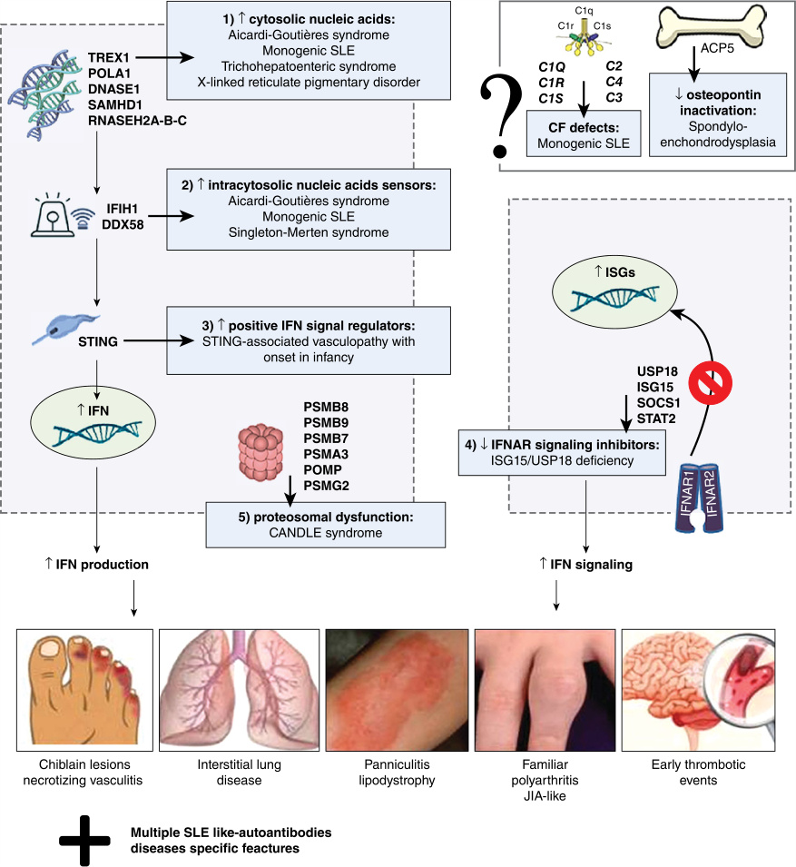

# Chapter 58: Type I Interferonopathies — Board-Style Self-Assessment MCQs
**Section X: Immune/Inflammatory Disorders** | [📖 Read Wiki Chapter](../chapters/058_Type_I_Interferonopathies.md) | [🃏 Chapter Flashcards](../flashcards/058_flashcards.md) | [🏠 Course Master Index](../../index.md)

Total questions: **14** *(Click "Show Answer & Rationale" beneath each question)*

### Question 1 (Clinical Vignette & Syndrome Diagnosis)
A pediatric patient is evaluated in the medical genetics clinic with the following clinical and molecular profile: Variant Mechanism (GOF/LOF): LOF — Inheritance: AR, AD (DN) — Protein Function: DNase. Which of the following rare disorders is the most likely diagnosis?

- **A.** Neonatal anemia, arthropathy, glomerulonephritis, and liver disease
- **B.** Failure to thrive/short stature
- **C.** AGS, FCL, SLE
- **D.** PRAAS

<b>Show Answer & Rationale</b>

**Correct Answer: C** — AGS, FCL, SLE

**Rationale:** **AGS, FCL, SLE** caused by pathogenic variants in **`TREX1`** presents with: Variant Mechanism (GOF/LOF): LOF — Inheritance: AR, AD (DN) — Protein Function: DNase.

**Why Other Options Are Incorrect:** **Neonatal anemia, arthropathy, glomerulonephritis, and liver disease** is incorrect (associated with DNASE2 — Variant Mechanism (GOF/LOF): LOF — Inheritance: AR — Protein Function: DNase). **Failure to thrive/short stature** is incorrect (associated with ACP5 — • Secondary to osseous dysplasia(ACP5) — Secondary to autosomal recessive variants in the acid phosphatase 5, ). **PRAAS** is incorrect (associated with PSMB8 — Variant Mechanism (GOF/LOF): LOF — Inheritance: AR — Protein Function: Proteosome — In some cases, additive lo).

### Question 2 (Clinical Vignette & Syndrome Diagnosis)
A pediatric patient is evaluated in the medical genetics clinic with the following clinical and molecular profile: Variant Mechanism (GOF/LOF): LOF — Inheritance: AR — Protein Function: RNase. Which of the following rare disorders is the most likely diagnosis?

- **A.** AGS, SP
- **B.** PTORCH, AGS-like
- **C.** Autoimmunity (including SLE), immune dysregulation, immunodeficiency
- **D.** X-linked reticulate pigmentary disorder

<b>Show Answer & Rationale</b>

**Correct Answer: A** — AGS, SP

**Rationale:** **AGS, SP** caused by pathogenic variants in **`RNASEH2B`** presents with: Variant Mechanism (GOF/LOF): LOF — Inheritance: AR — Protein Function: RNase.

**Why Other Options Are Incorrect:** **PTORCH, AGS-like** is incorrect (associated with USP18 — Variant Mechanism (GOF/LOF): LOF — Inheritance: AR — Protein Function: IFNAR regulation). **Autoimmunity (including SLE), immune dysregulation, immunodeficiency** is incorrect (associated with SOCS1 — Variant Mechanism (GOF/LOF): LOF — Inheritance: AD — Protein Function: JAK-STAT regulation). **X-linked reticulate pigmentary disorder** is incorrect (associated with POLA1 — Variant Mechanism (GOF/LOF): LOF — Inheritance: XLR — Protein Function: DNA polymerase).

### Question 3 (Clinical Vignette & Syndrome Diagnosis)
A pediatric patient is evaluated in the medical genetics clinic with the following clinical and molecular profile: Variant Mechanism (GOF/LOF): LOF — Inheritance: AR — Protein Function: Regulation of dNTP. Which of the following rare disorders is the most likely diagnosis?

- **A.** Infantile encephalopathy (mitochondrial disease), BSN
- **B.** AGS, FCL, cerebral vasculopathy
- **C.** NDD, systemic sclerosis, SP
- **D.** PTORCH, AGS-like

<b>Show Answer & Rationale</b>

**Correct Answer: B** — AGS, FCL, cerebral vasculopathy

**Rationale:** **AGS, FCL, cerebral vasculopathy** caused by pathogenic variants in **`SAMHD1`** presents with: Variant Mechanism (GOF/LOF): LOF — Inheritance: AR — Protein Function: Regulation of dNTP.

**Why Other Options Are Incorrect:** **Infantile encephalopathy (mitochondrial disease), BSN** is incorrect (associated with PNPT1 — Variant Mechanism (GOF/LOF): LOF — Inheritance: AR — Protein Function: Polynucleotide phosphorylase). **NDD, systemic sclerosis, SP** is incorrect (associated with ATAD3A — Variant Mechanism (GOF/LOF): LOF — Inheritance: AD (DN) — Protein Function: Multiple — DNA; or (ii) mitochondr). **PTORCH, AGS-like** is incorrect (associated with USP18 — Variant Mechanism (GOF/LOF): LOF — Inheritance: AR — Protein Function: IFNAR regulation).

### Question 4 (Clinical Vignette & Syndrome Diagnosis)
A pediatric patient is evaluated in the medical genetics clinic with the following clinical and molecular profile: Variant Mechanism (GOF/LOF): LOF — Inheritance: XLR — Protein Function: DNA polymerase. Which of the following rare disorders is the most likely diagnosis?

- **A.** PRAAS
- **B.** X-linked reticulate pigmentary disorder
- **C.** NDD, systemic sclerosis, SP
- **D.** Eosinophilic inflammatory disease, immune dysregulation

<b>Show Answer & Rationale</b>

**Correct Answer: B** — X-linked reticulate pigmentary disorder

**Rationale:** **X-linked reticulate pigmentary disorder** caused by pathogenic variants in **`POLA1`** presents with: Variant Mechanism (GOF/LOF): LOF — Inheritance: XLR — Protein Function: DNA polymerase.

**Why Other Options Are Incorrect:** **PRAAS** is incorrect (associated with PSMB8 — Variant Mechanism (GOF/LOF): LOF — Inheritance: AR — Protein Function: Proteosome — In some cases, additive lo). **NDD, systemic sclerosis, SP** is incorrect (associated with ATAD3A — Variant Mechanism (GOF/LOF): LOF — Inheritance: AD (DN) — Protein Function: Multiple — DNA; or (ii) mitochondr). **Eosinophilic inflammatory disease, immune dysregulation** is incorrect (associated with JAK1 — Variant Mechanism (GOF/LOF): GOF — Inheritance: AD — Protein Function: IFN signaling — This primarily involves).

### Question 5 (Clinical Vignette & Syndrome Diagnosis)
A pediatric patient is evaluated in the medical genetics clinic with the following clinical and molecular profile: Variant Mechanism (GOF/LOF): LOF — Inheritance: AD (DN) — Protein Function: Multiple — DNA; or (ii) mitochondrial integrity, perturbed by variant of the ATPase family AAA domain-containing protein 3A (the causative gene) gene, thought to lead to cyto. Which of the following rare disorders is the most likely diagnosis?

- **A.** AGS, BSN, SP
- **B.** NDD, systemic sclerosis, SP
- **C.** SPENCD, SLE
- **D.** STING-associated vasculopathy with onset in infancy, FCL

<b>Show Answer & Rationale</b>

**Correct Answer: B** — NDD, systemic sclerosis, SP

**Rationale:** **NDD, systemic sclerosis, SP** caused by pathogenic variants in **`ATAD3A`** presents with: Variant Mechanism (GOF/LOF): LOF — Inheritance: AD (DN) — Protein Function: Multiple — DNA; or (ii) mitochondrial integrity, perturbed by variant of the ATPase family AAA domain-containing protein 3A (ATAD3A) gene, thought to lead to cytosolic leakage of mitochondrial DNA..

**Why Other Options Are Incorrect:** **AGS, BSN, SP** is incorrect (associated with ADAR1 — Variant Mechanism (GOF/LOF): LOF — Inheritance: AR, AD (DN) — Protein Function: RNA editing). **SPENCD, SLE** is incorrect (associated with ACP5 — Variant Mechanism (GOF/LOF): LOF — Inheritance: AR — Protein Function: Phosphatase — Secondary to autosomal re). **STING-associated vasculopathy with onset in infancy, FCL** is incorrect (associated with STING1 — Variant Mechanism (GOF/LOF): GOF — Inheritance: AD, AR — Protein Function: Adaptor, DNA sensing).

### Question 6 (Molecular & Genomic Etiology)
A child is diagnosed with **AGS, FCL, SLE** after presenting with Variant Mechanism (GOF/LOF): LOF — Inheritance: AR, AD (DN) — Protein Function: DNase. Pathogenic variants in which of the following genes are the primary molecular etiology of this disorder?

- **A.** FGFR3
- **B.** KCNQ2
- **C.** TREX1
- **D.** HTT

<b>Show Answer & Rationale</b>

**Correct Answer: C** — TREX1

**Rationale:** Pathogenic variants in **`TREX1`** (AR) cause **AGS, FCL, SLE**, characterized by Variant Mechanism (GOF/LOF): LOF — Inheritance: AR, AD (DN) — Protein Function: DNase.

**Why Other Options Are Incorrect:** **FGFR3** is incorrect (associated with Lacrimo-auriculo-dento-digital syndrome (LADD)). **KCNQ2** is incorrect (associated with Complex).

### Question 7 (Molecular & Genomic Etiology)
A child is diagnosed with **AGS, SP** after presenting with Variant Mechanism (GOF/LOF): LOF — Inheritance: AR — Protein Function: RNase. Pathogenic variants in which of the following genes are the primary molecular etiology of this disorder?

- **A.** PMP22
- **B.** TERT
- **C.** HNF1A
- **D.** RNASEH2B

<b>Show Answer & Rationale</b>

**Correct Answer: D** — RNASEH2B

**Rationale:** Pathogenic variants in **`RNASEH2B`** (AR) cause **AGS, SP**, characterized by Variant Mechanism (GOF/LOF): LOF — Inheritance: AR — Protein Function: RNase.

**Why Other Options Are Incorrect:** **PMP22** is incorrect (associated with PMP22). **TERT** is incorrect (associated with Dyskeratosis Congenita (DC)). **HNF1A** is incorrect (associated with Glucosuria • Progressive glucose intolerance then diabetes in late adolescence or early adulthood).

### Question 8 (Molecular & Genomic Etiology)
A child is diagnosed with **AGS, FCL, cerebral vasculopathy** after presenting with Variant Mechanism (GOF/LOF): LOF — Inheritance: AR — Protein Function: Regulation of dNTP. Pathogenic variants in which of the following genes are the primary molecular etiology of this disorder?

- **A.** SPINK5
- **B.** DNAH5
- **C.** SAMHD1
- **D.** BBS1

<b>Show Answer & Rationale</b>

**Correct Answer: C** — SAMHD1

**Rationale:** Pathogenic variants in **`SAMHD1`** (AR) cause **AGS, FCL, cerebral vasculopathy**, characterized by Variant Mechanism (GOF/LOF): LOF — Inheritance: AR — Protein Function: Regulation of dNTP.

**Why Other Options Are Incorrect:** **SPINK5** is incorrect (associated with Netherton syndrome). **DNAH5** is incorrect (associated with Primary ciliary dyskinesia). **BBS1** is incorrect (associated with Bardet-Biedl syndrome (BBS)).

### Question 9 (Molecular & Genomic Etiology)
A child is diagnosed with **AGS, BSN, SP** after presenting with Variant Mechanism (GOF/LOF): LOF — Inheritance: AR, AD (DN) — Protein Function: RNA editing. Pathogenic variants in which of the following genes are the primary molecular etiology of this disorder?

- **A.** STING1
- **B.** KCNQ1OT1
- **C.** ADAR1
- **D.** IFIH1

<b>Show Answer & Rationale</b>

**Correct Answer: C** — ADAR1

**Rationale:** Pathogenic variants in **`ADAR1`** (AR) cause **AGS, BSN, SP**, characterized by Variant Mechanism (GOF/LOF): LOF — Inheritance: AR, AD (DN) — Protein Function: RNA editing.

**Why Other Options Are Incorrect:** **STING1** is incorrect (associated with STING-associated vasculopathy with onset in infancy, FCL). **IFIH1** is incorrect (associated with NOS 26-0540).

### Question 10 (Visual & Diagnostic Imaging Vignette)

A pediatric patient undergoes diagnostic evaluation for **Type I Interferonopathies**, yielding the clinical, neuroimaging, or molecular finding shown below. Which of the following best characterizes the illustrated disorder or mechanism?

- **A.** Schematic representation of various pathways affected in genetic interferonopathies. Purple rectangles indicate variant proteins in type I interferonopathies. Numbered yellow circles indicat
- **B.** Schematic representation of genetic mechanisms and clinical manifestations in main interferonopathies.
- **C.** Characteristic clinical phenotypes of interferonopathies. Chilblain lesions typical of monogenic type I interferonopathies, seen most frequently on the toes, fingers (A), ears (B), and nose.
- **D.** Clinical manifestations of stimulator of interferon genes (STING)–associated vasculopathy with onset in infancy (SAVI). (A) Typical facial distribution of telangiectatic lesions on the nose

<b>Show Answer & Rationale</b>

**Correct Answer: B** — Schematic representation of genetic mechanisms and clinical manifestations in main interferonopathies.

**Rationale:** **Fig. 58.1**: Schematic representation of genetic mechanisms and clinical manifestations in main interferonopathies.

### Question 11 (Diagnostic Criteria (Aicardi-Goutières Syndrome (AGS)))
During a multidisciplinary genetics evaluation for **Aicardi-Goutières Syndrome (AGS)**, which clinical entity or diagnostic phenomenon is defined by the following profile?
"nd/or cerebral aneurysms may be present, either with or without other features of AGS; individuals with SAMHD1 variant are at risk of cerebrovascular events."

- **A.** Moyamoya
- **B.** AGS, FCL, SLE
- **C.** COPA syndrome
- **D.** Infantile encephalopathy (mitochondrial disease), BSN

<b>Show Answer & Rationale</b>

**Correct Answer: A** — Moyamoya

**Rationale:** Moyamoya and/or cerebral aneurysms may be present, either with or without other features of AGS; individuals with SAMHD1 variant are at risk of cerebrovascular events.

### Question 12 (Diagnostic Criteria (Singleton-Merten Syndrome (SMS)))
During a multidisciplinary genetics evaluation for **Singleton-Merten Syndrome (SMS)**, which clinical entity or diagnostic phenomenon is defined by the following profile?
"for the disorders described above is generally oriented to the particular phenotype, focusing on management of vasculopathy and neurological disability and monitoring for end-organ disease (e."

- **A.** Treatment
- **B.** AGS, SMS, SP
- **C.** CMC, Autoimmunity, ICC
- **D.** Angelman syndrome (AS)

<b>Show Answer & Rationale</b>

**Correct Answer: A** — Treatment

**Rationale:** Treatment for the disorders described above is generally oriented to the particular phenotype, focusing on management of vasculopathy and neurological disability and monitoring for end-organ disease (e.

### Question 13 (Diagnostic Criteria (STING-Associated Vasculopathy of Infancy (SAVI) and COPA Syndrome))
During a multidisciplinary genetics evaluation for **STING-Associated Vasculopathy of Infancy (SAVI) and COPA Syndrome**, which clinical entity or diagnostic phenomenon is defined by the following profile?
"due to heterozygous dominant negative variants in COPA , albeit clinical nonpenetrance has been estimated in approximately 30% of variant carriers."

- **A.** Autoimmunity (including SLE), immune dysregulation, immunodeficiency
- **B.** Mendelian susceptibility to mycobacterial disease (MSMD)
- **C.** COPA syndrome
- **D.** PTORCH, AGS-like

<b>Show Answer & Rationale</b>

**Correct Answer: C** — COPA syndrome

**Rationale:** COPA syndrome , due to heterozygous dominant negative variants in COPA , albeit clinical nonpenetrance has been estimated in approximately 30% of variant carriers.

### Question 14 (Clinical & Pathophysiologic Mastery (Clinical Recognition))
When counseling a family and planning diagnostic management for **Clinical Recognition** (*Type I Interferonopathies*), which of the following clinical-genetic principles is **ACCURATE**?

- **A.** Autoimmune manifestations and autoantibodies may also be noted; some patients fulfil diagnostic criteria for specific autoimmune disorders such as SLE.
- **B.** Enzyme activity and protein expression remain completely normal across all affected tissues, excluding a monogenic etiology.
- **C.** Pathogenesis is driven exclusively by maternal mitochondrial DNA deletions without nuclear gene involvement.
- **D.** The condition is a benign, self-limiting physiologic variant that requires neither longitudinal surveillance nor genetic counseling.

<b>Show Answer & Rationale</b>

**Correct Answer: A** — Autoimmune manifestations and autoantibodies may also be noted; some patients fulfil diagnostic criteria for specific autoimmune disorders such as SLE.

**Rationale:** **Clinical & Molecular Principle (Clinical Recognition):** Autoimmune manifestations and autoantibodies may also be noted; some patients fulfil diagnostic criteria for specific autoimmune disorders such as SLE.

